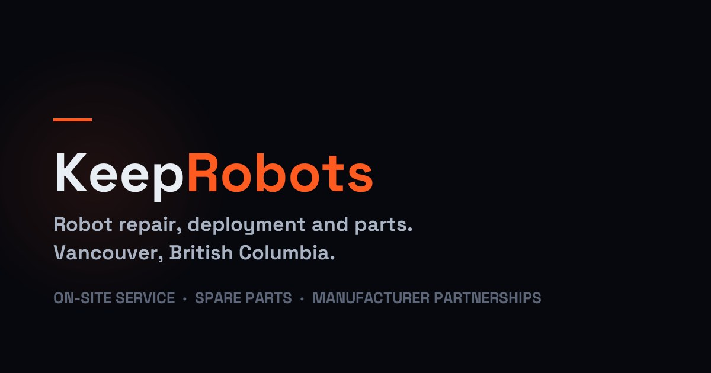

# Who fixes the robot? KeepRobots 2026 report on field service for robot makers entering North America



Your service provider in Vancouver looks after your robots there. A customer in Seattle, three hours down the highway, has a robot down. Can the same technician just drive over and fix it? Not necessarily: the US business-visitor route for Canadian citizens covers cross-border repair only under a warranty or service contract that came with the *original sale* `[ecfr-2142]` (non-citizens fall under general B-1 rules `[fam-b1]`), and a provider crossing per ticket is not clearly covered. It is easy to discover this only after the first breakdown, when the contract can no longer be changed.

This README is a working digest of a public-source report written by **KeepRobots**, a robot field-service company in Vancouver, Canada. It is for founders, international business leads and after-sales managers at robot companies, especially from China, planning North American sales of mobile, cleaning, delivery, humanoid or quadruped robots. Full report: [English summary](https://keeprobots.com/reports/robot-north-america-field-service-2026/) · [中文全文](https://keeprobots.com/zh/reports/robot-north-america-field-service-2026/). Data current to 12 October 2026.

**The argument in one line:** in 2026 the robots you have *already* shipped to North America are your business there, and who repairs them must be decided in the sales contract, priced on real ticket volume, and backed by spare parts close to the customer.

Keys in brackets, like `[fcc-786]`, point to rows in [`sources.tsv`](sources.tsv) (92 sources, all with URLs).

---

## 1. What the public evidence says

### One maker's figure: about 70% of faults fixed remotely

One cleaning-robot maker says about 70% of faults are resolved remotely, without dispatch `[gausium-guide]`. That leaves roughly three in ten needing a person on site. For transport and logistics service robots, the IFR says robots-as-a-service is already the dominant business model in the US `[ifr-service-pr]`. Under RaaS, the vendor bears the uptime risk.

### Canadian robot adopters mostly source robotics from outside providers

Statistics Canada's 2022 Survey of Advanced Technology (published 2024) found only 2.0% of Canadian enterprises had adopted robotics. Among those adopters, 73% sourced their robotics entirely from external providers, and the most-cited barrier was recruiting qualified staff (25.2%) `[statcan-robotics]`. The report reads this as Canadian customers relying heavily on outside deployment and maintenance capacity (strictly, the survey measures where the robotics came from, and it covers Canada only).

### Public service arrangements in North America: few, but they show the bar

| Arrangement | What was announced | Source |
|---|---|---|
| Burroughs for Avidbots (2023) | 650+ Burroughs technicians trained by Avidbots; on-site response **within 48 hours** in covered areas | `[avidbots-burroughs]` |
| Burroughs for Pudu (2025) | Field service for Pudu customers in the US and Canada; Burroughs cites 120+ forward stocking locations | `[pudu-burroughs]` |
| Tennant with Brain Corp (2025), equipment maker's own network | Service plans in the US and Canada; optional **next-business-day** on-site response for calls before 1 p.m. Central | `[tennant-brain]` |
| SoftBank Robotics America for Gausium (2025), dealer service certification | Gausium's top service certification requires deployment-training certification; SBRA's deployment-specialist program includes 3+ weeks of on-site training | `[sbra-gausium]` |

Meanwhile, public distribution announcements usually list sales, deployment and training and rarely say who does on-site repair `[agibot-robotshop]`. In our public sample, the US footholds of robot makers from China cluster in California, Texas, the Southeast, the Midwest and the Northeast. We found none with its own public office or service location in the US Pacific Northwest or Western Canada; third-party networks such as Burroughs, which covers the US and Canada, are a separate matter. That is a sample, not a census.

### Policy made the installed base more valuable

- **FCC Covered List, DA 26-786 (28 July 2026)** `[fcc-786]`:
  - Scope: foreign-produced ground-mobile machines including AMRs, humanoids and quadrupeds, over 4.4 lb with base or charger, with sensors, a network link of at least 200 kbps and control software. Fixed arms, drones, connected vehicles and FD&C 513 medical devices are excluded.
  - New models can't get FCC equipment authorization unless they receive a Conditional Approval, which the Department of War evaluates and which requires a plan to move production to the US.
  - "Foreign-produced" is judged by place of production under the federal "domestic end product" definition (48 CFR 25.101(a)), not by company nationality, so building in Canada or Europe doesn't avoid it.
  - Previously authorized models can still be imported, sold and used `[fcc-factsheet]`, and DA 26-789 allows certain software and firmware updates to them until at least 1 January 2029 `[fcc-789]`.
  - As of 21 October 2026, the FCC had published five robot Conditional Approvals: Husqvarna robot mower platforms (DA 26-957, 9 Sep), ANSCER AMRs (DA 26-996, 18 Sep), a Matic Robots floor-cleaning robot and charging dock (DA 26-1063, 2 Oct) `[fcc-ca]`, Volley Automation AGVs/AMRs (DA 26-1114, 16 Oct, [PDF](https://docs.fcc.gov/public/attachments/DA-26-1114A1.pdf)) and Vulcan Robotics' Sourccey mobile robotic platform (DA 26-1130, 21 Oct, [PDF](https://docs.fcc.gov/public/attachments/DA-26-1130A1.pdf)). None was for a humanoid or quadruped.
- **Tariffs.** China-origin goods under HTS 8479.50.00 face about 40% in combined US duties `[usitc-8479]` `[hts-ch99]`; Canada charges no MFN duty on the same heading, plus 5% GST at import `[cbsa-ch84]`. Treat 40% as a snapshot (a Section 232 robotics investigation was still open on 12 October 2026 `[fr-232]`), and many service robots may not classify under 8479.50: ask your broker.
- **Cross-border repair is narrower than people assume:**
  - US: Canadian citizens can enter as CUSMA business visitors for after-sales installation and repair only under a warranty or service contract incidental to the sale, during its term, for equipment made outside the US and bought from an enterprise outside the US, by people with specialized knowledge essential to the seller's contractual obligation `[ecfr-2142]`. State Department B-1 guidance adds that the sales contract must obligate the seller to provide the service and the visitor must receive no pay from a US source `[fam-b1]`.
  - Our reading, not legal advice: a robot sold through your US subsidiary or a US distributor, or a technician paid by the US customer, may fail these tests.
  - Canada: service contracts negotiated with third parties after the sale are excluded, unless the original sales agreement already names the third-party provider `[ircc-bv]`.
  - A third-party provider crossing per ticket is not clearly covered in either direction.

---

## 2. The cost model: why the first engineer mostly pays for waiting

**Cost per on-site hour = fully loaded annual cost ÷ hours actually spent on site.**

Where the annual cost comes from (KeepRobots illustrative estimate, `[kr-04]`):

- US median pay for commercial and industrial electronics repairers (SOC 49-2094) is US$74,090 `[bls-492094]`. Benefits are about 31.4% of total compensation in US private-industry installation, maintenance and repair jobs `[bls-ecec]`, which takes it to roughly US$108,000. Vehicle, travel, tools and training (our assumptions) bring it to about **US$140,000**. Using the lower industrial-machinery-mechanic median (SOC 49-9041, US$64,520) instead gives roughly US$127,000.
- In British Columbia, the median wage for industrial mechanics (NOC 72400) is C$42/hour, about C$87,360 a year `[jobbank-72400]`. Canadian statutory contributions (CPP, CPP2, EI, WorkSafeBC) add about C$7,600, plus C$3,000–6,000 of private benefits, a vehicle (~C$13,700), travel (~C$7,000) and tools and training, for about **C$124,000–132,000**; we use C$128,000 `[kr-04]`.

| On-site hours per year | US (US$140k/yr) | BC (C$128k/yr) |
|---|---|---|
| 300 | ~US$467 / hour | ~C$427 / hour |
| 600 | ~US$233 | ~C$213 |
| 1,000 | ~US$140 | ~C$128 |

**Why start at 300 hours.** It is an illustration, not a measurement: 100 tickets × 3 hours `[kr-04]`, or about six on-site hours a week. A paid year is 2,080 hours; whatever isn't spent on site goes to driving, flying, reports and waiting for the next ticket.

**Break-even = in-house annual cost ÷ the provider's all-in hourly rate.** Put any quote you get into the denominator: a national network, a dealer, a regional provider. One published example, kept inside one metro so travel doesn't distort it, is a 3-hour repair in Metro Vancouver:

| | Cost of one 3-hour repair visit |
|---|---|
| Own BC engineer at 300 on-site hours/year | 3 × C$427 ≈ **C$1,281** |
| Own BC engineer at 600 on-site hours/year | 3 × C$213 ≈ **C$639** |
| Your provider's quote | call-out + 3 × hourly rate + any diagnostic not credited |
| Example: KeepRobots published rate, core Metro Vancouver zone | C$100 call-out + 3 × C$150 labour = **C$550**, plus parts and tax, if you approve the repair (the C$200 diagnostic fee is then credited; if you decline, it is not credited and the call-out still applies) ([published pricing](https://keeprobots.com/faq/)) |

With that example, C$550 ÷ 3 ≈ C$183 per on-site hour, so break-even is C$128,000 ÷ C$183 ≈ **700 on-site hours a year** in one metro `[kr-04]`, roughly an engineer at half load. A provider charging more per hour moves the line earlier; one charging less moves it later.

Caveats, both ways:

- In-house may be cheaper than shown. The figure uses the BC median wage; the Greater Vancouver median is C$37/hour `[kr-04]`, roughly C$11,000 less a year (about C$390 per on-site hour at 300 hours). It also includes travel budgeted for an engineer covering several cities.
- In-house may be dearer than shown. It leaves out recruiting, management time, a local entity or employer-of-record, and turnover.
- Outsourcing has its own overhead: your time to train and manage the partner (see recommendation 4).

Outside a provider's core zone, travel is usually quoted per trip, so there is no single number to put here. The fair test there: compare the provider's trip quote with your own engineer's flight, hotel and days away, and put any regional provider closer to your customer in the same slot.

---

## 3. Five things to do, based on the report

### 1. Put service obligations, and the provider, in the original sales contract

Both countries tie cross-border after-sales work to the original sale. Canada explicitly accepts a third-party provider if the original sales agreement already names it `[ircc-bv]`; the US conditions are stricter (see above) `[ecfr-2142]` `[fam-b1]`. A clause like this helps for work in Canada and may not be enough for the US, and it can only be added before signing. Example wording to give your lawyer (illustrative, not legal advice):

> *"Seller shall provide installation, repair and maintenance of the Equipment during the Warranty Period and any Service Term purchased with this Agreement. Seller may perform these services through its designated service provider(s) named in Schedule B."*

Name the provider at signing. A provider added later by notice is close to the "negotiated after the sale" case that Canada excludes.

Even with this clause, a third-party technician crossing per ticket may not qualify. The report's advice: check with an immigration lawyer (status, tools and parts at the border, insurance), and expect to need a provider based in each country.

### 2. Write the response time back-to-back, using the public benchmarks

The published bars are **48 hours on-site in covered areas** (Avidbots via Burroughs) `[avidbots-burroughs]` and **optional next business day** for calls before 1 p.m. Central (Tennant for Brain Corp robots) `[tennant-brain]`. Whatever you promise the customer must be no faster than your partner's contract. Example:

> *"For faults not resolved by remote support within [4] business hours, on-site attendance within [2] business days inside the Service Area in Schedule A. Outside the Service Area, attendance is scheduled per trip and confirmed in writing."*

Define "Service Area" by city, not by country.

### 3. Decide in-house vs outsource per metro, with a number

Use the section 2 formula per metro, not per continent. Track on-site hours per metro each quarter. When one metro approaches the break-even for the rates you have actually been quoted (about 700 hours a year at the example rate above), price an in-house engineer there and keep the provider for other cities and peaks. Until then, the first engineer mostly pays for waiting.

### 4. Outsource execution, keep judgement and data

Keep firmware, root-cause analysis, spare-parts pricing, customer contracts, admin rights on the fleet platform and the final service promise in-house. Require every ticket to come back with serial number, firmware version, fault code, parts used, photos and logs. Train the partner to the public bar: Gausium's top certification required deployment training, and SBRA's specialist program runs 3+ weeks on site `[sbra-gausium]`. Give them fault trees, RMA rules and a list of seals not to break.

### 5. Treat the installed base as the asset after DA 26-786

For models already authorized: stock wear parts and key modules near customers on consignment, with movement records and reconciliation (Burroughs cites 120+ forward stocking locations `[pudu-burroughs]`), and plan firmware updates inside the DA 26-789 window `[fcc-789]`. For new models: assess Conditional Approval before you plan a US launch `[fcc-786]`. We found no comparable Canadian measure, and if your robot classifies under 8479.50 it enters Canada MFN duty-free (5% GST still applies), which makes Canada a reasonable base for demos, pilots and spares, but building or certifying in Canada doesn't get a product around US rules.

---

## Practical checklists

- [Robot Site Readiness Checklist (Canada & US)](docs/site-readiness-checklist.md): a copy-paste list of what to confirm with the customer's building before you ship a mobile robot or arm (floors, power, Wi-Fi, elevators, fire code, safety standards, privacy, COI, receiving), with a go/no-go rule and a one-page summary table.
- [Robot Fault Report & Dispatch Template (North America)](docs/robot-fault-report-template.md): what to send a field technician before a robot service visit, with a copy-paste ticket (Markdown + YAML), remote-vs-dispatch triage, authorization levels and example severity targets.
- [US Customer Support Escalation Sheet for Overseas Robot Makers](docs/us-customer-escalation-sheet.md): a one-page "who to call / what happens next" template a robot maker in China gives its US customers (L1/L2 remote, L3 on-site partner, blanks for response and on-site targets), with Beijing vs US Pacific/Central/Eastern business-hour tables for daylight and standard time and a rule for when to dispatch on-site.
- [Shipping a Robot Back to the Factory for Repair: Export & Return Paperwork Checklist](docs/robot-factory-return-paperwork.md): a copy-paste checklist (before export, at export, at factory, US return import, Canada return import, back on site) so a robot sent for factory RMA isn't charged more at the border than necessary, with a swap-on-site vs return decision table, a US (HTSUS 9802.00.40/50, 19 CFR 10.8) vs Canada (CBSA D8-2-10, 9992.00.00, GST/HST) comparison, and the cost of the two local visits.

## Files in this repository

| File | What it is |
|---|---|
| [`KeepRobots-2026-Report-EN.pdf`](KeepRobots-2026-Report-EN.pdf) | English summary, 9 pages ([read online](https://keeprobots.com/reports/robot-north-america-field-service-2026/)) |
| [`keeprobots-robot-north-america-field-service-2026-zh.pdf`](keeprobots-robot-north-america-field-service-2026-zh.pdf) | Full report in Chinese (中文全文) ([read online](https://keeprobots.com/zh/reports/robot-north-america-field-service-2026/)) |
| [`sources.tsv`](sources.tsv) | All 92 sources: key, title, URL |
| [`CITATION.cff`](CITATION.cff) | Citation metadata |
| [`cover.jpg`](cover.jpg) | Report cover |
| [`LICENSE`](LICENSE) | CC BY 4.0 |

The full report also covers the North American market data, a timeline of how robot makers from China entered North America in 2025–2026, five field-service models, and certification in both countries (NRTL, UL 3300, SCC marks, ISED, French documentation).

Found an error? Open an issue or email partners@keeprobots.com. We check and correct.

## How to cite

> KeepRobots. *2026 Robot Makers Entering North America: Field Service and After-Sales Report.* Vancouver: KeepRobots, October 2026. https://keeprobots.com/reports/robot-north-america-field-service-2026/

中文引用：KeepRobots《2026 机器人出海北美：现场服务与售后现状报告》，https://keeprobots.com/zh/reports/robot-north-america-field-service-2026/

```bibtex
@techreport{keeprobots2026fieldservice,
  author      = {{KeepRobots}},
  title       = {2026 Robot Makers Entering North America: Field Service and After-Sales Report},
  institution = {KeepRobots},
  address     = {Vancouver, BC, Canada},
  year        = {2026},
  month       = oct,
  url         = {https://keeprobots.com/reports/robot-north-america-field-service-2026/}
}
```

## License and disclaimer

Text and tables by KeepRobots are licensed [CC BY 4.0](https://creativecommons.org/licenses/by/4.0/): share and adapt, including commercially, with credit to **KeepRobots** and a link to the report. Third-party data, trademarks and company names remain their owners'; the KeepRobots name and logo are not licensed.

For information only; not legal, tax, customs, immigration or investment advice. Policies and tariffs change quickly. Company figures are labeled company-reported in the report; our cost model is an illustrative estimate. Public sources only: no survey or customer data. The companies named are a public sample, and none is a KeepRobots customer or partner.

## Work with us: field technicians and service partners in North America

We are building a network of field technicians and regional service partners across Canada and the US to cover robot deployment, repair and maintenance closer to customers. If you are an independent technician or a service company with robotics, automation or electro-mechanical experience, we'd like to hear from you. See [keeprobots.com/partners/technicians](https://keeprobots.com/partners/technicians/) ([中文](https://keeprobots.com/zh/partners/technicians/)) or email partners@keeprobots.com.

## About KeepRobots

[KeepRobots](https://keeprobots.com) is a robot field-service company based in Vancouver, British Columbia: on-site deployment, after-sales repair, preventive maintenance, pre-sales demos and spare-parts storage for robots made by other companies. Based in Greater Vancouver; elsewhere in Canada and in the United States, work is scoped per project. English and Chinese. We don't manufacture or sell robots and are not an exclusive dealer for any brand. Not affiliated with Keep Robotics or similarly named companies. KeepRobots is a brand of Toprobe Company Corporation.

Related pages:

- [Field-service partner for robot makers entering North America](https://keeprobots.com/partners/north-america/) · [中文：北美现场服务合作](https://keeprobots.com/zh/partners/north-america/)
- [Robot repair and field service in Canada: coverage, process, pricing](https://keeprobots.com/service/canada/)
- [Robot service companies in Canada and Vancouver (2026 comparison)](https://keeprobots.com/guides/robot-service-companies-canada/) · [中文：加拿大机器人售后服务商对比](https://keeprobots.com/zh/guides/canada-robot-service-providers/)
- [中文首页](https://keeprobots.com/zh/)
