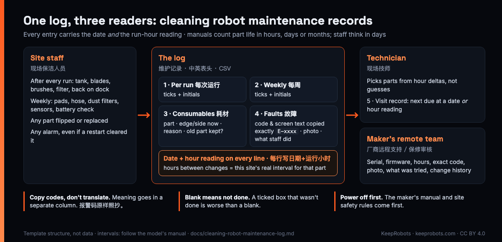

# Commercial Cleaning Robot Maintenance Log Template (EN/中文) — KeepRobots Template

> Written by KeepRobots, a robot field-service company in Vancouver, Canada that works in English and Chinese — [keeprobots.com](https://keeprobots.com). A bilingual log for autonomous floor scrubbers, sweepers and vacuums, kept by the site and the field technician together. Intervals marked "typical" or "our recommendation" are planning defaults, not data; the robot maker's manual always wins. Not legal, warranty or safety advice. Also available as CSV: [`cleaning-robot-maintenance-log.csv`](./cleaning-robot-maintenance-log.csv) (UTF-8, opens in Excel).

A hypothetical scheduled visit. The technician arrives at a building with two cleaning robots and asks: when was the rear squeegee last flipped, when was the dust filter changed, and how many hours has the robot run since? The night supervisor doesn't know; the person who did it left in September. Meanwhile, one robot stopped twice last week, and the maker's remote support team in another time zone wants the run hours and the exact error code. Someone remembers "an error about water". The photo was on a phone that is now off shift.

None of that is a repair problem. It is a record problem, and it costs a second visit: the technician guesses which parts to bring, the maker can't triage remotely, and a warranty conversation starts with "we think". This template fixes it with one log that does three jobs: it **makes daily and weekly staff tasks visible** (a blank box shows), it **lets the technician arrive with the right parts** (consumable changes are logged against the run-hour reading), and it **gives the maker evidence** for remote triage or a warranty claim (hours, change dates, exact error codes, photos). If you only keep two tables, start with 3 (consumables) and 4 (faults).

It is for facility managers, cleaning contractors and field technicians in Canada and the US, and for robot makers, especially from China, to hand to North American customers on day one. What to clean and what wears out first are on our [cleaning robot maintenance checklist](https://keeprobots.com/notes/commercial-cleaning-robot-maintenance-checklist/); this page is only about writing it down.

**中文摘要：** 这是一份给北美清洁机器人现场用的中英双语维护记录模板（洗地机、扫地机、吸尘机器人），中国厂商可以在交付时直接交给北美客户和当地技师。它解决三件事：一是让现场保洁人员的每日、每周保养真的做了、有签名；二是每次更换刷盘、刷垫、刮条、滤网、电池时都记下当时的运行小时数，技师上门前就知道该带哪些备件；三是出故障时，报警码原样照抄（不翻译）、拍照或录像、写清现场做了什么，厂商远程排查或审核保修时有证据可看。模板分五张表：每次运行、每周、耗材更换、故障与报警码、技师上门记录；表头中英对照，附 CSV 版可导入 Excel 或工单系统。各手册保养周期有的按小时、有的按天、有的按月，所以每条记录都要同时写日期和运行小时。周期以厂商手册为准；标「typical / our recommendation」的是规划默认值，不是数据。示例行均为假设。



---

## Why hours, not just dates

The manuals we read don't agree on the unit. One quick start guide for an autonomous scrubber lists part lives in **hours of use** (scrub pads 150 h, squeegee blades 300 h). A guide for an autonomous sweeper-scrubber lists them in **days**, assuming about 3 hours a day, 5 days a week, and adds that lifespans vary by site. A compact scrubber robot's guide gives squeegee rubber in **months** (1, 2 or 3, depending on how hard the site is). A rider-scrubber manual puts its technician items on **hour counts**: squeegee levelling every 50 hours, tank seals at 100, battery terminals at 200, tires at 500, motor carbon brushes at 500 and then every 100.

Site staff think in days. A robot running 2 hours a night and one running 6 reach "300 hours" months apart. So **every entry carries both the date and the run-hour reading** (from the robot's screen, app, fleet portal or hour meter). That one habit turns a clipboard into a parts forecast.

---

## How to use it

- **One log per robot**, by nameplate serial plus the site's name for it ("Lobby 1"). Same-model robots wear differently, and the maker asks one serial at a time.
- **Where it lives.** Paper at the dock for staff; the [CSV](./cleaning-robot-maintenance-log.csv) (or your CMMS or ticket tool) for the technician and maker, copied over weekly.
- **Who writes what.** Staff: run, weekly and fault logs, plus any consumable they change. Technician: consumables changed on visits and the visit record. Maker: adds its ticket or RMA number.
- **Dates and times.** Dates as `YYYY-MM-DD`. Times in site local time with the UTC offset (`23:10 UTC-8`). A maker's team in China (UTC+8) is 15–16 hours ahead of a Pacific-time site and 12–13 hours ahead of an Eastern-time site, so "Tuesday night" is already Wednesday for them.
- **Error codes are copied exactly, never translated**, in whatever language the screen shows; put your meaning in a separate column. A translated message can't be searched in the maker's fault database. (Terms: our [Chinese–English field service glossary](./robot-field-service-glossary-zh-en.md).)
- **Photos and videos.** Name them `serial_date_what` (e.g. `SN123_2026-11-14_rear-squeegee.jpg`) and log the file name. Keep faces out of frame where you can.
- **Power off before any hands-on task.** The manuals we read that cover it say to stop and switch off the machine before cleaning or maintenance (and remove the key on models that have one). The log doesn't change that.
- **Blank means not done.** A blank with a reason ("robot in repair") is useful; a ticked box that wasn't done is worse than nothing in a warranty review.

---

## 1. Per-run log · 每次运行记录 (site staff)

One line per run. The checks follow the after-every-run row of the [maintenance checklist](https://keeprobots.com/notes/commercial-cleaning-robot-maintenance-checklist/); cut the columns your model doesn't have (a vacuum has no recovery tank, a scrubber may have no dust bin).

```markdown
Robot: [name on site] · Serial 序列号: [ ] · Model 型号: [ ] · Site 现场: [ ] · Month 月份: [YYYY-MM]
```

| Date 日期 | Start–end 开始–结束 (local, UTC±) | Hour reading 运行小时 | Area / route 区域/路线 | Recovery tank drained, rinsed, left open 污水箱排空冲洗晾干 | Squeegee blades wiped, inlet clear 刮条擦净、吸口无堵 | Brushes/pads: hair & string removed 刷盘/刷垫去缠绕 | Filter / dust bin cleaned as manual says 滤网/尘盒按手册清理 | Back on dock, charging 已回桩充电 | Alarm during run? (Y → fault log) 运行中有报警？ | Initials 签名 |
|---|---|---|---|---|---|---|---|---|---|---|
| | | | | ☐ | ☐ | ☐ | ☐ | ☐ | ☐ N ☐ Y | |
| | | | | ☐ | ☐ | ☐ | ☐ | ☐ | ☐ N ☐ Y | |

The alarm column is the cheapest evidence you will ever collect; a Y with no fault-log line is the first thing anyone will ask about.

---

## 2. Weekly log · 每周记录 (site staff)

| Week of 周起始日 | Hour reading 运行小时 | Pads flipped or washed 刷垫翻面/清洗 | Suction hose rinsed 吸水管冲洗 | Dust filters tapped out / checked 尘滤拍打/检查 | Sensors and camera windows wiped (as manual says) 传感器/镜头擦拭（按手册） | Flooded lead-acid: water level checked after a full charge 富液铅酸：充满后查液位 | No-water packs (lithium etc.): charge never below manual's minimum 免加水电池（锂电等）：电量未低于手册下限 | Anything worn or damaged? (→ consumables log) 有无磨损/损坏 | Initials 签名 |
|---|---|---|---|---|---|---|---|---|---|
| | | ☐ | ☐ | ☐ | ☐ | ☐ n/a | ☐ n/a | | |

Notes on the battery columns, from the manuals:

- **Flooded lead-acid.** A rider-scrubber manual asks for an electrolyte check **weekly**, and says not to charge "more than once a day and only after running the machine for a minimum of 15 minutes". A battery maker's guide says to fully charge before adding water. Log any top-ups after short runs: a technician wants to see that pattern.
- **Packs that need no watering (lithium-ion and similar).** A compact robot's guide (it doesn't name the chemistry) says to keep the battery "above 10% at all times" and warns that a robot left unused for more than 30 days may be completely depleted. Log the date and charge level when a robot is parked for a shutdown.
- **Sensors.** The manuals we read say to use a dry microfibre cloth, and two say explicitly not to wet the sensors or the cloth. Other models may differ, so write your manual's rule in the column header so nobody has to remember it.

---

## 3. Consumables change log · 耗材更换记录 (staff and technician)

This is the table that tells the technician what to bring. One line every time a wear part is **flipped, rotated, cleaned-and-refitted after a problem, or replaced**.

| Date 日期 | Hour reading 运行小时 | Part 部件 | Part no. 料号 | Position 位置 (front/rear, left/right) | Action 操作 (flip / rotate edge / replace / clean) | Edge or side now in use 当前使用的边/面 | Reason 原因 (scheduled / worn to indicator / torn / streaks / suction weak / other) | Old part kept? 旧件保留？ (for warranty) | Photo 照片文件名 | By 操作人 |
|---|---|---|---|---|---|---|---|---|---|---|
| | | | | | | | | ☐ Y ☐ N | | |

What to log here, and why:

- **Squeegee blades: which edge.** A rider-scrubber manual says to rotate worn blades "end-for-end or top-to-bottom to a new wiping edge" and replace them when all edges are worn. Without an "edge now in use" column (`1/4`, `2/4`…), nobody knows how much blade is left.
- **Pads: which side.** One guide notes both sides of a pad can be used. Log `side A` / `side B`.
- **Sets.** One manual says to replace brushes and pads in sets; still log left and right on separate lines.
- **Reason.** "Torn after 20 hours" is different evidence from "scheduled". A part failing far short of its published life is something the maker should hear about.
- **Old part kept?** Our recommendation: when a part fails early, bag it, label it (serial, date, hour reading) and keep it until the maker says otherwise. A warranty review may ask for it.

**Turn the log into an order list.** After two or three changes of the same part, divide: *hours between changes* is your site's real interval for that part. One quick start guide shows the same arithmetic for planning: 20 hours a week × 52 weeks ÷ a 150-hour pad life ≈ 7 pad replacements a year. Put your logged hours in place of "150" and you have your site's order quantity.

---

## 4. Fault & error-code log · 故障与报警码记录 (site staff, then whoever responds)

One line per event, including the ones that cleared on a restart. Intermittent faults are only diagnosable when the repeats are written down.

| Date & time 日期时间 (local, UTC±) | Hour reading 运行小时 | Where on the route 发生位置 | Error code, copied exactly 报警码（原样照抄） | On-screen text, copied exactly 屏幕原文（不翻译） | What staff saw/heard/smelled 现场现象 | Photo/video file 照片/视频 | What staff did 现场处理 (power off, restart, cleared hair, emptied tank…) | Result 结果 (cleared / came back after N runs / robot out of service) | Reported to 已报给 (maker / dealer / technician, ticket no.) | By 记录人 |
|---|---|---|---|---|---|---|---|---|---|---|
| | | | | | | | | | | |

Rules for this table:

- **Copy code and full text exactly, or photograph the screen.**
- **Write what you did, even if it was nothing.** "Restarted twice, cleared, came back next run" beats "robot fixed itself".
- **Look at the obvious first, and log it.** Manuals' own troubleshooting tables send you to dirty sensors for false obstacle stops and to worn squeegee blades for water left on the floor. Log those too ("wiped sensors → cleared"): three in a week is a pattern.
- **Unsafe signs end the log entry and start a call.** Smoke, a hot or swollen battery, a burning smell or liquid near electrical parts: keep people away; if it is safe to reach, stop the robot by its own power-off procedure; for smoke or fire follow the site's emergency procedure (911 in Canada and the US). Write it down afterwards. Battery shipping and storage questions are in our [lithium battery shipping worksheet](./robot-lithium-battery-shipping-worksheet.md).
- **When it needs a technician**, this table becomes the "symptom" and "what was already tried" sections of the dispatch ticket. Copy the lines into the [fault report & dispatch template](./robot-fault-report-template.md); don't rewrite from memory.

---

## 5. Technician visit record · 技师上门记录 (technician)

One block per visit, filled before the technician leaves. The site supervisor initials it.

```markdown
## Visit 上门记录 — [robot name] · Serial [ ] · [YYYY-MM-DD]
- Visit type 类型: scheduled maintenance 定期保养 / repair 维修 / follow-up 复查
- Ticket / RMA no. 工单号 / RMA 号:
- Arrived – left 到达–离开 (local, UTC±):
- Hour reading on arrival 到场运行小时:
- Log reviewed since last visit 已核对上次以来的记录: ☐ run ☐ weekly ☐ consumables ☐ faults
  - Gaps found in the log 记录缺漏:
- Parts replaced 更换部件 (also add each to the consumables log 同步写进耗材表):
- Checks done 检查项目 (per the model's manual; e.g. tank seals, tires, squeegee levelling,
  battery terminals, charging contacts on robot and dock):
- Battery 电池: type 类型 ___ · health reading from service tool 健康度读数 ___ (tool + version)
- Firmware / software version 固件/软件版本: before ___ after ___ (changed only with the maker's approval)
- Error codes read from the robot's log 机器日志里的报警码 (copied exactly):
- Test after work 完工测试: e.g. 1 full route run, docked and charging, no new codes
- Next visit due 下次保养: date ___ or at hour reading ___ (whichever comes first)
- Parts to bring next time 下次带的备件:
- Technician 技师: ___  · Site supervisor initials 现场主管签字: ___
```

"Next visit due at hour reading ___" is the line that pays for the whole log: the technician arrives when blades and pads are actually near their end.

One manual we read says machine repair should only be carried out by technical staff approved by the robot's supplier. Check what your maker allows a third-party technician to do under warranty and put it on the ticket. Who signs off which step of a warranty repair is in our [warranty repair RACI](./warranty-repair-raci.md).

---

## What the maker's remote team will ask for

When a cleaning robot fault is escalated, expect these questions. Our recommendation: answer them from the log, not from memory.

1. **Serial number and firmware version** of the affected robot (not the model alone).
2. **Run-hour reading** now, and at the last change of the part involved.
3. **Exact error code and on-screen text**, with date, local time and UTC offset, and how many times it has appeared.
4. **Photo or short video** of the screen and of the part (squeegee edge, brush hub, filter, battery terminals).
5. **What was already done on site**, in order, and what each step changed.
6. **Consumable change history** for the part involved: dates, hour readings, part numbers, genuine or other parts.
7. **Charging pattern** (lead-acid: how often charged and after how long a run; no-water packs: lowest charge level and any storage period).
8. **Detergent or chemical in use**, and whether it changed recently.
9. **Whether the failed part was kept.**

If the log answers these, triage can start in one message instead of a day of back-and-forth across time zones.

---

## Filled example (hypothetical)

Everything below is invented: site, robot, code and readings are hypothetical, and `EX-DEMO-01` is a made-up placeholder, deliberately not in any maker's code format.

A compact autonomous scrubber, "Lobby 1", runs about 2.5 hours a night in an office lobby.

**Consumables log**

| Date | Hour reading | Part | Position | Action | Edge/side now | Reason | Old part kept? | By |
|---|---|---|---|---|---|---|---|---|
| 2026-10-06 | 338.0 | Squeegee blade | Rear | Rotate edge | 2/4 | Streaks on return leg | N | Night lead |
| 2026-11-03 | 412.5 | Squeegee blade | Rear | Rotate edge | 3/4 | Streaks on return leg | N | Night lead |
| 2026-11-14 | 435.0 | Vacuum fan filter screen | — | Replace | — | Torn after fault EX-DEMO-01 | Y (bagged, labelled) | Technician |

Read across the two squeegee lines: 412.5 − 338.0 = 74.5 hours per edge on this site. Edge 3/4 should last to about hour 487 and the last edge to about hour 561, so a new rear blade set belongs on the technician's list for the next visit, not the one after.

**Fault log**

| Date & time | Hour reading | Error code (exact) | On-screen text (exact) | What staff did | Result | Reported to |
|---|---|---|---|---|---|---|
| 2026-11-11 23:40 UTC-8 | 427.5 | EX-DEMO-01 | Vacuum motor overload | Powered off; photo of screen; emptied recovery tank; cleaned filter screen; restarted | Cleared; came back 2 runs later | Maker remote support, ticket in their system |

**Visit record (extract)**: 2026-11-14, hour reading 435.0 on arrival; log reviewed, no gaps; filter screen found torn, replaced and old one kept; vacuum hose and seals checked; 1 full route run, docked, no new codes; next visit at hour reading ~480 or 2027-01-15, whichever comes first; bring a rear squeegee set.

---

## CSV fields · CSV 字段

The [CSV](./cleaning-robot-maintenance-log.csv) holds the consumables, fault and visit records, one row per entry, so they can be filtered by robot, part or code; per-run and weekly ticks can go in `record_type` = `check` rows with the items listed in `notes`. UTF-8 with BOM so Excel opens Chinese text correctly. The example rows are the hypothetical ones above.

| Column | Meaning |
|---|---|
| `record_type` | `consumable` / `fault` / `visit` / `check` |
| `date`, `time_local` | `YYYY-MM-DD`; 24 h with UTC offset, e.g. `23:40 UTC-8` |
| `site`, `robot_name`, `serial_number`, `firmware_version` | Serial from the nameplate; firmware as the robot or app shows it |
| `hour_reading` | Run hours at the time of the entry |
| `part`, `part_number`, `position` | Wear part, maker's part number, front / rear / left / right |
| `action` | flip / rotate_edge / replace / clean / check |
| `edge_or_side_now` | e.g. `2/4`, `side B` |
| `reason` | scheduled / worn_to_indicator / torn / streaks / weak_suction / after_fault / other |
| `old_part_kept` | Y / N |
| `error_code_exact`, `screen_text_exact` | Copied exactly, original language |
| `staff_action` | What was done on site, in order |
| `result` | cleared / recurred_after_N_runs / out_of_service / done |
| `photo_files` | File names, `;`-separated |
| `ticket_or_rma` | Maker, dealer or technician reference |
| `next_due` | Date or hour reading, for `visit` rows |
| `by`, `notes` | Name or role; anything else |

---

## What a visit costs (example)

The log is free; staff minutes are the cost. For the technician visit, an example only at KeepRobots' current published rates, before tax and parts: a Greater Vancouver core-area site with two cleaning robots, about 1.5 hours on site for scheduled maintenance is C$100 call-out + 1.5 h × C$150 = **C$325**, with no diagnostic fee on a scheduled maintenance visit. The hours are an assumption. If a robot has a fault that needs repair, the diagnostic is C$200 (US$200 in the US) per unit per visit, credited against the repair if you approve it. US labour is US$150 per hour; travel for US sites and outside the core area is quoted per project. A good log saves money mostly by turning two visits into one.

---

## Sources

Manufacturer documents read in full or in the cited sections, 2026-11-12. In the text above they are described by type, not brand; intervals belong to each model, not to the industry.

- Tennant T7AMR Rider-Scrubber Operator Manual 9018134 Rev. 00 (10-2018): squeegee edges and levelling, brushes, hour-based items, lead-acid care, power-off. https://d2z4qs2e3spnc1.cloudfront.net/product_file/file/2864/tennant-t7amr-rider-floor-scrubber-operator-manual.pdf
- Tennant T380AMR (Battery) Rider-Scrubber Operator Manual 9020999 Rev. 00 (08-2020). https://d2z4qs2e3spnc1.cloudfront.net/product_file/file/2891/tennant-t380amr-ride-on-floor-scrubber-operator-manual.pdf
- PUDU CC1 Operation Guide V6.0: squeegee rubber 1/2/3 months, worn squeegee → water left, battery above 10% (p.8), depletion after 30 days unused (p.49). https://resource-wangsu.helplook.net/docker_production/r7bv6l/article/B3WuYdq5/attachments/PUDU_CC1_Operation_Guide_V6.0.pdf
- SoftBank Robotics Whiz Operational Manual v1.8: repair only by technical staff approved by SoftBank Robotics; sensors not wetted. https://ushelp.softbankrobotics.com/hubfs/whiz_manual_1.8_en.pdf
- Gausium Phantas Quick Start Guide P80100052A02 (SoftBank Robotics America): lives in days; "Lifespans vary by site". https://ushelp.softbankrobotics.com/hubfs/Product%20Guides%20and%20Wall%20Charts%20(2025%20Q2)/Phantas%20Quick%20Start%20Guide%20AIO%20P80100052A02.pdf
- Gausium Scrubber 50 Pro Quick Start Guide P30100054A02 (SoftBank Robotics America): lives in hours, the 20 × 52 ÷ 150 example, pad sides, dirty sensors → false obstacles. https://ushelp.softbankrobotics.com/hubfs/Product%20Guides%20and%20Wall%20Charts%20(2025%20Q2)/S50%20Quick%20Start%20Guide%20AIO%20P30100054A02.pdf
- Trojan Battery Flooded Battery Quick Start User's Guide (2017): fully charge before adding water. https://ressupply.com/documents/trojan_battery/Flooded_Battery_Quick_Start_Guide.pdf

Not legal, warranty or safety advice. The robot maker's manual, the warranty terms and the site's own safety rules come first.

---

## Related pages

- [Commercial cleaning robot maintenance checklist: daily, weekly, monthly and what wears out first](https://keeprobots.com/notes/commercial-cleaning-robot-maintenance-checklist/): what to clean and replace, part by part, which this log records
- [Robot repair, after-sales & field service in Canada](https://keeprobots.com/service/canada/)
- [Robot repair, after-sales & field service in the USA](https://keeprobots.com/service/usa/) (from Vancouver, travel quoted per project; no US office)
- [Robot after-sales & field service in North America, for robot makers](https://keeprobots.com/partners/north-america/)
- In this repository: [fault report & dispatch template](./robot-fault-report-template.md) · [warranty repair RACI](./warranty-repair-raci.md) · [Chinese–English field service glossary](./robot-field-service-glossary-zh-en.md)

KeepRobots is a robot field service company in Greater Vancouver serving Canada and the US in English and Chinese. We don't make robots and aren't an exclusive agent for any brand; we can service cleaning robots of any make, within what each maker allows under warranty, and in Canada we also sell robots from selected brands ([keeprobots.com/robots](https://keeprobots.com/robots/)). Found an error in this template? Open an issue or email partners@keeprobots.com.
