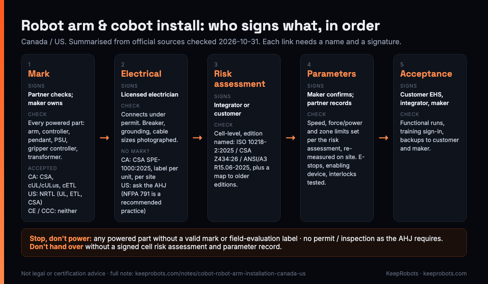

# Robot Arm & Cobot Installation Sign-off Sheet (US / Canada) — KeepRobots Template

A typical failure (illustrative, not a specific job): a cobot and its control cabinet arrive at a plant in Canada. The factory engineer is already on the plane, with three days booked for installation and acceptance on day four. The customer's licensed electrician opens the cabinet, reads the nameplate (CE, CCC, no CSA, cUL or cETL) and puts the cable down: "I can't connect this." Nothing on site is broken. What is missing is a mark. Fixing it now means field evaluation on site, one unit at a time, while the plane tickets and the acceptance date slip. It should have been caught before the arm shipped.

Installing an arm or cobot in North America is a chain of signatures, and each one belongs to a different person: **mark → electrical → risk assessment → safety parameters → acceptance.** This sheet gives each link a box, a name and a stop rule, so the gap shows up on paper weeks before anyone is on site.

**How to use it:** one sheet per cell, per site. Fill sections 1–3 before shipping and send the sheet to the customer and the field service partner with the document pack. Fill sections 4–6 on site. Performance tests, bad-case tests and the punch list are in the [commissioning & SAT template](robot-commissioning-sat-template.md); this sheet covers the safety and compliance signatures that must come first.

Facts below are summarised from official sources checked 2026-10-31 (list at the end). Provincial examples use British Columbia. **Not legal or certification advice: the certification body, the local electrical authority and the customer's safety lead decide.** Mobile service robots (delivery, cleaning, humanoid) follow different rules and are out of scope.

---

## 0. Who signs what

| Link | Signs | What the signature means | Can be fixed on site? |
|---|---|---|---|
| 1. Mark | Maker owns it; field service partner checks and photographs on arrival; electrician checks before connecting | Every part that connects to power carries a mark accepted in this country, or a field evaluation label | Only by field evaluation, one unit at a time |
| 2. Electrical | Licensed electrician, under permit; inspection as the local authority (US: AHJ) requires | Power is connected by the right person, to the right authority's rules | Yes, if the mark is in place |
| 3. Cell risk assessment | Integrator or customer (the customer may delegate to the integrator); optional third-party review | Hazards, measures and residual risk for *this* application, to a named edition | Updates yes; writing it from scratch on site is a bad sign |
| 4. Safety parameters | Maker confirms values; partner sets and records on site; customer witnesses | Speed, force/power and zone limits match the risk assessment and were re-measured | Yes |
| 5. Acceptance | Customer EHS lead, integrator, maker (remote) | Safety functions tested, training done, backups handed over | Yes |

This is a common arrangement, not a legal allocation. Agree it in the contract.

---

## 1. Header

| Field | Value |
|---|---|
| Site name, address | |
| Country / province or state | ☐ Canada: ______ ☐ US: ______ |
| Electrical authority | Canada: city or provincial body ______ / US: AHJ (state, county or city) ______ |
| Arm model / serial | |
| Controller model / serial | |
| Application (task, end-effector, workpiece) | |
| Collaborative application? | ☐ yes ☐ no |
| Maker contact (name, time zone) | |
| Integrator contact | |
| Customer EHS lead | |
| Licensed electrician (name, licence no.) | |
| Field service partner (company, technician) | |
| Planned arrival / power-on / acceptance dates | |

**Finding the electrical authority in BC:** eight local governments hold delegated authority for electrical under the Safety Standards Act: the City of Vancouver, Burnaby, Maple Ridge, the City and District of North Vancouver, Surrey, Victoria and West Vancouver. Everywhere else it is Technical Safety BC (Richmond and Kelowna have delegated authority for gas only). Ontario uses the ESA; other provinces have their own. In the US, identify the AHJ for the customer's plant and ask what it accepts before anything else.

---

## 2. Link 1: nameplate and mark check, per component

Photograph every nameplate before any tool comes out, and fill one row per part that connects to power. The electrician will check the cabinet, not just the arm.

**Accepted marks.** In **Canada**, electrical equipment must be "approved", meaning certified by a body accredited by the Standards Council of Canada (SCC) (Canadian Electrical Code Rule 2-024). Marks commonly accepted on site include CSA, cUL / cULus and cETL / cETLus; the full list is the SCC directory and the provincial notices. In the **US**, electrical equipment in workplaces must be approved (29 CFR 1910.303(a)), which in practice means listed, labelled or certified by an OSHA-recognized NRTL such as UL, Intertek (ETL) or CSA (definitions in 1910.399).

| Component | Model / serial | Marks on nameplate | Canada OK? (SCC-accredited: CSA, cUL/cULus, cETL/cETLus) | US OK? (NRTL: UL, ETL, CSA…) | Photo ref | Field evaluation needed? |
|---|---|---|---|---|---|---|
| Arm | | | ☐ | ☐ | | ☐ |
| Controller / cabinet (the assembly, not just parts inside it) | | | ☐ | ☐ | | ☐ |
| Teach pendant | | | ☐ | ☐ | | ☐ |
| External power supply | | | ☐ | ☐ | | ☐ |
| Gripper / end-effector controller | | | ☐ | ☐ | | ☐ |
| Added transformer | | | ☐ | ☐ | | ☐ |
| Other: ______ | | | ☐ | ☐ | | ☐ |

**Traps to check on every row:**

- **CE and CCC count in neither country.** Neither is a certification by an SCC-accredited body to Canadian standards, and neither is an NRTL listing.
- **"UL" without the small "c" usually means US only.** Canada needs cUL or c-UL-us.
- **Modifying certified equipment can void the mark.** Rewiring the cabinet on site, or swapping in a power module brought from the factory, can turn a valid mark into an invalid one. Ask the certification body first.
- **Radios are a separate question.** A pendant or controller with Wi-Fi or Bluetooth needs ISED certification in Canada and FCC equipment authorization in the US. Record the IDs below; they do not replace electrical safety certification.
- **US exceptions exist but don't plan around them.** 1910.399 allows some (inspection by the local authority, custom-made equipment judged on test data), but field inspectors usually still want a label.

| Radio part | ISED certification no. (Canada) | FCC ID (US) |
|---|---|---|
| | | |

**FCC Covered List note:** the FCC's July 2026 robot entry (DA 26-786) excludes fixed, non-mobile robots such as articulated, SCARA, parallel and Cartesian arms. An arm mounted on an AMR is a different question; ask a lawyer about the specific product.

**For the maker, before shipping:** in the US, UL 1740 (robots and robotic equipment) is the usual NRTL product standard for industrial robots; its revision dated 2023-08-11, effective 2025-08-11, adds clauses 32.3 (robot systems, applications and cells) and 35A.1 (end-effectors) that refer to ISO 10218-2 (per Intertek's notice). In Canada, industrial machinery is commonly certified to CSA C22.2 No. 301 (industrial electrical machinery); Intertek's notice says its 2023 second edition extended the scope to industrial robots and robotic equipment. On the US side, designing the cabinet to NFPA 79 (2024, electrical standard for industrial machinery) from the start, covering e-stop circuits, overcurrent protection, wire colours and marking, makes certification and field inspection easier. A dual mark (cULus, c-CSA-us, or ETL with both "c" and "us") can be applied for once; several NRTLs have labs or offices in China. Which standard applies to your model is a question for your certification body.

---

## 3. Link 2: electrical connection, or the field evaluation route

### 3a. If every row in section 2 is OK

| Item | Done | Evidence |
|---|---|---|
| Electrical permit obtained (who applied: ______) | ☐ | permit no. |
| Inspection booked as the authority / AHJ requires | ☐ | date |
| Supply matches the pack: voltage ___ phases ___ frequency ___ full-load current ___ breaker ___ | ☐ | |
| Connected by licensed electrician under permit | ☐ | name, licence no. |
| Breaker, grounding and cable sizes photographed | ☐ | photo refs |

Electrician signature: ______________ Date: ________

### 3b. If any row is missing a valid mark

| | Canada | US |
|---|---|---|
| Route | Field evaluation by an SCC-accredited inspection body to **CSA SPE-1000:2025** (sixth edition, December 2025, supersedes 2021); label applied if it passes | No single code accepted everywhere. Connection goes through the state, county or city AHJ's permit and inspection |
| Scope | Meant for small numbers of custom or special equipment, not as a substitute for certifying a product line | Field evaluation bodies widely reference **NFPA 791** (2024), the recommended practice for evaluating unlabelled equipment. It is a recommended practice, so whether the AHJ accepts a given body's report varies |
| Unit of approval | **Per unit, per site.** A second unit of the same model, or the same unit moved to another site, may need a new evaluation | Whatever the AHJ accepts. Some cities publish lists of accepted field evaluation bodies; others decide case by case |
| First call | The electrical authority for the site (see section 1) and an SCC-accredited inspection body | The AHJ: ask what it accepts |

| Field evaluation item | Done | Date / ref |
|---|---|---|
| Evaluation body chosen (name, accreditation) | ☐ | |
| Electrical drawings, BOM and component certification list sent for pre-review | ☐ | |
| On-site evaluation date | ☐ | |
| Label applied (label no. per unit) | ☐ | |
| Only then: electrician connects under permit (go to 3a) | ☐ | |

**Planning suggestion, not any body's committed turnaround:** check marks on every powered part 6–8 weeks before shipping; send drawings, BOM and certification list for pre-review 2–4 weeks before shipping; on arrival, evaluation → label → connection. Ask the body for actual dates.

---

## 4. Link 3: cell risk assessment

The cell-level risk assessment is normally done by the integrator or the customer. The maker supplies the robot's safety functions and information for use (ISO 10218 **Part 1** is the manufacturer's; **Part 2** covers the application and cell).

| Item | Value |
|---|---|
| Prepared by (company, name) | |
| Edition followed | ☐ ISO 10218-2:2025 ☐ CSA Z434:26 ☐ ANSI/A3 R15.06-2025 ☐ other: ______ |
| Covers the actual tool, workpiece, speeds and where people stand? | ☐ |
| Collaborative content: does it rely only on ISO/TS 15066? | ☐ no ☐ yes, explain: ______ |
| Hazards, measures and residual risk listed | ☐ |
| Safeguarding decided by the assessment (fences, scanners, light curtains, interlocks) | ☐ |
| Edition map attached (section 7) | ☐ |
| Optional third-party review | ☐ by ______ |

Two points safety leads raise:

- **"Collaborative application", not "collaborative robot".** The 2025 standards treat collaboration as a property of the whole application. Force limiting on the arm does not mean the cell needs no safeguarding.
- **TS 15066 has been folded in.** A3 says the collaborative application content from ISO/TS 15066 is now in ISO 10218-2:2025. ISO still lists TS 15066:2016 as current while it is revised, but a file that cites only TS 15066 will get questions.

Risk assessment approved by: ______________ (integrator / customer) Date: ________

---

## 5. Link 4: safety parameter record

The maker confirms the values, the field service partner sets and records them on site, the customer witnesses. One row per limit; "measured" means re-measured on site, not copied from the configuration screen.

| Parameter | Zone / mode | Value from risk assessment | Value set in controller | Measured on site | Method / instrument | Pass ☐ | Initials |
|---|---|---|---|---|---|---|---|
| Max TCP speed | | | | | | ☐ | |
| Max joint speed (if used) | | | | | | ☐ | |
| Force limit (body region per the risk assessment: ___) | | | | | | ☐ | |
| Power / momentum limit | | | | | | ☐ | |
| Reduced-speed zone boundary | | | | | | ☐ | |
| Soft limits / safety zone boundaries | | | | | | ☐ | |
| Tool / payload setting (actual end-effector) | | | | | | ☐ | |

| Safety function test | Expected response | Result | Initials |
|---|---|---|---|
| Each emergency stop pressed once (list IDs: ____) | Stop category ___; recovery as specified | | |
| Enabling device (three-position): middle position | Motion permitted (as specified) | | |
| Enabling device: released | Stops | | |
| Enabling device: pressed fully | Stops | | |
| Door interlocks | Stop category ___; restart requires reset: ☐ | | |
| Light curtains / safety scanners | Stop category ___ / reduced speed ___; restart requires reset: ☐ | | |
| Stopping time / distance, if the safeguarding layout depends on it | Value used in the risk assessment: ___ | Measured: ___ | |
| Lockout points confirmed (US: OSHA 1910.147; Canada: provincial OHS rules) | | | |

| Software | Version |
|---|---|
| Controller firmware | |
| Pendant firmware | |
| Safety controller firmware | |
| Matches manual version? | ☐ |

Safety parameter checksum / config ID (if the controller provides one): ______

Values confirmed by maker: ______________ Set and recorded by (field service partner): ______________ Witnessed by customer: ______________ Date: ________

---

## 6. Link 5: acceptance and sign-off

| Item | Done |
|---|---|
| Sections 2–5 complete, no open stop condition (below) | ☐ |
| Functional acceptance per the [SAT template](robot-commissioning-sat-template.md) | ☐ |
| Operator and maintenance training, sign-in sheet attached | ☐ |
| Safety parameters, programs and configuration backed up: one copy to customer, one to maker | ☐ |
| Information for use handed over: manuals in English (and French for Quebec), English warning labels (ask your certification body whether French markings are also required) | ☐ |

| Role | Name | Signature | Date |
|---|---|---|---|
| Customer EHS lead | | | |
| Integrator | | | |
| Maker (remote OK) | | | |
| Field service partner | | | |

**Quebec:** the Charter of the French Language requires documents supplied with a product, including instructions, to be in French, with no other language more prominent. Check with counsel.

### Stop rules

These are template rules (our suggestion, based on the requirements above). If any box is ticked, the line below it applies.

| Condition | Rule |
|---|---|
| ☐ Any part that connects to power has no valid mark for this country and no field evaluation label | **Stop. Don't power that part.** Go to 3b |
| ☐ Mark is valid but the cabinet was modified on site or a factory part was swapped in | **Stop.** Ask the certification body whether the mark still holds |
| ☐ No permit, or inspection not done as the authority / AHJ requires | **Stop. Don't connect** |
| ☐ Power would be connected by anyone other than the licensed electrician | **Stop** |
| ☐ No cell risk assessment, or it names no edition, or it doesn't cover the actual tool and workpiece | **Don't run with people in the cell; don't hand over** |
| ☐ A measured parameter differs from the risk assessment value | **Don't hand over** until maker and assessor agree |
| ☐ Any safety function test failed | **Don't hand over** |
| ☐ Radio part without ISED / FCC ID | Raise with the maker before power-on |

Report any missing mark or document to the maker **the same day it is found**, not on acceptance day.

---

## 7. Standards map (attach to the risk assessment)

Regulations and customers still quote older editions. One page saves an hour of explaining on site.

| Topic | Current (2025–2026) | Older editions still quoted |
|---|---|---|
| Robot (manufacturer) | ISO 10218-1:2025 | — |
| Application and cell (integrator) | ISO 10218-2:2025 | — |
| Canada | CSA Z434:26 (adopts ISO 10218-1/-2 with Canadian deviations; published 2026-03-31) | CAN/CSA-Z434-14 (superseded) |
| US | ANSI/A3 R15.06-2025 (adapted from ISO 10218-1/-2:2025) | — |
| Collaborative content | Folded into ISO 10218-2:2025 (per A3) | ISO/TS 15066:2016 (listed by ISO as current while revised) |
| BC workplace rule | WorkSafeBC OHS Regulation s.12.83 cites CAN/CSA-Z434-94 or ANSI/RIA R15.06-1992; Guideline G12.83 (2019) accepts Z434-14. It did not mention Z434:26 when checked | |
| US workplace rule | No robot-specific OSHA standard. Enforcement uses 1910.212 (machine guarding), 1910.147 (lockout/tagout), Subpart S (electrical) and the General Duty Clause (OSH Act 5(a)(1)); R15.06 is a consensus standard, commonly used as evidence of recognized practice | |
| Product certification | UL 1740 (revision effective 2025-08-11); CSA C22.2 No. 301 (2023 2nd ed.); NFPA 79 (2024) | |
| Field evaluation | CSA SPE-1000:2025 (Canada); NFPA 791 (2024, US, recommended practice) | CSA SPE-1000 (2021) |

| Edition we used | What changed from the edition the site/regulation quotes | How we addressed it |
|---|---|---|
| | | |

---

## Sources (checked 2026-10-31)

- Technical Safety BC, approved certification marks for electrical products: https://www.technicalsafetybc.ca/regulatory-resources/regulatory-notices/approved-certification-marks-electrical-products
- BC Electrical Safety Regulation (B.C. Reg. 100/2004), s.21: https://www.bclaws.gov.bc.ca/civix/document/id/complete/statreg/100_2004
- BC government, Safety Standards Act and local government delegation: https://www2.gov.bc.ca/gov/content/industry/construction-industry/building-codes-standards/legislation/safety-standards
- IAEI, CE Code Rule 2-024 and "approved": https://iaeimagazine.org/columns/canadian/common-misconceptions-related-to-the-design-installation-and-use-of-electrical-equipment/
- SCC, accredited organizations directory: https://scc-ccn.ca/search/accredited-organizations
- SCC, CSA SPE-1000:2025 inspection requirements update: https://scc-ccn.ca/accreditation/bulletins/update-csa-spe-10002025-inspection-requirements
- SCC standards database, CSA Z434:26: https://scc-ccn.ca/standardsdb/standards/4035147
- ISO 10218-2:2025: https://www.iso.org/standard/73934.html
- A3, ANSI/A3 R15.06-2025 published: https://www.automate.org/robotics/industry-insights/ansi-a3-publish-revised-r15-06-industrial-robot-safety-standard
- WorkSafeBC OHS Regulation Part 12 (s.12.83): https://www.worksafebc.com/en/law-policy/occupational-health-safety/searchable-ohs-regulation/ohs-regulation/part-12-tools-machinery-and-equipment
- WorkSafeBC Guidelines Part 12 (G12.83): https://www.worksafebc.com/en/law-policy/occupational-health-safety/searchable-ohs-regulation/ohs-guidelines/guidelines-part-12
- OSHA 29 CFR 1910.303: https://www.osha.gov/laws-regs/regulations/standardnumber/1910/1910.303
- OSHA 29 CFR 1910.399: https://www.osha.gov/laws-regs/regulations/standardnumber/1910/1910.399
- OSHA, robotics standards: https://www.osha.gov/robotics/standards
- OSH Act section 5, duties: https://www.osha.gov/laws-regs/oshact/section5-duties
- OSHA NRTL program: https://www.osha.gov/nationally-recognized-testing-laboratory-program
- Intertek, CSA C22.2 No. 301:2023 update notice: https://w3prep.intertek-ar.com/siteassets/resources/sun/2024/csa-c22.2-no-301-sun-rev-9-1-2023-ed-9-1-2025.pdf
- Intertek, UL 1740 revision notice: https://w3prep.intertek-ar.com/siteassets/resources/sun/2024/ul-1740-rev-8-11-2023-ed-8-11-2025.pdf
- NFPA 79: https://www.nfpa.org/codes-and-standards/nfpa-79-standard-development/79
- NFPA 791: https://www.nfpa.org/codes-and-standards/nfpa-791-standard-development/791
- CSA Group laboratories in Guangzhou: https://www.canadianelectricalwholesaler.ca/csa-group-accelerates-expansion-in-china-with-two-new-laboratories-in-guangzhou
- FCC DA 26-786: https://docs.fcc.gov/public/attachments/DA-26-786A1.pdf
- Quebec, Regulation respecting the language of commerce and business (C-11, r. 9): https://www.legisquebec.gouv.qc.ca/en/document/cr/C-11,%20r.%209

This sheet summarises public sources for orientation only, as of 2026-10-31. It is not legal or certification advice. Lead times, the who-signs-what allocation and the stop rules are template suggestions.

### Related pages on keeprobots.com

- [Cobot and robot arm installation in Canada and the US: marks, field evaluation, CSA Z434, acceptance](https://keeprobots.com/notes/cobot-robot-arm-installation-canada-us/)
- [Robot repair, after-sales and field service in the USA](https://keeprobots.com/service/usa/)
- [Robot field service companies in North America (comparison)](https://keeprobots.com/guides/robot-field-service-companies-north-america/)
- [Robot field service across Canada](https://keeprobots.com/service/canada/)

---

*Maintained by KeepRobots (Vancouver robot field service).*
