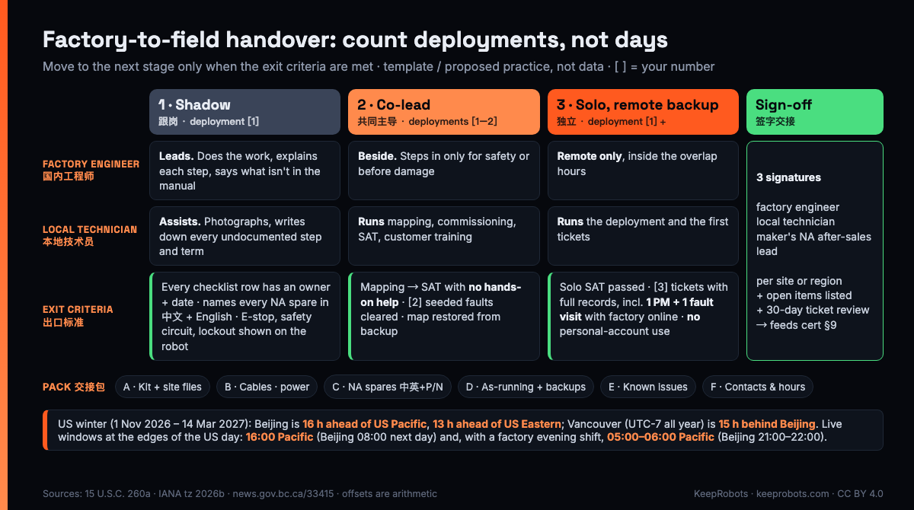

# Factory-to-Field Handover Kit: First Robot Deployments in North America (EN/中文) — KeepRobots Template

> Written by KeepRobots, a robot field-service company in Vancouver, Canada — [keeprobots.com](https://keeprobots.com). This is a template and our proposed practice, not survey data. The bracketed numbers are placeholders for you to set. Not legal, safety-compliance or immigration advice.

A hypothetical January: your factory engineer flew in for the first three deployments, trained the local technician, and flew home. Robot number four stops at 10:00 a.m. in a Seattle building. The local technician has a laptop but no service account. The spare-parts list says 左驱动轮总成 and gives no part number. The one person who knows the workaround for this fault is in Beijing, where it is 02:00.

None of that is a skills problem. It's a handover problem. The engineer knew everything; most of it just never got written down or handed over before the flight home.

This kit is what a robot maker's factory engineer should hand to a local North American field technician **before and during the first deployments**, so that the local technician can take over. It has four parts:

1. a handover checklist of what the engineer learned **at these sites** (site files, factory-only cables, power checks, spares as they really sit in North America, backups, known issues, overlap hours),
2. three stages for the first deployments, **shadow → co-lead → solo**, each with exit criteria,
3. a bilingual EN/中文 glossary of 29 field terms, each with the trap that causes the mix-up,
4. a YAML handover record, plus a short validation check.

**中文摘要：** 这是给中国机器人厂商的模板：首批北美部署时，国内派来的工程师在回国前，要把在**这几个现场**学到的东西交给北美本地技术员（现场档案、只有工厂有的线缆、电源核对、北美实际在库的备件（中英文名 + 原厂料号 + 适用序列号段）、地图备份和恢复、已知问题、升级联系人和时差重叠时段）；首批部署怎么分「跟岗 → 共同主导 → 独立」三段走、每段的出口标准；一份 29 个现场术语的中英对照表（每条写明容易错在哪）；以及一份 YAML 交接记录样例和校验脚本。按型号的培训资料包见认证模板第 2 节，本文不重复。方括号里的数字请按自己的情况改。

**How this fits with the [Field Technician Certification Template](./robot-field-technician-certification-template.md):** its section 2 is the **per-model kit**: service manual, fault codes, fault trees, spare-parts BOM, tool list, diagnostic software and accounts, firmware procedure, PM checklist, escalation contacts. HQ builds it once per model. This kit is the **per-site / per-region handover** from the engineer who was actually on site, and it assumes the cert §2 kit already exists. The certification template answers "is this person qualified on this model?" This kit answers a narrower question: **"if the factory engineer's phone is off for a week, can the local technician still run the robots at these sites?"**

Other repo docs this kit doesn't repeat:

- what the building must have before the robot ships, including power and receptacles → [Site Readiness Checklist](./site-readiness-checklist.md)
- commissioning tests and customer sign-off → [Commissioning & SAT Template](./robot-commissioning-sat-template.md)
- how tickets and RMAs flow between your system and the partner's → [OEM Ticket & RMA Integration Spec](./oem-ticket-rma-partner-integration-spec.md)
- what the factory engineer or a Canadian partner needs before working at a US site, including visitor rules → [US On-Site Visit Pack](./us-onsite-visit-pack.md)



---

## 1. Handover checklist 交接清单

**Timing rule:** before the factory engineer's return flight, every row has an **owner and a due date**. A row doesn't have to be done by then. Anything not done goes into `open_items` in the handover record (section 4) with its owner and date. Each row has a "done when" test that someone other than the factory engineer can check.

### A. The per-model kit, and what the sites added 资料

| # | Item | Done when |
|---|---|---|
| A1 | Per-model kit from [cert §2](./robot-field-technician-certification-template.md#2-training-kit-handed-over-per-model), items 1–13 | Every item is ticked there. If not, list the gaps here as open items. Don't rebuild the kit in this file |
| A2 | Site file for each deployed site: map version, charging dock position, virtual walls, elevator and door integrations, site contact, photos of the dock and of any spot where the robot struggled | Stored in the shared folder, not on the factory engineer's laptop |
| A3 | Commissioning/SAT records for deployments 1–3 ([SAT template](./robot-commissioning-sat-template.md)) | Signed copy in the shared folder |

### B. Tools, cables and power 工具、线缆和电源

Torque values are in cert §2 item 1 and the tool list is item 5. B1 is a units check on item 1, B2 is what item 5 missed (found on site), and B3 is the power check:

| # | Item | Done when |
|---|---|---|
| B1 | Units check on the torque values in cert item 1 | Written in the procedure in N·m **and** in·lb or ft·lb. North American torque wrenches are often marked only in imperial units |
| B2 | Cables and adapters the item 5 tool list missed, found on site (a debug cable, a programming header, a dongle the engineer brought in a pocket) | [2] sets in North America, with part numbers |
| B3 | Power check for every charger, dock and power supply that ships, done against its **nameplate** | Input rating covers **120 V / 60 Hz**. A unit labelled only for 220 V / 50 Hz needs a different SKU, not an adapter. Plug matches the site receptacle (**NEMA 5-15** or **5-20**; a 5-20P plug won't fit a 5-15 outlet). The charger itself carries a North American mark: an OSHA NRTL listing for US workplaces, or an SCC-accredited mark such as CSA, cUL or cETL in Canada. See [site readiness §2 and §6](./site-readiness-checklist.md#2-power-and-charging) |

### C. Spares as they really sit in North America 北美在库备件 (row C1)

The per-model BOM is cert §2 item 4. That BOM has English names. What the handover adds is the link between the factory's Chinese name, the part number and the hardware actually in the field. A note that says 左驱动轮总成 can't be ordered, can't be matched to an RMA, and can't be cleared at a border. One row per part **held in North America**:

| Field | Example (illustrative) | Why |
|---|---|---|
| OEM part number 原厂料号 | `[XX-DRV-0123-B]` | The only key that works in your ERP, RMA and customs paperwork |
| Name, Chinese 中文名 + English | 左驱动轮总成 / Left drive wheel assembly | The factory engineer will say the Chinese name on the phone at 07:00 |
| Compatible serial range | SN from `[2026-08]` | Robots at different sites may be on different hardware revisions |
| Qty / where | [2] / [partner stock, Vancouver] | Who can reach it on a Saturday |
| Serialized? / Return removed part? | Yes / Yes, RMA | Serial in and out on the visit record; don't scrap the old part |
| Contains lithium battery? | No | If yes, see the [battery shipping worksheet](./robot-lithium-battery-shipping-worksheet.md) |

### D. Software as it is actually running 现场实际软件和权限

Access levels and the firmware procedure are cert §3 and §2 item 7. Here, check the sites themselves:

| # | Item | Done when |
|---|---|---|
| D1 | As-running version list per site: robot firmware, app, fleet platform, mapping tool | Read from each robot, not copied from release notes |
| D2 | Map and configuration backups for each site | The local technician **restored** one from backup on a test unit or at a site |
| D3 | Shared or borrowed accounts used during deployment | Closed or renamed. No one is using the factory engineer's login after they leave |

### E. Known-issues list 已知问题清单 (row E1)

The factory engineer's head is full of things that aren't in any manual. Get them out before the flight. One row per issue:

| Symptom (customer's words) | Likely cause | Field workaround | Permanent fix / firmware where fixed | Escalate if |
|---|---|---|---|---|
| "Robot stops at the same doorway" | `[threshold height / lidar reflection]` | `[add virtual wall / slow zone]` | `[fixed in vX.Y]` | Happens after workaround |

A good known-issues list includes the embarrassing items too: the connector that loosens in shipping, the error that clears with a reboot, the sensor that dislikes polished floors. If the list is empty, it hasn't been written yet. "No known issues" is not an answer.

### F. Escalation contacts and overlap hours 升级联系人和时差 (row F1)

Use the contact table from cert §2 item 13 and write every hour in the **technician's local time**, with the site's time zone. Until 14 March 2027 Vancouver (UTC-7 all year) and Seattle (US Pacific, UTC-8 in winter) are on different clocks: a Vancouver technician's 08:00 is 07:00 at a Seattle site.

The live windows with Beijing sit at the two edges of the US day. At the end of the day, Beijing 08:00 is 16:00 Pacific, so send written questions before 16:00 Pacific. At the start of the day there is a second window only if the factory runs an evening shift: Beijing 21:00–22:00 is 05:00–06:00 Pacific (06:00–07:00 Vancouver). Full tables for both seasons are in the [US Customer Escalation Sheet](./us-customer-escalation-sheet.md#2-the-time-zone-reality).

---

## 2. Three stages for the first deployments 跟岗 → 共同主导 → 独立

Don't count days. Count deployments, and only move on when the exit criteria are met. If a stage fails its exit criteria, repeat it on the next deployment rather than skipping ahead.

| | Stage 1: Shadow 跟岗 | Stage 2: Co-lead 共同主导 | Stage 3: Solo 独立 (remote backup) |
|---|---|---|---|
| Deployments | [1] | [1–2] | [1], then ongoing |
| Who leads | Factory engineer | Local technician, with the factory engineer beside them | Local technician alone on site |
| Factory engineer | Does the work, explains each step, says what isn't in the manual | Watches, only steps in for safety or before something is damaged | Remote only, inside the overlap hours in section 1F |
| Local technician | Assists, photographs, writes down every undocumented step and term | Runs mapping, commissioning, the SAT and customer training | Runs the deployment and the first tickets |
| Output | Gaps added to the checklist (A–F); first glossary additions | Procedure corrected from real use; known-issues list started | Signed SAT; first service reports in the maker's ticket system |
| **Exit criteria** | Every checklist row has an owner and a due date; the technician can name every part held in North America, in Chinese and English; E-stop, safety-circuit and lockout points shown on the real robot | Technician completed mapping → commissioning → SAT with **no hands-on help**; cleared [2] seeded faults using the fault trees; restored a map from backup | Solo deployment passed SAT; [3] tickets closed in the maker's system with complete records, of which at least **one PM visit and one fault visit with the factory online**, reports accepted; **no** use of the factory engineer's personal account |

**Sign-off 签字** happens after Stage 3, **per site or per region**, and needs three signatures: the factory engineer, the local technician (or the partner's service lead) and the maker's after-sales lead in North America. It says the local team can run this model at these sites, and it lists what is still open (for example, cable set B2 arriving in [3] weeks).

This sign-off **feeds [cert §9](./robot-field-technician-certification-template.md#9-handover-sign-off)**. It doesn't replace it. Cert §9 is the partner-level sign-off per model, with two signatures. One of its conditions is "two real visits with the factory online (one PM, one fault)", and the Stage 3 exit criteria require exactly that evidence. Sign cert §9 once per model. Sign this kit once per site or region, each time the model goes somewhere new.

After sign-off, keep a 30-day follow-up: the factory engineer reviews every ticket from the sites in the handover. Any fault that needed the factory to solve it adds a row to the known-issues list or a step to a fault tree. If two tickets in a row need the factory, treat it as a handover gap rather than a technician problem.

A note on trip planning: the factory engineer's trip and the local technician's work both raise visitor and work-permit questions, especially when people cross between Canada and the US. Check them before booking. The [US On-Site Visit Pack](./us-onsite-visit-pack.md) and [section 7 of the certification template](./robot-field-technician-certification-template.md#7-who-trains-on-site-and-the-visitor-rules-to-check-first) list what to check.

---

## 3. Field glossary EN / 中文 现场术语对照

Each of these terms is on the list because it has a specific trap between a factory engineer and a local technician. That trap is in the last column. Add your own model-specific terms (error names, menu labels) as you go.

| # | 中文 | English (North American field use) | Trap 容易错在哪 |
|---|---|---|---|
| 1 | 急停 | E-stop (emergency stop) | An E-stop stops motion. It does **not** isolate energy, so it is not a lockout |
| 2 | 上锁挂牌（也说 锁定挂牌） | LOTO (lockout/tagout) | A required procedure with personal locks. 断电 ("power off") is not enough |
| 3 | 断电 / 上电 | power down / power up | Say which: main switch, battery disconnect, or charger |
| 4 | 安全回路 | safety circuit (safety relay / safety PLC chain) | Not the same as the E-stop button. "E-stop won't reset" is usually the circuit: a door switch, a bumper, a scanner field |
| 5 | 绝缘 / 绝缘电阻测试 | insulation / insulation resistance test ("megger test") | 绝缘 can mean the material or the test, so say which |
| 6 | 接地 | ground (US) / earth | "Ground" can also mean the floor, so use "ground connection" |
| 7 | 报警 / 警告 / 故障 | alarm / warning / fault | The words differ by maker: on many arm controllers an "alarm" is what stops the robot. Customers report all three as "error". Ask whether it stops the robot, and get the code |
| 8 | 掉线 | lost connection (offline) | Not "powered off". The robot may still be moving. Check Wi-Fi or the fleet server before driving out |
| 9 | 建图 | mapping | Mapping makes the map. It's different from localization |
| 10 | 定位 / 重定位 | localization / relocalization | "Robot lost" usually means relocalization failed, not that the map is bad |
| 11 | 虚拟墙 / 禁行区 | virtual wall / keep-out zone (no-go zone) | Ask whether it is in the map file or in the fleet platform |
| 12 | 点位 / 站点 | waypoint / station (pickup or drop-off point) | 站点 can also mean the customer site, so check which |
| 13 | 回充桩 / 充电桩 | charging dock (charging station) | Not an EV charger. Customers may also say "base" |
| 14 | 底盘 | base / chassis (mobile base) | "Base" also means the robot's home position |
| 15 | 示教器 | teach pendant (arms and cobots) | Not a "teacher" or a tablet app. It usually has its own enable switch and E-stop |
| 16 | 驱动器 | motor drive / servo drive | Not a software "driver" |
| 17 | 主板 / 控制板 | main board / controller board | Use the part number. Several boards are called 主板 |
| 18 | 标定 | calibration (sensor calibration / extrinsics) | In North America "calibration" can also mean an instrument certificate. 标定 is the robot procedure |
| 19 | 固件 / 软件 / 刷机 | firmware / software / reflash (flash firmware) | Ask "what version, of what?" every time |
| 20 | OTA 升级 | OTA update (over-the-air) | Who can push one, and when the customer is told |
| 21 | 工单 | ticket (support) / work order (field visit) | One 工单 may be both. Agree which number is the master ([spec](./oem-ticket-rma-partner-integration-spec.md)) |
| 22 | 退货授权号（RMA 号）；返厂；返修 | RMA = Return Merchandise Authorization (number); return to factory; repair | RMA is the **authorization number** the maker issues, not the shipment or the repair. 返厂 is sending the unit back. 返修 is the repair, which may happen on site. No RMA number, don't ship |
| 23 | 易损件 / 耗材 | wear parts / consumables | Decides who pays under warranty, so define the list |
| 24 | 料号 | part number (P/N) | Not the same as 序列号 |
| 25 | 序列号 / 铭牌 | serial number (S/N) / nameplate (rating label) | Photograph the nameplate on every visit |
| 26 | 保修期内 / 过保 | in warranty / out of warranty | Starts at SAT sign-off or at delivery? Check the contract |
| 27 | 现场验收 | SAT (site acceptance test) | Not FAT, which happens at the factory |
| 28 | 复现 / 偶发 | reproduce / intermittent | "Can't reproduce" ≠ "no fault found". Log the conditions |
| 29 | 荷电状态 | state of charge (SoC) | Shipping rules depend on it |

Tip: print this table and leave it in the service case. The factory engineer will add terms during Stage 1, which shows the list is working.

---

## 4. YAML handover record 交接记录

Keep one file per model per site or region, in the same folder as the site files. Update it at each stage. Every value below is illustrative.

```yaml
# handover/[model]-[region].yaml — illustrative example, not real data
handover_id: HO-[MODEL]-PNW-001
model: "[Model name]"
hardware_revision: "Rev B"
region: "Pacific Northwest"
maker_after_sales_lead: "[name, NA]"
factory_engineer: "[name]"
local_technician: "[name, partner]"

stage: solo            # shadow | co_lead | solo | signed_off
deployments:
  - { site_id: S1, stage: shadow,  sat_signed: true,  date: "[YYYY-MM-DD]" }
  - { site_id: S2, stage: co_lead, sat_signed: true,  date: "[YYYY-MM-DD]" }
  - { site_id: S3, stage: solo,    sat_signed: false, date: "[YYYY-MM-DD]" }

checklist:             # every row from section 1: owner + due, then done + evidence
  A1: { owner: maker_hq,  due: "[YYYY-MM-DD]", done: true,  evidence: "cert-s2-[model].md all ticked" }
  A2: { owner: factory,   due: "[YYYY-MM-DD]", done: true,  evidence: "sites/S1..S3/" }
  A3: { owner: local,     due: "[YYYY-MM-DD]", done: true,  evidence: "sat/S1.pdf, sat/S2.pdf" }
  B1: { owner: factory,   due: "[YYYY-MM-DD]", done: true,  evidence: "procedure v1.3 table 4" }
  B2: { owner: maker_hq,  due: "[YYYY-MM-DD]", done: false }
  B3: { owner: local,     due: "[YYYY-MM-DD]", done: true,  evidence: "photos/nameplates/" }
  C1: { owner: factory,   due: "[YYYY-MM-DD]", done: true,  evidence: "spares below" }
  D1: { owner: local,     due: "[YYYY-MM-DD]", done: true,  evidence: "versions.csv" }
  D2: { owner: local,     due: "[YYYY-MM-DD]", done: true,  evidence: "restore log S2" }
  D3: { owner: maker_hq,  due: "[YYYY-MM-DD]", done: true,  evidence: "account audit" }
  E1: { owner: factory,   due: "[YYYY-MM-DD]", done: true,  evidence: "known-issues.md" }
  F1: { owner: maker_na,  due: "[YYYY-MM-DD]", done: true,  evidence: "contacts.md" }

spares:
  - oem_pn: "[XX-DRV-0123-B]"
    name_zh: "左驱动轮总成"
    name_en: "Left drive wheel assembly"
    serial_range: "SN from [2026-08]"
    qty_na: 2
    serialized: true
    return_removed_part: true
    lithium: false

known_issues:
  - id: KI-01
    symptom: "Stops at the same doorway"
    workaround: "[virtual wall / slow zone]"
    fixed_in: null      # null = no permanent fix yet

escalation:
  - { role: L3_factory, name: "[name]", tz: "Asia/Shanghai",
      reachable_local: "16:00-18:00 America/Los_Angeles (winter)", p1_wake: "[phone app]" }

open_items:
  - { id: B2, owner: maker_hq, due: "[YYYY-MM-DD]", note: "2 debug cable sets shipping" }
signoff: { factory_engineer: null, local_technician: null, maker_na_lead: null }
```

**Validation, in short:** every row in section 1 must be present with an `owner` and a `due` date; a row that isn't `done` with `evidence` must appear in `open_items` by its exact `id`; every spare needs `oem_pn`, `name_zh` and `name_en`; a `lithium: true` spare needs a `shipping_note`. To reach `signed_off`, at least one `solo` deployment must have `sat_signed: true` and all three `signoff` fields must be filled. A short check that you can run in CI or before a review:

```python
# check_handover.py — pip install pyyaml; python check_handover.py handover/x.yaml
import sys, yaml
REQUIRED = "A1 A2 A3 B1 B2 B3 C1 D1 D2 D3 E1 F1".split()
r = yaml.safe_load(open(sys.argv[1], encoding="utf-8"))
err, rows = [], r.get("checklist") or {}
open_ids = {o.get("id") for o in r.get("open_items") or []}
for k in REQUIRED:
    v = rows.get(k)
    if v is None:
        err.append(f"checklist {k}: missing"); continue
    if not (v.get("owner") and v.get("due")):
        err.append(f"checklist {k}: no owner or due date")
    if not (v.get("done") and v.get("evidence")) and k not in open_ids:
        err.append(f"checklist {k}: not done and not in open_items")
for p in r.get("spares") or []:
    for f in ("oem_pn", "name_zh", "name_en"):
        if not p.get(f):
            err.append(f"spare {p.get('oem_pn') or p.get('name_en')}: missing {f}")
    if p.get("lithium") and not p.get("shipping_note"):
        err.append(f"spare {p.get('oem_pn')}: lithium part without shipping_note")
if r.get("stage") == "signed_off":
    if not any(d.get("stage") == "solo" and d.get("sat_signed") for d in r.get("deployments") or []):
        err.append("signed_off without a signed solo SAT")
    so = r.get("signoff") or {}
    err += [f"signoff {k} missing" for k in ("factory_engineer", "local_technician", "maker_na_lead") if not so.get(k)]
print("\n".join(err) or "OK")
sys.exit(1 if err else 0)
```

The example file returns `OK` at `stage: solo`, because `B2` isn't done but is listed in `open_items` by its id. Change the stage to `signed_off` and it reports four errors: no signed solo SAT yet, and each of the three signatures missing. Delete the `B2` line from `open_items` and it adds a fifth.

---

## Who this is for, and where a partner fits

This kit is written for after-sales and international business leads at robot makers, especially from China, who are sending a factory engineer for the first North American deployments and handing over to a local technician or a field-service partner afterwards. KeepRobots can take the local side of this handover: our engineers read Chinese technical documents and can work around China hours. We're based in Vancouver and serve Western Canada day to day. US and other Canadian work is travel, quoted per project, because we have no US office.

**About KeepRobots:** robot field service from Vancouver (deployment, repair, preventive maintenance, demos, spare-parts storage). Diagnostic fee $200 CAD / $200 USD per unit per visit (credited if you approve the repair), $100 CAD call-out in core Greater Vancouver, labour $150 CAD / $150 USD per hour, taxes extra; travel outside the core zone and to the US is quoted per project. partners@keeprobots.com

### Sources (checked 2026-11-12)

- 15 U.S.C. 260a, US daylight saving time (second Sunday in March to first Sunday in November) — https://www.law.cornell.edu/uscode/text/15/260a
- IANA Time Zone Database 2026b (America/Vancouver permanent UTC-7) — https://www.iana.org/time-zones/releases/2026b
- Government of British Columbia, permanent daylight time announcement — https://news.gov.bc.ca/33415
- Power and approval marks (row B3): this repo's [Site Readiness Checklist](./site-readiness-checklist.md) §2 and §6, and its sources, including OSHA on NRTL approval of electrical equipment (29 CFR 1910.303) — https://www.osha.gov/laws-regs/standardinterpretations/2011-01-28-0
- KeepRobots rates — https://keeprobots.com/service/usa/ and https://keeprobots.com/service/canada/

Time conversions are arithmetic from the UTC offsets above. Found an error? Open an issue. We check and correct.

## Related pages on keeprobots.com

- [Field-service partner for robot makers entering North America](https://keeprobots.com/partners/north-america/)
- [Robot repair, after-sales and field service in the USA](https://keeprobots.com/service/usa/): US visits from Vancouver, with prices
- [Robot repair and field service in Canada: coverage, process, pricing](https://keeprobots.com/service/canada/)
- [中文：北美现场服务合作](https://keeprobots.com/zh/partners/north-america/)
