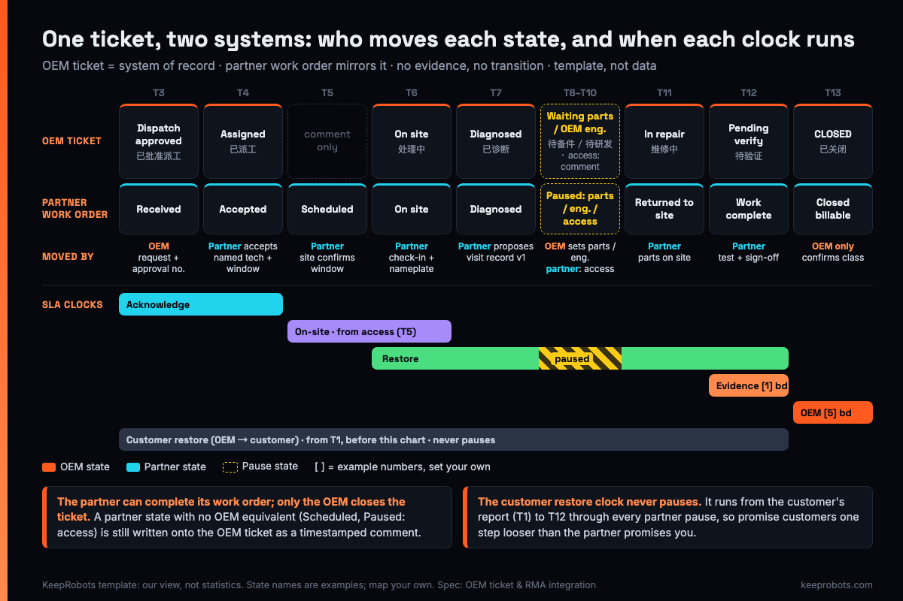

# OEM Ticket & RMA Integration Spec for a North American Field-Service Partner — KeepRobots Template

> Written by KeepRobots, a robot field-service company in Vancouver, Canada — [keeprobots.com](https://keeprobots.com). Everything below is our view and a template, not survey data.

A hypothetical Tuesday: a delivery robot in a US hotel stops working. In the maker's ticket system in Shenzhen, the ticket has read 待备件 ("waiting for parts") for six days. In the service provider's portal, the same job has read "Completed" since day two, because the technician closed the work order when he left the site. When the hotel's manager asks the maker's US sales lead why nobody came back, the two systems give two different answers.

This spec fixes that by putting **one ticket, in one system: the robot maker's**. The partner's work order mirrors it. Robot makers, especially Chinese OEMs selling in the US and Canada, can paste sections 1–5 into the annex of a service-partner agreement and change the bracketed numbers.

It doesn't repeat what is already in this repo:

- what the dispatch request must contain → [Robot Fault Report & Dispatch Template](./robot-fault-report-template.md)
- who is Responsible or Accountable for each warranty step → [Warranty Repair RACI](./warranty-repair-raci.md)
- export and re-import paperwork for parts and robots → [Factory Return Paperwork](./robot-factory-return-paperwork.md)
- what the end customer sees → [US Customer Escalation Sheet](./us-customer-escalation-sheet.md)

Not legal, customs or tax advice.



---

## 0. The design rule: the partner adapts, the maker doesn't

Write the integration so the partner adapts to the maker's system: named logins in your ticket tool, your field format, your part numbers, your RMA numbers, Chinese where your factory engineers need it. Some providers can do this; others need every maker on one intake format. Either way, write these rules into the contract:

1. **The OEM ticket is the system of record.** If the two systems disagree, the OEM ticket wins.
2. **Each state has one owner.** Only the party named in section 1 may move it.
3. **No evidence, no transition.** A state change without the evidence listed is invalid and does not stop a clock.
4. **The partner never decides coverage.** It records evidence and proposes a classification; the OEM decides (same split as row 5 of the [RACI](./warranty-repair-raci.md)).

---

## 1. State machine: OEM ticket ↔ partner work order

Use your own state names; the Chinese labels are only examples.

| # | OEM ticket state | Partner work-order state | Who moves it | Evidence required to move | Clock effect |
|---|---|---|---|---|---|
| T1 | NEW 新建 | — | OEM support / NA seller | Customer report logged, serial confirmed | Customer response **and customer restore** clocks start (OEM's own SLA to the customer) |
| T2 | TRIAGE 远程排查 | — | OEM support | Triage script result, log pull, firmware version | — |
| T3 | DISPATCH_APPROVED 已批准派工 | RECEIVED | OEM support | Completed [dispatch request](./robot-fault-report-template.md) **including the OEM approval number** and authorization level | **Partner acknowledge clock starts** |
| T4 | ASSIGNED 已派工 | ACCEPTED | Partner | Named technician + proposed visit window | Acknowledge clock stops |
| T5 | — | SCHEDULED | Partner | Visit window confirmed by site contact, in writing | **On-site clock starts** (site access confirmed) |
| T6 | ON_SITE 处理中 | ON_SITE | Partner | Check-in time + photo of robot nameplate | On-site clock stops; **restore clock starts** |
| T7 | DIAGNOSED 已诊断 | DIAGNOSED | Partner (proposes) | Visit record v1 (section 2): fault codes, logs, photos, proposed classification | — |
| T8 | WAITING_PARTS 待备件 | PAUSED_PARTS | **OEM** sets it, after approving the part | RMA/parts order no., part number, ETA | Restore clock **pauses** |
| T9 | WAITING_OEM 待研发 | PAUSED_ENGINEERING | **OEM** | Escalation note acknowledged by a named engineer | Restore clock **pauses** (count it separately); resumes when the engineer's answer is posted on the ticket |
| T10 | — | PAUSED_ACCESS | Partner | Site's written refusal or reschedule | Restore clock **pauses**; resumes when site access is reconfirmed in writing (before T6, it pauses the on-site clock instead) |
| T11 | IN_REPAIR 维修中 | RETURNED_TO_SITE | Partner | Parts delivered to site (carrier proof or consignment pick record) | Restore clock **resumes** (parts pause ends). For part-swap jobs, this is also a fair start point for a separate parts-on-site clock |
| T12 | PENDING_VERIFY 待验证 | WORK_COMPLETE | Partner | Post-repair test result, customer sign-off, visit record (draft) | Restore clock stops; **evidence clock starts** |
| T13 | CLOSED 已关闭 | CLOSED_BILLABLE | **OEM** | Evidence pack accepted; classification confirmed (warranty / chargeable / NFF = no fault found; DOA = dead on arrival) | **OEM decision clock stops**; partner may invoice |
| T14 | CLOSED_NFF / CANCELLED | CLOSED_BILLABLE, CANCELLED (no charge) or CANCELLED_LATE | OEM | NFF reason; cancellation time vs agreed cut-off | Billed per the NFF/cancellation clause |

The rule that would have prevented the hotel scenario is **T12 → T13**. The partner can mark its own work complete, but only the OEM can close the ticket. A partner state with no OEM equivalent (SCHEDULED, PAUSED_ACCESS) still goes onto the OEM ticket as a timestamped comment, so the US sales lead reads one timeline.

**Sync method, in order of preference:** (a) the partner works directly in the OEM tool with named accounts; (b) an API or webhook pushes partner state changes into the OEM ticket within [15] minutes; (c) as a last resort, one email per state change to a ticket-specific address. Not a spreadsheet reconciled weekly.

---

## 2. Required fields per visit (machine-readable)

The [fault report template](./robot-fault-report-template.md) is what the partner receives. This is the record the partner **returns**, built for import without retyping. Change the enums to match your system.

```yaml
# visit_record v1.0, one per site visit, attached to the OEM ticket
oem_ticket_id:        required  # the OEM's number, never the partner's
partner_wo_id:        required
oem_approval_no:      required  # from T3; no approval no. = not billable as warranty
visit_seq:            required  # 1, 2, 3... on the same ticket
technician:           required  # named person with an OEM account (section 5)

robot:
  serial:             required  # read from nameplate; photo in photos[nameplate]
  model:              required
  firmware_before:    required  # as shown on robot/app, exact string
  firmware_after:     required_if_changed
  run_hours:          required_if_available

fault:
  oem_fault_codes:    required  # list, OEM's codes verbatim, e.g. ["E-2041"]
  symptom_observed:   required  # what the technician saw, not what the ticket said
  reproduced:         required  # yes | no | intermittent
  root_cause:         optional  # or "hypothesis:" + evidence

logs:
  bundle_file:        required  # OEM's export tool output, unmodified
  sha256:             required  # so nobody argues later about which file
  time_range_utc:     required  # covers the fault time on the ticket

photos:               required  # minimum set below; filenames carry the ticket id
  - nameplate
  - before_removal    # each part to be replaced, in place
  - part_label        # OEM PN + serial legible
  - damage_or_none    # close-up, or one wide shot stating "no visible damage"
  - after_repair

parts_used:           # one entry per part; empty list if none
  - oem_part_no:      required  # OEM PN, not a supplier or partner SKU
    qty:              required
    new_serial:       required_if_serialized
    removed_serial:   required_if_serialized
    source:           required  # consignment | shipped_by_oem | partner_stock
    rma_no:           required_if_returnable  # see section 3

time:
  arrive_local:       required  # ISO 8601 with UTC offset
  depart_local:       required
  labour_hours:       required  # on site, excluding travel
  travel_hours:       required
  oem_engineer_call_minutes: optional

classification:
  proposed:           required  # warranty | chargeable | nff_triage_done | nff_triage_skipped | doa
  # nff_triage_done: no fault found after OEM triage was done -> OEM pays the visit
  # nff_triage_skipped: no fault found, triage skipped at seller/customer request -> they pay
  # doa: dead on arrival within the DOA window -> OEM quality cost
  evidence:           required_if_not_warranty  # photo ids / log lines supporting it
  decided_by_oem:     set_by_oem_only

signoff:
  site_name:          required
  site_signed_at:     required
  test_result:        required  # pass | partial | fail, with what was run
  open_items:         optional
```

Validation rules worth enforcing in the tool, not in a manual:

- `classification.proposed: chargeable` with no `evidence` is rejected.
- `parts_used[].oem_part_no` must exist in the OEM's parts list for that `robot.model`.
- A visit record with `firmware_after` ≠ `firmware_before` needs a firmware change approval in the ticket thread.
- `visit_seq ≥ 2` within [30] days on the same fault code flags the ticket for a workmanship review (see the "same fault returns" row in the [RACI](./warranty-repair-raci.md)).

---

## 3. RMA handoff from the field

The **OEM issues the RMA number**, always, before the failed part leaves the site. Without one, the part stays on site, tagged "awaiting RMA".

| Step | Partner does | OEM does | Proof in the ticket |
|---|---|---|---|
| 1. Remove | Photographs the part in place and its label (section 2 photos) | — | `before_removal`, `part_label` |
| 2. Tag | Tag on the part **and** the box: RMA no., OEM PN, serial, ticket id, fault code, removal date, technician | Issues the RMA no. at T8 or earlier | Photo of tagged part and sealed box |
| 3. Quarantine | Keeps it in a separate, labelled bin; never mixes it with good stock | — | Custody log entry: location, date |
| 4. Disposition | Waits for the instruction | Picks one: **return to factory / ship to NA hub / hold for inspection / scrap locally** (local scrap needs a photo, the serial and a disposal or recycling certificate) | Written disposition on the ticket |
| 5. Ship | Ships per instruction with the OEM-provided paperwork | Provides commercial invoice data, account number, address | Tracking number on the ticket |
| 6. Close | — | Confirms receipt, links the failure-analysis result | Receipt date; FA reference |

**Chain of custody.** Every handover (technician → partner premises → carrier → OEM receiving) gets one line in the custody log: who, when, where, and seal intact yes/no. A part without a custody trail shouldn't be used to deny a claim.

**Hold period before scrap (template default).** The partner holds a failed part for [60] days from removal. Then it asks for a written disposition; if none arrives within [14] more days, the partner may charge storage at [rate] or ship to the OEM's NA address at the OEM's cost. It **never scraps without written instruction**. Damaged lithium batteries follow their own rules; see the [lithium battery shipping worksheet](./robot-lithium-battery-shipping-worksheet.md) before they come off the robot.

**How credits flow.** The partner never takes a parts credit or bills the customer for a covered part. The OEM credits whoever paid for the replacement: the NA seller or the customer, or it replenishes the consignment stock. The partner invoices only labour, call-out or diagnostic, and travel; never parts. Each line references `oem_approval_no`. Customs refunds on defective parts returned for credit are covered in [factory return paperwork](./robot-factory-return-paperwork.md).

---

## 4. SLA clocks, defined so nobody can argue

In our view, SLA disputes start more often from an undefined clock than from a late technician. Define each clock by its **start event, its stop event and its pause events**, all of them tied to state changes in section 1.

| Clock | Starts | Stops | Pauses | Owner of the promise |
|---|---|---|---|---|
| Customer response | T1: customer report logged | First human reply to customer | — | OEM / NA seller |
| Customer restore | T1: customer report logged | T12 robot back in service | Never | OEM / NA seller |
| Partner acknowledge | T3: complete dispatch request received | T4: partner accepts with named technician + proposed window | Incomplete dispatch request or missing approval number (sent back) | Partner |
| On-site | T5: site access window confirmed in writing | T6 check-in | Site postpones (logged as PAUSED_ACCESS) | Partner |
| Restore | T6 arrival | T12 work complete | T8 waiting parts, T9 waiting OEM engineering, T10 site access (each resumes as in section 1) | Shared: report each pause separately |
| Evidence | T12 | Visit record final + log bundle uploaded, within [1] business day | — | Partner |
| OEM decision | Visit record final | T13 classification confirmed, [5] business days | — | OEM |

Two choices to make explicitly:

- **Approval vs access.** If the on-site clock starts at OEM approval, the partner is measured on the site's scheduling. We recommend starting it at confirmed access (T5) and recording both timestamps.
- **Business hours whose?** Name the time zone and the holiday calendar of the site, and write every timestamp with its UTC offset. Canadian provinces and US states don't share the same holidays.

Your promise to the customer should be one step looser than what the partner promises you. Partner pauses still count against the customer restore clock.

---

## 5. Access and data

| Item | Template rule |
|---|---|
| Accounts | One named account per technician in the OEM ticket tool, diagnostic app and parts portal. No shared logins. MFA where the tool supports it |
| Scope | Read/write on tickets assigned to the partner; read on service manuals and fault trees for the models in the agreement; no access to other partners' tickets or to customer data beyond the site contact |
| Diagnostic level | Write the level (view logs / change parameters / flash firmware) per technician; firmware flashing only with approval in the ticket |
| Remote access to robots | Only through the OEM's tool, with session logging |
| Partner copies | Partner keeps logs and photos [24] months for disputes, then deletes them |
| Joiner | Account created only after the technician passes the OEM's model training (see the [technician certification template](./robot-field-technician-certification-template.md)) |
| Leaver | Accounts revoked within [1] business day of the technician leaving the partner or the contract; diagnostic dongles returned |
| Contract exit | The partner exports all visit records and custody logs in the section 2 format, returns consignment stock and tools, and confirms deletion in writing within [30] days |

---

## 6. Test a provider in 30 minutes

Before you sign with any provider, give them one **real, closed ticket from your own system, in Chinese**, with customer and site names and robot serials removed (use an NDA if your policy needs one). Ask for items 1, 2 and 4 within 30 minutes; the YAML can follow. It fits alongside the [RFQ template](./robot-field-service-rfq-template.md).

1. **Map it.** Which of their work-order states would this ticket have passed through, and which of your states has no equivalent on their side?
2. **Write the escalation note to your factory engineer, in Chinese.** Fault code, what remote support tried, what they'd check first, the one question for your engineer, and the part numbers they'd bring.
3. **Fill the section 2 YAML** for the visit the ticket describes, marking the fields the ticket doesn't give them.
4. **Mark the clocks.** At each timestamp in the ticket, which clock from section 4 was running?

| What you see | What it tells you |
|---|---|
| They read the Chinese fault description and log notes without asking for a translation | They can work inside your system, not just next to it |
| The escalation note asks one specific question | They will use your engineers' night hours well |
| They use your part numbers and fault codes verbatim | Their records will import cleanly into your warranty desk |
| They spot a missing field or a clock that was ambiguous | They will find the same gaps in your live tickets |

---

## Where a dedicated partner fits

KeepRobots is set up to work this way: our engineers read Chinese technical documents and can work China hours. We're based in Vancouver and serve Western Canada day to day; US and other Canadian work is travel, quoted per project, because **we have no US office**. Rates: diagnostic $200 CAD / $200 USD per unit per visit (credited if the repair is approved), $100 CAD Greater Vancouver call-out, $150 CAD / $150 USD per labour hour, taxes extra. To run the 30-minute test on us, send a redacted closed ticket to partners@keeprobots.com.

---

## Related pages on keeprobots.com

- [Robot field service partner for North America](https://keeprobots.com/partners/north-america/)
- [Robot repair and field service in the USA](https://keeprobots.com/service/usa/) — US visits from Vancouver, with prices
- [Nationwide robot service network vs a dedicated field service partner](https://keeprobots.com/notes/nationwide-robot-service-network-vs-field-service-partner/) — how to choose, and how to use both
