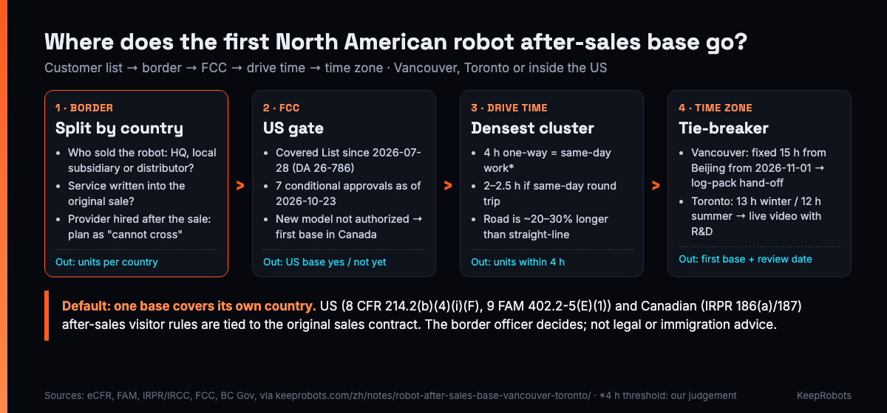

# North American Robot After-Sales Base Location Worksheet (Canada / US) — KeepRobots

> Written by KeepRobots, a robot field-service company in Vancouver, Canada — [keeprobots.com](https://keeprobots.com)

Vancouver to Seattle is about 230 km by road. On a map, one service base covers both. At the border, it often doesn't: US and Canadian rules both let a foreign engineer do after-sales repair as a business visitor, but both tie that permission to the **original sales contract**. Was the robot bought from a company outside the country? Was the service written into the sale? A service provider the customer hires afterwards usually can't cross the border on that basis.

So a base mostly serves customers in **its own country**, within a few hours' drive. This worksheet turns your customer list into a decision on where the first base goes: Vancouver, Toronto or inside the US. It is for overseas business leads and after-sales managers at robot companies, especially from China, about to place a first North American service point (own staff, a service partner or a warehouse). Copy it into an issue, a spreadsheet or a shared doc.

We are a service company in Vancouver, so we are not neutral on this question. The decision rules below say when **not** to choose Vancouver. Entry rules are summarized from US federal regulation, the US State Department's Foreign Affairs Manual and IRCC (Immigration, Refugees and Citizenship Canada) source texts, checked 2026-10-29. The border officer decides each entry. **This is not legal or immigration advice.**



---

## How to use this worksheet

1. **Section 1:** list every installed site plus customers likely to sign in the next 12 months. One row per site.
2. **Section 2:** tag each row with the cross-border situation. This is the step most teams skip.
3. **Section 3:** split the rows by country, then group them into clusters by metro area and drive time.
4. **Section 4:** add the FCC gate (it feeds decision rule 2, right after the border), then time zone and spares as adjustments.
5. **Section 5:** apply the decision rules in order and write down the result.
6. **Section 6:** check the sales contract wording before you sign the next customer, not after the first breakdown.

---

## 1. Customer list

```markdown
# After-sales base worksheet: [company], [date]
Products / models: [ ]                  FCC authorization for each model sold in the US: [ ] yes  [ ] no  [ ] pending
Who sells in North America: [ ] HQ exports directly  [ ] US subsidiary  [ ] Canadian subsidiary  [ ] distributor(s): [ ]
Engineers per candidate base and their citizenship: [e.g. 2 × Canadian citizen, 1 × Chinese national]
Prepared by: [ ]                        Reviewed by (legal / immigration counsel): [ ]
```

| # | Customer / site | City | Prov. / state | Country | Metro cluster | Units installed | Units likely in 12 mo | Sold by (HQ / US sub / CA sub / distributor) | Warranty or service written into sale? | Service provider named in sale? | Warranty ends | Time zone |
|---|---|---|---|---|---|---|---|---|---|---|---|---|
| 1 | [ ] | [ ] | [ ] | CA / US | [ ] | [ ] | [ ] | [ ] | Y / N | [name] / none | [ ] | [ ] |
| 2 | [ ] | [ ] | [ ] | CA / US | [ ] | [ ] | [ ] | [ ] | Y / N | [name] / none | [ ] | [ ] |
| 3 | [ ] | [ ] | [ ] | CA / US | [ ] | [ ] | [ ] | [ ] | Y / N | [name] / none | [ ] | [ ] |

"Sold by" matters more than the address. The cross-border rules look at who the customer bought the robot from.

---

## 2. Can a base on one side serve this row across the border?

### The rules, in short

**Canadian citizens going to the US: 8 CFR 214.2(b)(4)(i)(F), USMCA "after-sales services."** Covers installers, repair and maintenance personnel and supervisors with specialized knowledge essential to the seller's contractual obligation. They must be working under a warranty or other service contract incidental to the sale of commercial or industrial equipment purchased from an enterprise located outside the US, during the life of that warranty or agreement. The equipment must also have been manufactured outside the US. The visitor must still meet the general B-1 requirements, including the source of pay.

**Engineers who need a US visa (including staff sent from China): 9 FAM 402.2-5(E)(1).** A B-1 visa may be issued to someone coming to install, service or repair commercial or industrial equipment bought from a company outside the US. Conditions: the sales contract specifically requires the seller to provide the service, the person has unique knowledge essential to that obligation, and they receive no pay from a US source. It does not cover building or construction work, whether on site or in the plant.

**US engineers going to Canada: IRPR section 186(a) and section 187.** IRCC lists after-sales service as a business-visitor activity:
- **Equipment:** specialized commercial or industrial equipment bought or leased outside Canada.
- **Work:** limited to repair, servicing, setup and installation, testing and supervision. Setup and installation exclude hands-on building-trades work such as electrical and plumbing.
- **Contract:** the service contract must be part of, or an extension of, the original sale or lease agreement.
- **Not covered:** IRCC states plainly that service contracts negotiated with a third party after the sales agreement don't qualify; work outside the original warranty or service agreement needs a work permit.
- **Named provider:** if the original sales agreement already names another company as the service provider, the visit is assessed under the general business-visitor test in section 187.

### Tag each row in section 1

| Tag | Your situation | Cross-border from a base in the other country? |
|---|---|---|
| **A** | HQ sold the robot directly to the North American customer, warranty service is in the sales contract, you send your own engineers | Closest fit to both after-sales provisions; business-visitor entry is possible. Carry the contract excerpt, a letter from the maker and proof of training on the model. Which US rule applies depends on the engineer's citizenship: Canadian citizens use 8 CFR (F); others, including staff sent from China, use the 9 FAM B-1 route (our reading of the two provisions). Into Canada: the IRPR 186(a)/187 conditions above |
| **B** | Sold by your subsidiary or a distributor **in the customer's country** (e.g. US subsidiary selling to a US customer) | Not "purchased from an enterprise outside" the country. Plan for people with local work status; the base goes on the customer's side |
| **C** | Customer (or you) hires a third-party service provider after the sale, including providers like us | Canada side: explicitly not covered. US side: depends on whether it falls under the original sale's warranty or service contract and who pays. **Plan as "cannot cross"** |
| **D** | Warranty has expired; customer wants a one-off repair | Outside the after-sales provisions on both sides. Use a local provider |

**Default assumption: a base covers its own country.** Treat rows tagged A as a possible bonus, not as the plan. Each crossing still has to show it meets the conditions.

---

## 3. Split by country, then cluster by drive time

A base's first job is to reach its densest cluster **the same day**. Our rule of thumb is **4 hours' one-way drive**: leave in the morning, arrive before noon, work that day. Beyond that, you fly or schedule a trip, and response is measured in days. If the contract requires a same-day round trip, use 2–2.5 hours. (The 4-hour threshold is our judgement, not a regulation.)

Reference distances (straight-line between city centres, calculated by us; real road distance is typically 20%–30% longer, plus border waits):

| From | To |
|---|---|
| Vancouver | Seattle ~195 km (about 230 km by road); Portland ~420 km; Calgary ~670 km |
| Toronto | Buffalo ~95 km; Detroit ~330 km; Ottawa ~350 km; Montreal ~500 km |
| Bay Area / Los Angeles | Bay Area to LA ~520 km; LA to San Diego ~180 km; Seattle to Bay Area ~1,100 km |

Buffalo, Detroit and Seattle are close, but they are across the border. Section 2 applies to them.

Fill in one table per country:

| Country | Cluster (metro area) | Sites | Units now + 12 mo | Share of this country's units | Candidate base | Units within 4 h drive of it | Units needing flights / trips |
|---|---|---|---|---|---|---|---|
| CA | [e.g. Greater Vancouver + Fraser Valley] | [ ] | [ ] | [ ] % | [ ] | [ ] | [ ] |
| CA | [e.g. Toronto–Ottawa–Montreal corridor] | [ ] | [ ] | [ ] % | [ ] | [ ] | [ ] |
| US | [e.g. Bay Area] | [ ] | [ ] | [ ] % | [ ] | [ ] | [ ] |
| US | [e.g. Los Angeles–San Diego] | [ ] | [ ] | [ ] % | [ ] | [ ] | [ ] |
| US | [e.g. Seattle–Portland] | [ ] | [ ] | [ ] % | [ ] | [ ] | [ ] |

Canada context (Statistics Canada, 2021 Census): Toronto metro 6.2 million, Greater Vancouver 2.64 million; Ontario 38.5% and Quebec 23.0% of the population. From Vancouver, other BC cities and Alberta mean flights or multi-day trips.

A common, normal result: **the first base covers less than half your customers.** Its job is the densest cluster. Everything else is project travel until volume justifies a second base.

---

## 4. FCC gate, then time zone and spares

### Time zone: how you work with R&D in China

| Base | Offset from Beijing | Pattern it suits |
|---|---|---|
| Vancouver | Fixed 15 h, all year, from 2026-11-01 (BC moved to permanent UTC-7; last clock change 2026-03-08) | **Hand-off:** 5 pm in Vancouver is 8 am next day in Beijing. The log pack sent at end of shift is read when China starts work. Same schedule all year |
| US West Coast | 16 h in winter, 15 h in summer | Same hand-off pattern; the schedule changes twice a year |
| Toronto | 13 h in winter, 12 h in summer (Eastern Time with daylight saving, second Sunday of March to first Sunday of November) | **Live:** in summer, 8–10 am Toronto is 8–10 pm Beijing, so live video troubleshooting with R&D is possible if they stay online in the evening. In winter only 8–9 am / 9–10 pm remains |

Score it: if the product still changes fast and depends on live remote guidance from R&D, give the eastern option extra weight. If a log pack and a next-day answer close most tickets, the West Coast is simpler.

### FCC gate: can the model be sold in the US yet?

On 2026-07-28 the FCC added foreign-produced advanced robotic equipment (including autonomous mobile robots, humanoids and quadrupeds) to the Covered List (DA 26-786). New models without FCC authorization before that date cannot currently enter the US. As of 2026-10-23 the FCC had announced 7 conditional approvals for robots (DA 26-1154). Canada uses its own ISED certification; we found no public information that Canada has taken a similar step.

- [ ] Every model planned for US customers has FCC authorization → US base is an option
- [ ] Any new model without authorization → **no US base for it yet.** Put the first base in Canada for demos, pilots and reference customers

### Spares: the cheaper-duty side doesn't replace the customer's side

As of 2026-10-27, common robot tariff codes (8479.50 industrial robots, 8428.70, 8427.10 AGVs) are duty-free at Canada's MFN rate, with 5% GST normally due at import; lithium battery packs imported separately are 7%. In the US, 8479.50 of Chinese origin totals about 40% as of 2026-10-26 (2.5% general rate + 25% Section 301 List 1 + 12.5% multi-country Section 301 action); confirm your actual code and rate with a customs broker.

- [ ] Spares held in Canada and taken to a US site are **imported into the US** at the border, even in the technician's car
- [ ] Spares held in the US need someone acting as US importer

---

## 5. Decision rules (apply in order)

1. **Border first.** Split units by country using section 3. Rows tagged B, C or D in section 2 count only for the country they're in.
2. **FCC second.** If any new model planned for the US lacks FCC authorization, the first base goes in Canada.
3. **Densest cluster third.** In the country with more units, place the base at the cluster with the most units inside a 4-hour drive.
4. **Time zone as a tie-breaker.** Depends on live R&D support → lean east (Toronto). Log pack + next-day reply closes tickets → West Coast is easier.
5. **Before committing:** drive the real routes, confirm the work status of every engineer at each base, and check local on-site rates.

| Your situation | First base | Second base (once volume grows) |
|---|---|---|
| Customers in BC and Alberta; or a new model without FCC authorization, so Canada first | Vancouver | Toronto (as Ontario and Quebec grow); a base inside the US once US customers grow |
| Customers in Ontario and Quebec | Toronto | Vancouver (western customers, spare-parts staging) |
| Authorized models, customers mainly in the US, sold by a US subsidiary or distributor | Inside the US, in the state with the densest cluster (California, Washington, etc.) | A second US cluster; Canada once Canadian customers grow |
| HQ exports directly, after-sales in the sales contract, your own engineers travel | At the densest cluster; cross-border trips under the after-sales provisions are possible, but each one must be shown to qualify | Depends on ticket volume |

**Result:**

```markdown
First base: [city]         Covers: [n] of [N] units within 4 h ([ ] %)
Reason (rule #): [ ]
Rows that need project travel: [#s]
Rows that need a provider in the other country: [#s]
Second base trigger: [e.g. "when cluster X reaches [n] units or [n] tickets per month"]
Review date: [ ]
```

---

## 6. Contract clause check

Run these against your standard sales contract **before** the next North American deal. If the answer is "no" or "not sure", that's a question for your counsel, not for the border officer on the day. These are checks, not drafting.

- [ ] Does the sales contract **specifically require the seller to provide** installation, repair and maintenance service (not just "support")?
- [ ] Does it say **who** will provide on-site service: the seller's own engineers, or a named service company?
- [ ] If you plan to use a local service provider, is that provider **named in the sales contract now**, rather than hired after the first fault? (In Canada, this at least opens assessment under section 187; in the US, it lets you confirm in advance which jobs each party may do.)
- [ ] Is the buyer purchasing from the company **outside** the customer's country, or from your local subsidiary or distributor?
- [ ] (US, 8 CFR route) Was the equipment **manufactured outside** the US?
- [ ] (Canada) Was it **bought or leased outside** Canada?
- [ ] Does the warranty or service agreement have a clear **term**, and is today's job inside it?
- [ ] Who **pays** the travelling engineer, and from which country?
- [ ] Is the scope limited to repair, servicing, setup, installation, testing and supervision, with electrical, plumbing and construction work assigned to local licensed trades?
- [ ] Is there a standard document pack for each crossing: contract excerpt, letter from the maker, proof of training on the model?

---

## 7. Common mistakes

- **Reading the map, not the border.** Vancouver is close to Seattle; that doesn't make Seattle warranty tickets coverable from Vancouver. The same goes for Toronto and Detroit or Buffalo.
- **Hiring the provider first, fixing the contract later.** If the sales contract doesn't say who provides service, a provider brought in afterwards is explicitly outside the after-sales provision on the Canadian side.
- **Treating the spare-parts warehouse as the service base.** Parts can sit in one place. The person who shows up needs lawful work status on the customer's side.
- **Opening a US base for a model without FCC authorization.** Until that's resolved, a US base is cost only.
- **Forgetting daylight saving.** From November 2026, Vancouver stops falling back, so in winter it is one hour ahead of Seattle. Book US site visits in the customer's local time.

---

## When Vancouver fits, and when it doesn't

**Fits:** customers in BC and Alberta; Canada first, then the US; a new model without FCC authorization that needs North American reference sites; tickets that close with a log pack and next-day reply; people and parts coming from China, so the Port of Vancouver (Canada's largest port; China was 36% of its international cargo in 2025, per the port authority's figures as reported by media) and direct YVR flights to Beijing, Shanghai and Guangzhou help.

**Doesn't fit:** customers mainly in Ontario, Quebec or the US East Coast (start in the east); customers mainly in the US and sold through a subsidiary or distributor (the first base belongs inside the US).

If the worksheet points to Vancouver, KeepRobots can act as that base: deployment, hourly on-site repair, preventive maintenance, pre-sales demos and spare-parts storage, in English and Mandarin. For US jobs we check the after-sales conditions above before quoting, and travel is confirmed before anyone leaves. Rates are on the Canada and USA service pages linked below.

Related templates in this repo: [Robot Commissioning & Site Acceptance Test Template](robot-commissioning-sat-template.md), [Robot Fault Report & Dispatch Template](robot-fault-report-template.md), [US Customer Support Escalation Sheet](us-customer-escalation-sheet.md).

---

## Sources

- US eCFR, 8 CFR 214.2(b)(4)(i)(F), USMCA business visitors, after-sales services — https://www.ecfr.gov/current/title-8/chapter-I/subchapter-B/part-214/section-214.2
- US Department of State, 9 FAM 402.2-5(E)(1), Commercial or Industrial Workers — https://fam.state.gov/fam/09FAM/09FAM040202.html
- Immigration and Refugee Protection Regulations, section 186 — https://laws-lois.justice.gc.ca/eng/regulations/SOR-2002-227/section-186.html
- Immigration and Refugee Protection Regulations, section 187 — https://laws-lois.justice.gc.ca/eng/regulations/SOR-2002-227/section-187.html
- IRCC program delivery instructions, business visitors (after-sales service, third-party service contracts, scope of setup and installation) — https://www.canada.ca/en/immigration-refugees-citizenship/corporate/publications-manuals/operational-bulletins-manuals/temporary-residents/foreign-workers/work-without-permit/business.html
- Statistics Canada, The Daily, 2022-02-09, 2021 Census population counts — https://www150.statcan.gc.ca/n1/daily-quotidien/220209/dq220209a-eng.htm
- BC Government news, 2026: BC moves to permanent daylight time (UTC-7) — https://news.gov.bc.ca/releases/2026AG0013-000209
- National Research Council Canada, time zones and daylight saving time — https://nrc.canada.ca/en/certifications-evaluations-standards/canadas-official-time/time-zones-daylight-saving-time
- Vancouver Fraser Port Authority, about the port — https://www.portvancouver.com/about ; 2025 cargo figures as reported by Castanet (2026-03) — https://www.castanetkamloops.net/news/Metro-Vancouver/602777/Port-of-Vancouver-reports-record-cargo-in-2025
- YVR China routes 2026–27 (Castanet) — https://www.castanetkamloops.net/news/BC/632097/BC-tourism-to-benefit-as-YVR-China-flights-set-to-surge-40
- CBSA, 2026 Customs Tariff, Chapter 84 — https://www.cbsa-asfc.gc.ca/trade-commerce/tariff-tarif/2026/html/00/ch84-eng.html
- USITC Harmonized Tariff Schedule, 8479.50 — https://hts.usitc.gov/search?query=8479.50
- FCC DA 26-786 (Covered List: foreign-produced advanced robotic equipment) — https://docs.fcc.gov/public/attachments/DA-26-786A1.pdf ; FCC DA 26-1154 (Appendix B, conditional approvals, updated 2026-10-23) — https://docs.fcc.gov/public/attachments/DA-26-1154A1.pdf
- KeepRobots, 北美第一个机器人售后据点放哪？(the Chinese article this worksheet is based on, with all of the above) — https://keeprobots.com/zh/notes/robot-after-sales-base-vancouver-toronto/

Entry rules are summaries of the source texts as checked on 2026-10-29. Each entry is decided case by case by the border officer; **this is not legal or immigration advice**. Tariff and FCC figures were checked 2026-10-23 to 10-27; use the official version on the day you ship. City distances are straight-line between city centres, calculated by us; the ~230 km Vancouver–Seattle road figure is from https://keeprobots.com/partners/vancouver/ and its sources. The 4-hour threshold and the placement rules are our judgement. Found an error? Open an issue. We check and correct.

## Related pages on keeprobots.com

- [Where to put your first North American robot after-sales base: Vancouver, Toronto or the US West Coast (Chinese)](https://keeprobots.com/zh/notes/robot-after-sales-base-vancouver-toronto/)
- [Robot field service companies Canada](https://keeprobots.com/service/canada/)
- [Robot repair and field service in the USA](https://keeprobots.com/service/usa/)
- [Robot field service in Seattle and the Pacific Northwest](https://keeprobots.com/notes/robot-field-service-seattle-pacific-northwest/)

*KeepRobots is a robot field-service company in Vancouver, BC (deployment, commissioning, repair, maintenance). We don't make or sell robots. Licensed CC BY 4.0, like the rest of this repository.*
