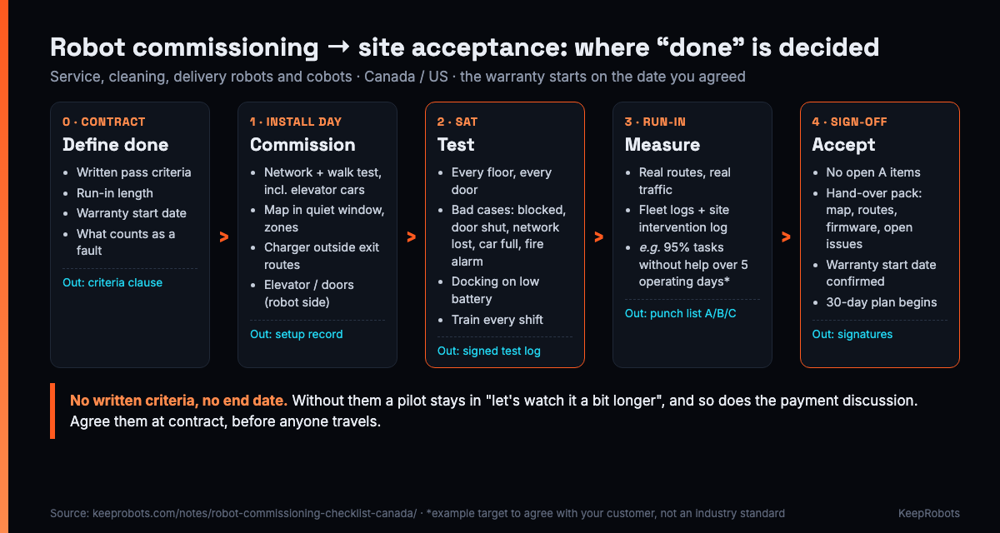

# Robot Commissioning & Site Acceptance Test Template (Canada / US) — KeepRobots

> Maintained by KeepRobots (Vancouver robot field service) — [keeprobots.com](https://keeprobots.com)

A common way a robot pilot stalls: the robot runs every route on commissioning day, everyone shakes hands, the technician leaves. Three months later the pilot is still in "let's watch it a bit longer", the final invoice is unpaid, and nobody can say whether the warranty started at delivery, at go-live, or hasn't started at all. Nothing broke. Nobody wrote down what "done" meant.

This is a fill-in **site acceptance test (SAT) and commissioning sign-off template** for service, cleaning and delivery robots (AMRs) and, with the extra rows marked *arms only*, cobots and robot arms, installed at a site in Canada or the US. It records what was set up, what was tested, against which pass criterion, who saw it pass, what is still open, and the date the customer accepted. Copy it into an issue, a shared doc or a printed binder for the site.

It starts where the [Robot Site Readiness Checklist](site-readiness-checklist.md) (what the building needs **before** shipping) ends. Example pass criteria are illustrations to agree with your customer, not industry standards; caveats and sources are at the end.



---

## How to use this template

1. **At contract:** fill in section 3's "pass criterion" column with the customer and put it in the contract, before anyone travels. Also tick the warranty-start box in section 7. Written criteria are what stop a pilot from drifting, and the payment with it.
2. **Go/no-go call, about 3 business days before the visit:** confirm the site readiness items are done. Move the date if the network approval, the elevator interface (multi-floor routes), the charging spot or the mapping window is not ready. Rescheduling costs a phone call; a failed commissioning day costs a call-out and a day of labour.
3. **Commissioning visit:** complete sections 1 and 2 as you go. Run the bad-case tests in section 4 on site, with the site's safety lead present.
4. **Run-in period:** measure the section 3 criteria over the agreed number of operating days from fleet logs plus the site's own log of staff interventions. Anything that fails goes on the punch list (section 6).
5. **Sign-off meeting:** walk sections 3 to 6 with the robot maker, the site and the field service provider. Sign section 7 when no blocking item is open. Hand over the pack in section 5.

Roles used below: **OEM** = robot maker or its distributor; **Site** = building owner, tenant, facility manager, IT; **FS** = field service provider doing the on-site work; **EC** = the building's licensed elevator contractor.

---

## 1. Header

```markdown
# Commissioning & SAT record: [site name], [city, province/state]
Robot model: [ ]          Units / serials: [ ]
Firmware version: [ ]     Map version: [ ]     Charger model + cert mark: [ ]
Contract / PO ref: [ ]    Acceptance criteria ref (clause): [ ]
Commissioning date(s): [ ]    Run-in: [from] to [to] ([n] operating days)
OEM lead: [name, role]    OEM remote engineer: [name, time zone]
Site lead: [name]         Site IT: [name]     Site safety lead: [name]
FS technician(s): [ ]     Elevator contractor (if any): [company, contact]
```

## 2. Commissioning record (install day)

What was set up, and the evidence that it was set up. Tick only when the evidence column is filled.

| ✓ | Item | Done when | Evidence | By |
|---|---|---|---|---|
| [ ] | Network joined | Robot connects on the network the site's IT approved in writing (dedicated SSID/VLAN, enterprise login or LTE), not a guest captive portal | IT approval ref; SSID/VLAN noted | FS + Site IT |
| [ ] | Coverage along the route | Walk test done on the full route: lobbies, back corridors, elevator lobbies, **inside elevator cars** | Survey file / screenshots | FS |
| [ ] | Remote access | OEM engineers can reach the robot by the method IT accepted; no inbound access opened unless IT agreed | Method noted | OEM + Site IT |
| [ ] | Map built | Mapped in the agreed quiet window, furniture in normal place, no people or carts mapped as walls | Map file + version | FS |
| [ ] | Zones | Virtual walls, robot-free zones (e.g. kitchens, stairs and escalator landings, loading docks) and slow zones (lobbies, corners, children's areas) set as agreed with the site | Zone list | FS + Site |
| [ ] | Routes and tasks | Every contracted route and task created and run once | Route list | FS |
| [ ] | Charging spot | Charger not in an exit route or in front of a fire door, away from wet floors, visible to staff | Photo | FS + Site |
| [ ] | Charger circuit | Charger + dock + anything else on the circuit added up from nameplates. Canada: continuous load on a breaker not marked for 100% operation generally ≤ 80% of its rating (12 A on a 15 A circuit). New outlet = licensed electrician | Load note | FS + Site |
| [ ] | Charger certification mark | Canadian-accepted mark (CSA, cUL, cETL or similar) in Canada; UL-only is a common surprise | Photo of label | FS |
| [ ] | Water station *(cleaning robots with auto water station)* | Water supply and drain connected (site's plumber if needed) | Photo | Site |
| [ ] | Elevator link | Robot side configured on the agreed path (elevator maker's API, OEM IoT box installed by the EC, or dry contact wired by the EC). Nobody but the EC opens the controller | Interface type; EC work order ref | FS + EC |
| [ ] | Doors and gates | Each door on each route has its decision working: robot opens it, a person opens it, or the route avoids it | Door list | FS + Site |
| [ ] | Signage | Signs posted where robots operate and at the charging spot | Photos | Site |
| [ ] | Safety walk-through | Route walked with the site's safety lead; stop-button locations and "robot blocks a route" procedure agreed | Notes | FS + Site |
| [ ] | *Arms only:* safeguarding | Safeguarding reviewed against CSA Z434 with the site; in BC the employer's safeguarding is regulated by WorkSafeBC | Risk assessment ref | Integrator/OEM + Site |
| [ ] | *Warehouse/plant AMRs:* risk assessment | Site requirements and risk assessment per ANSI/A3 R15.08-2 on file; configured safety fields and speed per zone checked on site against it | Ref + config export | Integrator/OEM + Site |

## 3. Site acceptance tests: performance criteria

Agree the "pass criterion" column at contract. The examples in *italics* are illustrations, not benchmarks.

| ✓ | Test | Pass criterion (agreed) | Measured how | Result | Pass / Fail | Initials (OEM / Site) |
|---|---|---|---|---|---|---|
| [ ] | Task success | [ ] *e.g. 95% of tasks completed without staff help over 5 operating days* | Fleet logs + site log of interventions. Agree up front: do site-caused stops (pallet in the aisle, door propped, network outage) count, and do run-in days pause during site outages? Excluded events: [ ] | [ ] % over [ ] days | [ ] | [ ] / [ ] |
| [ ] | Elevator rides | [ ] *e.g. every floor tested; 20 consecutive rides without a failed call or exit* | Test log signed by site and elevator contractor | [ ] rides, [ ] failures | [ ] | [ ] / [ ] |
| [ ] | Docking | Returns and charges on its own at end of shift **and** on low battery | Observed + logs | [ ] | [ ] | [ ] / [ ] |
| [ ] | Doors | Every door on every route passed in the decided way | Door list ticked | [ ] / [ ] doors | [ ] | [ ] / [ ] |
| [ ] | Real traffic | Real routes and duty cycles at real traffic, incl. the narrowest point at peak hours | Observed + logs | [ ] | [ ] | [ ] / [ ] |
| [ ] | Every shift | Robot used on every shift it is contracted for (not only the day shift) | Logs by shift | [ ] | [ ] | [ ] / [ ] |
| [ ] | *Cleaning robots* | [ ] coverage / result agreed with the site | [ ] | [ ] | [ ] | [ ] / [ ] |
| [ ] | *Arms only* | [ ] cycle / task criterion agreed with the site | [ ] | [ ] | [ ] | [ ] / [ ] |

## 4. Site acceptance tests: bad cases

The robot will meet every one of these in its first months. Define the expected behaviour **before** the test, then watch it happen.

| ✓ | Case | Expected behaviour (agreed) | How tested (live / simulated / EC-witnessed) | Observed | Pass / Fail | Witness |
|---|---|---|---|---|---|---|
| [ ] | Route blocked (person, cart, chairs pushed back) | [ ] | [ ] | [ ] | [ ] | [ ] |
| [ ] | Door on route closed | [ ] | [ ] | [ ] | [ ] | [ ] |
| [ ] | Network lost on the route | [ ] | [ ] | [ ] | [ ] | [ ] |
| [ ] | Network lost **during an elevator ride** (most robots need to finish the trip on their own) | [ ] | [ ] | [ ] | [ ] | [ ] |
| [ ] | Elevator car full | [ ] | [ ] | [ ] | [ ] | [ ] |
| [ ] | Elevator door held | [ ] | [ ] | [ ] | [ ] | [ ] |
| [ ] | Elevator out of service / in independent or inspection service | [ ] | [ ] | [ ] | [ ] | [ ] |
| [ ] | Fire alarm / fire recall: fire doors on hold-open magnets close; robot must not block them | [ ] | [ ] | [ ] | [ ] | [ ] |
| [ ] | Power loss in the elevator car | [ ] | [ ] | [ ] | [ ] | [ ] |
| [ ] | Low battery mid-task | [ ] | [ ] | [ ] | [ ] | [ ] |
| [ ] | Failed docking: staff can see it and know what to do | [ ] | [ ] | [ ] | [ ] | [ ] |
| [ ] | Emergency stop pressed, then restart | [ ] | [ ] | [ ] | [ ] | [ ] |

Fire alarm, fire recall, power loss in the car and independent/inspection service are tested only as the building and the elevator contractor allow; the "How tested" column records which way each was done.

## 5. Training and hand-over pack

**Training record:** one row per session. Train every shift and the people who actually use the robot (front desk, servers, janitorial crew, security, maintenance). Ask the site manager for names per shift before the visit.

| Shift | Date | Trainees (names) | Covered | Sign-in sheet |
|---|---|---|---|---|
| Day | [ ] | [ ] | [ ] start/stop [ ] send a task [ ] e-stop [ ] robot stuck [ ] recharge [ ] common error codes [ ] who to call | [ ] |
| Evening | [ ] | [ ] | [ ] same list | [ ] |
| Night | [ ] | [ ] | [ ] same list | [ ] |

- [ ] One-page quick card left at the charging spot (and a short video if the OEM has one)
- [ ] BC sites: sign-in sheet given to the site to keep. WorkSafeBC OHS Regulation sections 3.23–3.25 require employers to give young and new workers workplace-specific orientation and training and keep records of it
- [ ] Quebec sites: training documents, quick cards and on-screen language available in French (Charter of the French language, per OQLF; confirm details with Quebec counsel)

**Hand-over pack:**

- [ ] Map export and map version
- [ ] Route list, zone list
- [ ] Network settings (no passwords in this document; store them where IT says)
- [ ] Firmware version, frozen for the pilot, with a rollback plan
- [ ] Maps and settings backed up (where: [ ])
- [ ] Open-issues list with dates (section 6)
- [ ] Spare parts worth keeping on site: [ ]
- [ ] Who handles service from here: name, contact, hours, how to raise a ticket

## 6. Punch list

Every failed test or open item gets a row. Agree the category in the sign-off meeting.

**A** = blocks acceptance · **B** = accept now, fix by the due date · **C** = note only

| # | Found in (section / test) | Issue | Cat. | Owner (OEM / Site / FS / EC) | Due | Closed (date, initials) |
|---|---|---|---|---|---|---|
| 1 | [ ] | [ ] | [ ] | [ ] | [ ] | [ ] |
| 2 | [ ] | [ ] | [ ] | [ ] | [ ] | [ ] |
| 3 | [ ] | [ ] | [ ] | [ ] | [ ] | [ ] |

Site-side items (a new outlet, a winter entrance mat that raised a threshold, a door the access-control vendor still has to connect) are owned by the site, not the robot. Name them that way, or they quietly become the robot's fault.

## 7. Acceptance and sign-off

```markdown
## Acceptance
Criteria in section 3 met:            [ ] yes  [ ] yes, with category B items listed in section 6
Open category A items:                [ ] none
Bad cases (section 4) all tested:     [ ] yes
Training on every shift done:         [ ] yes
Hand-over pack delivered:             [ ] yes

Warranty period starts on:   [ ] delivery  [ ] go-live  [ ] this signed acceptance  [ ] other: [ ]
                             Date: [ ]   (as agreed in contract clause [ ])
What counts as a fault after hand-over (vs. site change, misuse, consumables): [ref / summary]
Re-mapping after a layout change is: [ ] included  [ ] billable  ([ ] visits included)

Accepted by (site/customer):   name [ ]  title [ ]  signature [ ]  date [ ]
Robot maker / distributor:     name [ ]  title [ ]  signature [ ]  date [ ]
Field service provider:        name [ ]  title [ ]  signature [ ]  date [ ]
Elevator test log signed by EC (if elevator): [ ] attached
```

## 8. The first 30 days after go-live (sign-off falls inside them)

Put a 30-day post-go-live plan in the contract alongside the criteria. The run-in and the sign-off meeting sit inside it:

- [ ] Daily remote health checks in week 1
- [ ] A scheduled on-site check in week 2 or 3
- [ ] A re-map budget for layout changes (seasonal displays, moved furniture)
- [ ] A weekly report to the customer
- [ ] The acceptance sign-off meeting on the calendar (section 7)
- [ ] Winter sites in Canada: wheel and sensor cleaning added to the routine (salt and slush near entrances)

---

## What commissioning costs, and what a wasted day adds

Example at KeepRobots' published rates in the Greater Vancouver core area: C$100 call-out per visit, C$150 per hour on site, before tax (US: US$150/h, travel quoted per project). Hours are assumptions for illustration, not job records.

| Scenario (assumed) | Visits × hours | Example, CAD before tax |
|---|---|---|
| One robot, one floor, no elevator, site ready | 1 × 6 h | $100 + 6 × $150 = **$1,000** |
| Two robots, multi-floor with elevator, site ready | 2 × 8 h | 2 × $100 + 16 × $150 = **$2,600** |
| Same, but the network was not approved on day 1 (one wasted visit + return) | +1 × 4 h | +$100 + 4 × $150 = **+$700** |

Elevator contractor charges, electrician work, parts and the OEM's remote engineering time are separate. The cheapest commissioning is the one where the site is ready and the pass criteria were agreed before the truck left.

Related templates in this repo: [Robot Site Readiness Checklist](site-readiness-checklist.md) (before shipping), [Robot Fault Report & Dispatch Template](robot-fault-report-template.md) (after hand-over), [US Customer Support Escalation Sheet](us-customer-escalation-sheet.md).

---

## Sources

- KeepRobots, Robot commissioning checklist for Canadian sites (acceptance criteria table, bad cases, training, elevator and power points, cost examples) — https://keeprobots.com/notes/robot-commissioning-checklist-canada/
- KeepRobots, Robot deployment checklist: 30 items (item 1 acceptance criteria, item 28 firmware freeze, item 30 30-day plan) — https://keeprobots.com/notes/robot-deployment-checklist/
- KeepRobots, Robot deployment and commissioning in Canada and the US (go-live and handover steps, rates) — https://keeprobots.com/service/robot-deployment-canada-usa/
- Technical Safety BC, Elevating devices (licensed contractors; CSA B44-16) and approved certification marks for electrical products — https://www.technicalsafetybc.ca/
- WorkSafeBC OHS Regulation Part 3, sections 3.22–3.25 — https://www.worksafebc.com/
- Office québécois de la langue française, obligations of businesses — https://www.oqlf.gouv.qc.ca/
- Canadian Electrical Code, Part I, Rule 8-104 (continuous loading), as summarized in the Electrical Industry guide to Section 8 — https://electricalindustry.ca/
- A3, ANSI/A3 R15.08 industrial mobile robots — https://www.automate.org/ ; CSA Z434 — https://webstore.ansi.org/

Not legal, electrical or elevator-safety advice; the authority having jurisdiction has the final say. Facts checked 2026-10-28 against the pages above. Example criteria, hours and costs are planning assumptions, not measured fleet data or industry benchmarks. KeepRobots rates are as published on 2026-10-28 and may change; taxes, parts, contractor charges and travel outside the core area are extra. Found an error? Open an issue. We check and correct.

## Related pages on keeprobots.com

- [Robot commissioning checklist for Canadian sites](https://keeprobots.com/notes/robot-commissioning-checklist-canada/)
- [Robot deployment and commissioning in Canada and the US](https://keeprobots.com/service/robot-deployment-canada-usa/)
- [Robot repair and after-sales service in Canada](https://keeprobots.com/service/canada/)
- [Robot deployment checklist: 30 items before your first North American site](https://keeprobots.com/notes/robot-deployment-checklist/)

*KeepRobots is a robot field-service company in Vancouver, BC (deployment, commissioning, repair, maintenance). We don't make or sell robots. Licensed CC BY 4.0, like the rest of this repository.*
