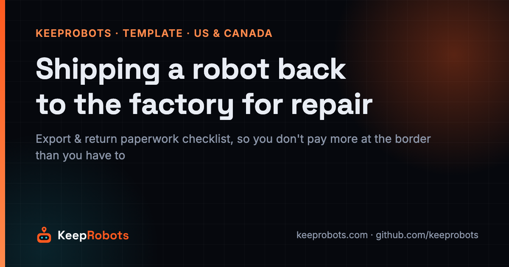
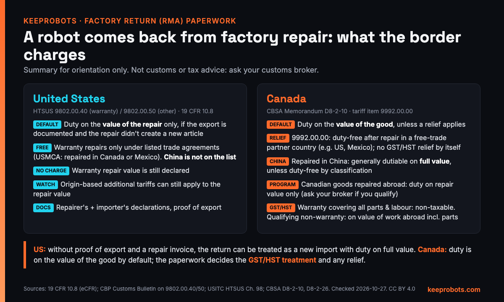

# Shipping a Robot Back to the Factory for Repair: Export & Return Paperwork Checklist for the US and Canada (KeepRobots Template)

> Maintained by KeepRobots (Vancouver robot field service) — [keeprobots.com](https://keeprobots.com)



A robot leaves a US site for factory repair as an ordinary export. Weeks later it comes back fixed, and with no proof of export and no repair invoice it can be treated as a new import, with duty on its full value. Nothing went wrong at the factory. The paperwork that would have proved "this left for repair" was never created.

In the US, that paperwork is what limits duty to the value of the repair. Canada works differently: duty is assessed on the value of the good by default, and the paperwork decides how GST/HST is charged and whether any relief applies.

This page is a fill-in checklist for the after-sales or logistics lead at a robot maker who is about to send a whole robot or a large assembly back to the factory (an RMA). It covers what to document **before** the robot leaves, how the return is treated in the **US** and in **Canada**, what the two local visits cost, and the question to ask first: *does it have to go at all?*

Not legal, customs or tax advice: **ask your customs broker**. Checked 2026-10-27; sources at the end.

---

## 1. First decision: swap on site or send it back?

Returning to the factory means crating, an export entry, international freight, a factory queue, freight back, a North American customs entry, and re-deployment. Downtime is counted in weeks. Air freight is billed on the greater of actual and volumetric weight (commonly L × W × H in cm ÷ 6,000; your forwarder confirms the divisor), and you pay it twice.

| Situation | Usual route | Why |
|---|---|---|
| Fault traced to a field-replaceable module (drive wheel, motor, lidar, sensor, battery, main board), part in North America or days away | **On-site module swap**; failed part goes back under RMA | Short downtime; cost is local labour plus the part |
| Fault can't be found on site, needs factory equipment or rework | **Return to factory** | The fix isn't possible in the field |
| Fault inside a sealed assembly that must not be opened in the field | **Return the assembly**, not the whole robot, if it can be removed | Smaller crate, same paperwork |
| Damaged, swollen or crashed lithium battery pack | **Do not plan an air return** | Forbidden on aircraft (IATA; Canada TDG SP 137); US allows road, rail or vessel only with special packaging (49 CFR 173.185(f)). Agree photos, logs and a local recycling certificate instead |
| Customer can't tolerate downtime | **Swap in a spare unit first**, then repair the faulty one without the clock running | Downtime is the cost nobody invoices |

If the robot is at a Canadian site, check whether the fault can be fixed locally before booking freight: [robot repair and after-sales service in Canada](https://keeprobots.com/service/canada/) by module swap avoids shipping the whole robot across the border twice (the failed module still goes back under your RMA, and the replacement part is still imported).

## 2. US vs Canada: how the return is treated



| | United States (CBP) | Canada (CBSA) |
|---|---|---|
| Rule | HTSUS 9802.00.40 (warranty repairs) / 9802.00.50 (other repairs); 19 CFR 10.8 | Memorandum D8-2-10 |
| Default on return | Duty on the **value of the repair** only, if the export is documented and the repair didn't create a new article | Duty on the **value of the good**, unless a relief applies |
| Repaired in a free-trade partner country | Warranty repairs (9802.00.40) are free only under listed trade agreements (for USMCA: repairs done in Canada or Mexico) | Tariff item 9992.00.00: duty-free re-entry after repair in a free-trade partner country (e.g. US, Mexico); no GST/HST relief by itself |
| Repaired in China | Not on the list: duty on the repair value | Generally dutiable on the full value, unless the goods are duty-free by classification |
| Repair-value-only relief | The default (see above) | CBSA's program for Canadian goods repaired abroad: duty on the repair value only. Ask your broker whether your robot qualifies |
| No-charge warranty repair | The repair value is still declared | Not covered by our sources; ask your broker how to value it |
| Sales tax | Our sources cover duty only; ask your broker | Warranty repair returns: non-taxable for GST/HST when the warranty covers all parts and labour. Qualifying non-warranty repairs: GST/HST on the value of the work done abroad, including added parts |
| Watch out | Additional tariffs that apply to the goods' origin can still apply to the repair value | Which case applies depends on the goods and the paperwork |
| Paperwork | Declarations from the repairer and the importer (19 CFR 10.8) | Proof of export, repair invoice; ask your broker for the exact documents |

## 3. Cost: the two local visits

Somebody has to de-install and pack the robot, and somebody has to re-deploy and test it when it returns. Example at KeepRobots' published rates in the Greater Vancouver core zone (before tax; hours are assumptions):

| Visit | Calculation | Example |
|---|---|---|
| De-install and pack (2 h) | C$100 call-out + 2 × C$150 | C$400 |
| Re-deploy, re-map, test (4 h) | C$100 call-out + 4 × C$150 | C$700 |
| **Total** | 2 × $100 + 6 × $150 | **C$1,100**, before freight and duties |

This assumes the fault was triaged remotely. If an on-site diagnosis comes first and concludes "send it back", no repair is approved locally, so the C$200 diagnostic is charged rather than credited. Worked examples, same assumed hours:

- Diagnose and de-install on the same visit: C$200 + C$1,100 ≈ **C$1,300**.
- Separate diagnostic trip first (C$200 + C$100 call-out = C$300), then the two visits above: ≈ **C$1,400**.

In the US the same structure applies at US$200 diagnostic per robot, per visit (credited if the repair is approved), US$150/h on site, and travel quoted per project.

For comparison, an approved two-hour on-site module swap in the same zone is C$400 plus the part (C$100 + 2 × C$150, with the C$200 diagnostic credited). Both routes start with the same diagnosis; what differs is whether the fix can happen on site. The full breakdown is in [how much robot repair costs in North America](https://keeprobots.com/notes/robot-repair-cost-north-america/).

## 4. The checklist (copy and fill)

```markdown
# Factory return (RMA): [robot model], serial [ ], site [city, state/province]
RMA no. [ ]   Warranty: [yes / no / disputed]   Owner on file: [ ]   Broker: [ ]

## Before export
- [ ] Remote triage done; on-site module swap ruled out (reason: [ ])
- [ ] Spare unit or loaner arranged for the customer? [yes / no]
- [ ] Customs broker consulted on the route (US 9802.00.40 / 9802.00.50; Canada D8-2-10 / 9992.00.00)
- [ ] Importer of record for the return decided: [ ]
- [ ] Commercial invoice states "goods exported for repair", with value and warranty status
- [ ] Serial numbers of robot and major assemblies photographed and listed
- [ ] Battery condition checked; damaged pack removed from the shipment and handled locally
- [ ] Forwarder quote door-to-door, both legs, volumetric weight confirmed

## At export
- [ ] Export declared as goods for repair, not an ordinary export (confirm with your broker/forwarder which export declaration applies)
- [ ] Export record / proof of export filed under the RMA no.
- [ ] Crate photos, dimensions and weights recorded
- [ ] De-install visit report filed (date, hours, condition)

## At factory
- [ ] Repair invoice lists the work, parts added and their value, even if no charge
- [ ] Repairer's declaration prepared (needed for US entry under 19 CFR 10.8)
- [ ] Repair stays a repair: no change that turns it into a new article
- [ ] Return shipment references the original export and RMA no.

## Return import: United States
- [ ] Broker files under 9802.00.40 (warranty) or 9802.00.50 (other)
- [ ] Importer's declaration + repairer's declaration + export record supplied
- [ ] Origin-based additional tariffs on the repair value checked with broker

## Return import: Canada
- [ ] Broker confirms relief route (9992.00.00 if repaired in a free-trade partner country; otherwise check)
- [ ] Warranty status documented for GST/HST (warranty covering all parts and labour vs non-warranty)
- [ ] Value of work and added parts stated on the invoice

## Back on site
- [ ] Re-deploy visit booked; site access confirmed
- [ ] Re-mapping, functional test and customer sign-off done
- [ ] Repair report (root cause, parts, firmware) filed with the RMA
- [ ] Duties and taxes paid recorded against the RMA for the next decision
```

For who pays each leg (freight, duties, visits) under a warranty, see [robot warranty and RMA in North America](https://keeprobots.com/notes/robot-warranty-rma-north-america/). Related templates in this repo: the [Robot Fault Report & Dispatch Template](robot-fault-report-template.md), the [Robot Site Readiness Checklist](site-readiness-checklist.md) and the [US Customer Support Escalation Sheet](us-customer-escalation-sheet.md).

---

## Sources

- US eCFR, 19 CFR 10.8, articles exported for repairs or alterations — https://www.ecfr.gov/current/title-19/chapter-I/part-10/section-10.8
- US CBP, HTSUS 9802.00.40 / 9802.00.50 repairs and alterations (Customs Bulletin notice) — https://www.cbp.gov/bulletins/43genno14.pdf
- USITC, HTSUS Chapter 98 — https://hts.usitc.gov/reststop/file?release=currentRelease&filename=Chapter%2098
- CBSA Memorandum D8-2-10, Goods Returning to Canada After Being Repaired Outside Canada — https://www.cbsa-asfc.gc.ca/publications/dm-md/d8/d8-2-10-eng.html
- CBSA Memorandum D8-2-26 (goods repaired in free trade partner countries) — https://www.cbsa-asfc.gc.ca/publications/dm-md/d8/d8-2-26-eng.html
- IATA Lithium Battery Guidance Document — https://www.iata.org/contentassets/05e6d8742b0047259bf3a700bc9d42b9/lithium-battery-guidance-document.pdf
- 49 CFR 173.185 — https://www.law.cornell.edu/cfr/text/49/173.185
- Transport Canada, transporting batteries — https://tc.canada.ca/en/dangerous-goods/safety-awareness-materials-faq/industry/transporting-batteries
- KeepRobots rates (Canada, updated 2026-10-20) — https://keeprobots.com/service/canada/

Example costs use KeepRobots' published rates as of 2026-10-27, before tax and parts; hours are assumptions, not records from a job. Found an error? Open an issue. We check and correct.

## Related pages on keeprobots.com

- [How much does robot repair cost in North America?](https://keeprobots.com/notes/robot-repair-cost-north-america/)
- [Robot warranty and RMA in North America: who pays for what](https://keeprobots.com/notes/robot-warranty-rma-north-america/)
- [Robot repair and after-sales service in Canada](https://keeprobots.com/service/canada/)
- [Robot service companies in Canada: comparison](https://keeprobots.com/guides/robot-service-companies-canada/)

*KeepRobots is a robot field-service company in Vancouver, BC (deployment, commissioning, repair, maintenance). We don't make or sell robots. Licensed CC BY 4.0, like the rest of this repository.*
