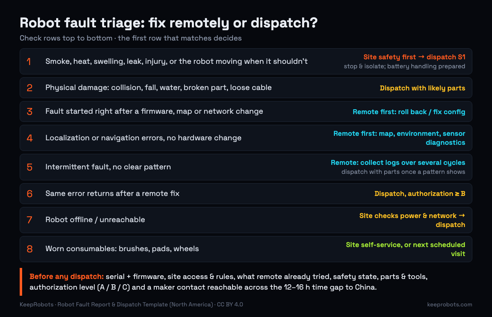

# Robot Fault Report & Dispatch Template (North America)

> Maintained by KeepRobots (Vancouver robot field service) — [keeprobots.com](https://keeprobots.com)

A composite scenario: Friday, 7:40 p.m. in Vancouver. A delivery robot has stopped on the third floor of a hotel, and the ticket says *"Robot not working, please check."* The technician drives 40 minutes and finds a security desk that won't issue a badge without a contractor form. Upstairs, the robot shows a lidar error that remote support had already seen at 2 p.m. The replacement sensor is in a warehouse in Shenzhen, where it is now 10:40 a.m. on Saturday. Nobody has said whether the technician may open the sensor housing. That visit was paid for and fixed nothing.

This is a copy-paste **robot fault report and dispatch template**. A robot maker's remote support team, or a fleet operator, sends it to the field technician **before** anyone drives to the site. It is written for mobile robots (cleaning, delivery, AMR, humanoid, quadruped) and arms in Canada and the US. Put it in your ticketing system, an issue, or an email.

For the work done before the robot ships, see the [Robot Site Readiness Checklist](site-readiness-checklist.md). Not legal or safety-engineering advice: the site's own safety program and the maker's procedures come first. Sources were checked on 2026-10-23 and are listed at the end.

---

## Why the first visit depends on the ticket

A technician can only bring what the ticket asks for. When a first visit ends with "I'll come back", the cause is usually one of five things the ticket left out:

| What went wrong on site | The ticket field that would have prevented it |
|---|---|
| Couldn't get in: badge, escort, loading-dock hours, induction video | **Site & access** |
| Diagnosed in 10 minutes, but the part is in another country | **Parts likely needed + where they are** |
| Knew the fix but wasn't allowed to do it, and the maker's engineer was asleep | **Authorization level + maker contact window** |
| Started from zero because remote support didn't say what it had tried | **What remote support already tried** |
| Robot was hot, swollen or still powered, and nobody had said so | **Safety state** |

On hourly field service, each extra visit repeats the call-out, the travel and the diagnostic time. It also costs the customer another day without the robot. The template below is built around those five gaps.

---

## The ticket template (copy-paste)

Fields marked **(required)** should block dispatch if they are empty. Write every time with its UTC offset (for example 18:00 UTC-7), not as "Pacific time". If remote support can fix the fault, close the ticket before dispatch. That is the cheapest outcome.

```markdown
## Robot fault report / dispatch request

**Ticket ID:**                       **Severity (S1–S4):**
**Opened (local time + UTC):**       **Requested on-site window:**

### 1. Robot (required)
- Maker / model:
- Serial number:                     - Robot name on site:
- Firmware / software version:       - Map / config version:
- Charger / dock model + serial:
- Under warranty or service contract? (Y/N, contract #)

### 2. Site & access (required)
- Site name + full street address:
- Exact location of robot now (floor, room, gridline):
- Site contact on the day (name, role, mobile):
- Access: badge / sign-in / contractor form / induction video / escort needed?
- Hours the technician may work there; quiet hours; noise limits
- Parking / loading dock / freight elevator (booking needed? key?)
- PPE required on site (safety boots, hi-vis, glasses, hard hat, other):
- Site safety rules to follow: site lockout procedure, hot-work or permit rules,
  working-alone check-in, restricted zones:
- Wi-Fi / network access for the technician's laptop (or none):

### 3. Symptom (required)
- What the robot does / doesn't do (one paragraph, plain words):
- Error codes shown (exact text or screenshot):
- First seen (local time + UTC):          - Frequency: constant / intermittent / once
- What changed recently: firmware update, new route, furniture moved, floor
  waxed, Wi-Fi change, collision, water, drop:

### 4. What remote support already tried (required)
- Steps taken, in order, with result of each:
- Logs already reviewed, and what they showed:
- Remote hypothesis (most likely cause → second most likely):

### 5. Log bundle (attach or link)
- [ ] System + error logs covering the time from shortly before the first fault to now
- [ ] Version manifest (firmware, software, map, config)
- [ ] Current map + any recent map edits
- [ ] Sensor snapshots / diagnostics export (lidar, depth, IMU, motor currents)
- [ ] Camera clips: only the frames needed, people blurred or excluded where possible
      (see privacy note)
- [ ] Photos / short video of the robot and the spot where it failed (site staff)

### 6. Safety state (required)
- Robot now: moving / stopped / e-stopped / powered off / battery disconnected
- Any of: swelling, heat, smoke, hissing, odour, leak, cracked case,
  recent impact, fall or water? (Y/N + detail)
- If yes: robot isolated? Who on site knows? Moved to where?
- Maker's energy-isolation steps for this model attached? (Y/N)

### 7. Parts, tools & handling
- Part numbers + qty (most likely / backup):
- Where they are: technician's van / local consignment stock (address) /
  in transit (tracking #, ETA) / not yet ordered
- Return of faulty part: RMA #, return address, battery shipping rules
- Service-mode access (password, dongle, key): how it will be provided
  (never put credentials in the ticket)
- Diagnostic software + licence the technician needs (version, who installs):
- Special tools / jigs / calibration targets (where they are):
- Remote access / VPN for the maker's engineer during the visit: tested and up? (Y/N)
- Robot weight; two-person lift or lifting gear needed? (Y/N, what)

### 8. Authorization (required)
- Level granted: A / B / C (see definitions)
- Max on-site time before calling back for approval (hours):
- Who approves anything beyond this level (name, phone/WeChat, hours in
  site local time + UTC offset, e.g. 17:00–20:00 UTC-7):

### 9. Maker contact & time window (required)
- Remote engineer (name, language, phone / WeChat / Teams / Lark):
- Available (their local time + site local time, both with UTC offset,
  e.g. 08:00–11:00 UTC+8 = 17:00–20:00 UTC-7):
- Backup contact if no answer in 15 min:

### 10. Acceptance & close-out
- Fix is accepted when: (e.g. 3 consecutive full route runs without error;
  docking ×3; error code cleared and not repeated during the visit)
- Who signs off on site:
- Report format the technician returns: (see below)
```

The same ticket as YAML, for ticketing systems, APIs or forms (click to expand):

<details>
<summary>YAML version of the ticket</summary>

```yaml
# The Markdown template above is authoritative. Sections marked "# required"
# match its (required) sections and should block dispatch if empty.
ticket:
  id: ""
  severity: S2              # S1 | S2 | S3 | S4
  opened_local: ""          # 2026-10-23T19:40-07:00
  opened_utc: ""
robot:                      # required
  maker: ""
  model: ""
  serial: ""
  firmware: ""
  map_config_version: ""
  charger_serial: ""
  contract: { warranty: false, contract_id: "" }
site:                       # required
  name: ""
  address: ""               # full street address
  robot_location: ""        # floor / room / gridline
  contact: { name: "", role: "", mobile: "" }
  access:
    badge_or_signin: ""
    contractor_form_or_induction: ""
    escort_required: false
    work_hours: ""          # when the technician may be on site
    elevator_or_dock: ""
  ppe: []                   # [safety_boots, hi_vis, glasses, hard_hat]
  safety_rules: ""          # site lockout procedure, permits, working-alone check-in
  network_for_technician: ""
symptom:                    # required
  description: ""
  error_codes: []
  first_seen_utc: ""
  frequency: intermittent   # constant | intermittent | once
  recent_changes: ""
remote_tried:               # required
  - { step: "", result: "" }
remote_hypothesis: []
logs:
  system_logs: false
  version_manifest: false
  map: false
  sensor_diagnostics: false
  camera_clips: { attached: false, people_blurred: false }
  site_photos: false
safety_state:               # required
  robot_state: stopped      # moving | stopped | e_stopped | powered_off | battery_disconnected
  battery_warning_signs: false   # swelling, heat, smoke, hissing, odour, leak, damage
  battery_detail: ""
  isolation_procedure_attached: false
parts_tools_handling:
  parts:
    - { pn: "", qty: 1, location: consignment, where: "", tracking: "" }   # van | consignment | in_transit | not_ordered
  rma: { number: "", return_address: "" }
  service_mode_access_method: ""   # how it is provided; never the credential itself
  diagnostic_software: { name: "", version: "", licence: "" }
  special_tools: []
  remote_access_tested: false
  robot_weight_kg: null
  two_person_or_lifting_gear: false
authorization:              # required
  level: A                  # A | B | C
  max_onsite_hours: 2
  approver: { name: "", contact: "", hours_site_local: "" }   # e.g. "17:00-20:00 UTC-7"
maker_contact:              # required
  engineer: ""
  channel: ""               # phone | WeChat | Teams | Lark
  window_site_local: ""     # e.g. "17:00-20:00 UTC-7" (= 08:00-11:00 UTC+8 next day)
  backup: ""
acceptance:
  criteria: ""
  signoff_name: ""
```

</details>

---

## Field notes: what each section is for

### 1. Robot identity

Serial and firmware version decide which parts fit, which known issues apply and which logs to read. Add the charger serial: docking faults are often the dock, not the robot.

### 2. Site access and site rules

Ask the site for its contractor rules once, then copy them into every ticket for that site.

- **Lockout procedures go both ways.** In the US, when outside servicing personnel do work covered by OSHA's lockout standard, the on-site employer and the outside employer must inform each other of their lockout/tagout procedures (29 CFR 1910.147(f)(2)). In BC, WorkSafeBC's OHS Regulation Part 10 requires equipment shut down for maintenance to be locked out before work starts, using procedures available to the workers doing it (s. 10.3, 10.4).
- **Working alone.** A technician alone in a hotel basement at night is likely to be "working alone or in isolation" under WorkSafeBC's definition (s. 4.20.1). The employer needs a written check-in procedure with set intervals between checks and a final check at the end of the shift (s. 4.21). Put the site contact's mobile number in the ticket so the check-in can work.
- **PPE and permits** vary by site: warehouses usually want safety boots and hi-vis; some sites need a hot-work or confined-space permit. Write it down so the technician arrives with the right gear.

### 3–4. Symptom and what remote support already tried

Use the exact error text, the time in both local time and UTC (logs are often in UTC), and **what changed recently**. "Floor was waxed yesterday" or "Wi-Fi access points replaced" saves an hour. Then list each remote step and its result. A technician who knows that a reboot, sensor cleaning and a map reload were already tried starts at the next step, not the first one.

### 5. Log bundle, and camera footage

Ask for logs that start shortly before the first fault, plus the version manifest. Logs without versions are hard to read.

**Camera footage that shows people is personal information.** In practice:

- send only the frames needed for diagnosis, with people blurred or cropped where you can;
- share through an access-controlled link, not open group chats;
- record who received the clips and delete them when the ticket closes;
- in the US, check state law, and never turn on face recognition to debug.

Why: Canadian privacy commissioners' video-surveillance guidance says recordings fall under PIPEDA and the Alberta and BC PIPAs, and should be kept secure, disclosed only when justified and documented, and destroyed when no longer needed. The federal commissioner's cross-border guidance adds that an organization stays accountable for personal information it sends to a third party for processing, including abroad.

### 6. Safety state: lockout, e-stop, battery

- **An e-stop is not lockout.** OSHA's definition says push buttons, selector switches and other control-circuit devices are not energy-isolating devices (29 CFR 1910.147(b)). WorkSafeBC defines an energy-isolating device as one that "physically prevents the transmission or release of an energy source" (s. 10.1). Attach the maker's model-specific isolation steps (battery disconnect, main breaker, brake release, where stored energy remains).
- **Unplugging the charger doesn't isolate the robot.** Both rules relax lockout for cord-and-plug equipment when the plug is disconnected and kept under the worker's control (1910.147(a)(2)(iii)(A); WorkSafeBC s. 10.11(b)). A battery-powered robot carries its own energy source, and OSHA requires stored energy to be "relieved, disconnected, restrained, and otherwise rendered safe" after isolation (1910.147(d)(5)). Treat the battery as the energy source.
- **Damaged lithium batteries change the visit.** If the ticket reports swelling, heat, smoke, hissing, odour, leakage, or a hard impact, fall or water exposure, the robot should not be charged or powered on. The site follows its own emergency procedures, and the technician should come prepared for battery handling, not repair. Moving that battery is regulated:
  - **US:** damaged or defective lithium batteries that could produce dangerous heat, fire or a short circuit may travel by highway, rail or vessel only, not by air. Each battery goes in its own non-metallic inner packaging, cushioned with non-combustible, electrically non-conductive, absorbent material, inside Packing Group I-level outer packaging marked "Damaged/defective lithium ion battery" in letters at least 12 mm high (49 CFR 173.185(f)). Lithium-ion batteries are Class 9: UN3480 on their own, UN3481 when contained in or packed with equipment (49 CFR 172.101). A whole robot may be classified differently, for example as a battery-powered vehicle, so let the carrier confirm the entry.
  - **Canada:** under the Transportation of Dangerous Goods Regulations, special provision 137 covers damaged or defective lithium batteries, including ones that "have leaked or vented" or have physical damage and "cannot be diagnosed prior to transport". The outer packaging must be marked "Damaged/Defective" or "endommagées/défectueuses". Batteries liable to react dangerously in normal transport are forbidden from transport (SP 137(5)).
  - Either way: don't put a suspect battery in a courier box or a car trunk. Book a carrier trained for dangerous goods, and put the shipping instructions on the RMA.

### 7. Parts, tools and handling

"Part ordered" is not enough. The ticket should say whether the part is in the technician's van, in local consignment stock (with the address and who has the key), or in transit with a tracking number. Cross-border shipments add customs time, so local consignment stock of wear parts and the modules that fail most often is what makes a first-visit fix possible.

Tools are the other half. Many robots need a service-mode password or dongle, the maker's diagnostic software with a valid licence, or a calibration jig. The ticket should say how each will reach the technician; credentials go through a separate secure channel, never in the ticket. Check that the maker's remote access or VPN works before the visit, and give the robot's weight: a humanoid or a large cleaning robot may need two people or lifting gear. For US sites, confirm the replacement part is identical to the one in the FCC-authorized model: the FCC's robot Covered List FAQ says repair and replacement with identical parts are not prohibited for previously authorized devices.

### 8. Authorization levels

Agree these once in the service contract, then just tick the level in each ticket.

| Level | Technician may do | Typical example |
|---|---|---|
| **A: Inspect & restore** | Inspect, collect logs, clean sensors, reboot, reseat connectors, run the maker's built-in diagnostics and calibration, replace consumables (brushes, pads, wheels or tyres if user-replaceable) | Robot stops near glass; lidar window dirty |
| **B: Swap modules** | Everything in A, plus replace field-replaceable units under the maker's procedure, flash a maker-supplied firmware image, change parameters under live remote guidance | Drive motor or lidar module swap |
| **C: Engineering-level** | Everything in B, plus open sealed or battery enclosures, board-level work, or change safety settings (speed limits, safety fields, stop zones), only with written approval from the maker for that ticket | Battery pack or safety-controller work |

A change to safety settings is a change to the application. ANSI/A3 R15.08-3-2026 puts risk assessment, and re-assessment after changes, on the user of an industrial mobile robot application (see the site readiness checklist's sources). Level C close-out should include who re-checked the risk assessment.

### 9. Maker contact and time window

China is UTC+8 year-round. Vancouver and most of BC moved to permanent UTC-7 in 2026, so **Vancouver is 15 hours behind Shenzhen all year**. Some communities in eastern BC, such as the East Kootenay, keep Mountain Time and differ. US Pacific sites (Seattle, Portland, California) are on PDT (UTC-7, also 15 hours behind) until **2 a.m. on Sunday 1 November 2026**, then PST (UTC-8, 16 hours behind) until DST resumes on the second Sunday of March. From 1 November, Seattle is one hour behind Vancouver. Devices and ticketing systems with time-zone data older than IANA 2026b will show Vancouver as UTC-8 after 1 November, so write UTC offsets explicitly.

| Site | Overlap with a Shenzhen workday (08:00–12:00 next day there) | Example |
|---|---|---|
| Vancouver / most of BC (UTC-7 all year) | 17:00–21:00 | 18:00 Tue Vancouver = 09:00 Wed Shenzhen |
| US Pacific, until 1 Nov 2026 (PDT) | 17:00–21:00 | Same as Vancouver |
| US Pacific, from 1 Nov 2026 (PST) | 16:00–20:00 | 17:00 Mon Seattle = 09:00 Tue Shenzhen |
| US Eastern, until 1 Nov 2026 (EDT, UTC-4) | 20:00–24:00 | 20:00 Mon New York = 08:00 Tue Shenzhen |
| US Eastern, from 1 Nov 2026 (EST, UTC-5) | 19:00–23:00 | 19:00 Mon New York = 08:00 Tue Shenzhen |

So a technician on site during the North American day reaches the maker's engineers at their night. Either the maker names an on-call engineer and their hours in the ticket, or the authorization level must be high enough to finish without a call. Friday afternoon in Vancouver is Saturday morning in China, so set weekend cover before Friday's visit.

### 10. Acceptance, close-out and the report the technician returns

Write measurable acceptance criteria before the visit, for example "three consecutive full route runs without the error; docks three times out of three". "Seems OK" is not a criterion. The technician returns:

```markdown
## Field service report
- Ticket ID / robot serial / firmware before → after:
- On site: arrival, departure (local time); labour hours; travel
- Found: root cause (or best hypothesis + evidence)
- Done: steps, in order; parameters changed (old → new)
- Parts: used (PN, serial of new and removed part); removed part status (RMA #, where it is now)
- Safety: isolation used; battery condition; any safety settings changed + who approved
- Test: acceptance criteria and results (runs, docking, error recurrence)
- Photos: before / after; label of any part replaced
- Open items: follow-up needed, parts to restock, recommended firmware/map change
- Signed off by (site): name, time
```

---

## Triage: fix remotely or dispatch?



Check the rows from top to bottom. The first row that matches decides.

| Condition | Decision |
|---|---|
| Smoke, heat, swelling, leak, injury, or the robot moving when it shouldn't | **Site safety first** (stop and isolate; site emergency procedures), then dispatch as S1 with battery handling prepared |
| Physical damage: collision, fall, water, broken part, loose cable | **Dispatch** with likely parts; remote can't fix hardware |
| Fault started right after a firmware, map or network change | **Remote first:** roll back or fix config; dispatch only if remote access is down |
| Localization or navigation errors with no hardware change | **Remote first:** check map, environment changes, sensor diagnostics; ask site for photos |
| Intermittent fault with no clear pattern | **Remote:** collect logs over several cycles; schedule dispatch with parts once a pattern shows |
| Same error comes back after a remote fix | **Dispatch,** with authorization at least B |
| Robot unreachable (offline) | Ask site to check power and network first; **dispatch** if still offline |
| Consumables worn (brushes, pads, wheels) | **Site self-service** if trained; otherwise add to the next scheduled visit |

## Severity levels (suggested targets, examples only)

These response targets are **examples to start a contract discussion, not promises**. Real targets depend on the contract, travel distance, parts location and border crossings. For a public benchmark, Tennant's Gold service plan with Brain Corp offers next-business-day on-site service in the US and Canada, for service requested before 1 p.m. Central.

| Level | Definition | Example remote response | Example on-site target |
|---|---|---|---|
| **S1: Safety** | Possible injury, fire, battery damage, uncontrolled motion | Call back within 15 min; site isolates immediately | Same day or next morning, within local service area |
| **S2: Down** | Robot out of service; the customer's operation is affected | Within 1 business hour | Next business day |
| **S3: Degraded** | Works with errors, slower, or needs frequent help | Within 1 business day | Next scheduled or planned visit, within a week |
| **S4: Minor** | Cosmetic, a feature request, or a question | Within 2 business days | Next preventive-maintenance visit |

Define "business hour" by the site's time zone, and write down who owns the clock when the maker and the technician are 12–16 hours apart (15 for Vancouver).

---

## Sources

- OSHA, 29 CFR 1910.147, The control of hazardous energy (lockout/tagout): scope (a)(1)(i), cord-and-plug exception (a)(2)(iii)(A), energy-isolating device definition (b), stored energy (d)(5), outside personnel (f)(2) — https://www.ecfr.gov/current/title-29/subtitle-B/chapter-XVII/part-1910/subpart-J/section-1910.147
- WorkSafeBC, OHS Regulation Part 10, De-energization and Lockout (s. 10.1, 10.3, 10.4, 10.11) — https://www.worksafebc.com/en/law-policy/occupational-health-safety/searchable-ohs-regulation/ohs-regulation/part-10-de-energization-and-lockout
- WorkSafeBC, OHS Regulation Part 4, Working alone or in isolation (s. 4.20.1, 4.21) — https://www.worksafebc.com/en/law-policy/occupational-health-safety/searchable-ohs-regulation/ohs-regulation/part-04-general-conditions
- 49 CFR 173.185(f), damaged, defective or recalled lithium cells and batteries — https://www.ecfr.gov/current/title-49/subtitle-B/chapter-I/subchapter-C/part-173/subpart-E/section-173.185
- 49 CFR 172.101, Hazardous Materials Table (UN3480, UN3481, Class 9) — https://www.ecfr.gov/current/title-49/subtitle-B/chapter-I/subchapter-C/part-172/subpart-B/section-172.101
- Transportation of Dangerous Goods Regulations (SOR/2001-286), Schedule 2, special provision 137 — https://laws-lois.justice.gc.ca/eng/regulations/SOR-2001-286/FullText.html
- OPC / Alberta / BC OIPC, Guidelines for Overt Video Surveillance in the Private Sector (2008) — https://www.oipc.bc.ca/guidance-documents/1453
- OPC, Guidelines for processing personal data across borders (2009) — https://www.priv.gc.ca/en/privacy-topics/airports-and-borders/gl_dab_090127/
- FCC, Covered List FAQs: robots and inverters (repair of authorized devices) — https://www.fcc.gov/covered-list-faqs-robots-inverters
- IANA Time Zone Database 2026b (America/Vancouver permanent UTC-7) — https://www.iana.org/time-zones/releases/2026b
- 15 U.S.C. 260a (US daylight saving time ends first Sunday of November) — https://www.law.cornell.edu/uscode/text/15/260a
- ANSI/A3 R15.08-3-2026, Use of IMR applications (A3 store) — https://www.automate.org/store/products/ansi-a3-r15-08-3-2026-american-national-standard-for-industrial-mobile-robots-safety-requirements-part-3-use-of-imr-applications-pdf-download
- Brain Corp, Brain Corp and Tennant elevating robot service standards in US and Canada (2025-06-24) — https://www.braincorp.com/resources/brain-corp-and-tennant-elevating-robot-service-standards-in-us-and-canada

Found an error? Open an issue. We check and correct.

## Related pages on keeprobots.com

- [Robot repair, field service and after-sales in the USA](https://keeprobots.com/service/usa/)
- [Robot field service companies in North America (2026 comparison)](https://keeprobots.com/guides/robot-field-service-companies-north-america/)
- [Robot repair and field service in Canada: coverage, process, pricing](https://keeprobots.com/service/canada/)
- [Field-service partner for robot makers entering North America](https://keeprobots.com/partners/north-america/)

*KeepRobots is a robot field-service company in Vancouver, BC (deployment, commissioning, repair, maintenance). We don't make, sell, test or certify robots. Licensed CC BY 4.0, like the rest of this repository.*
