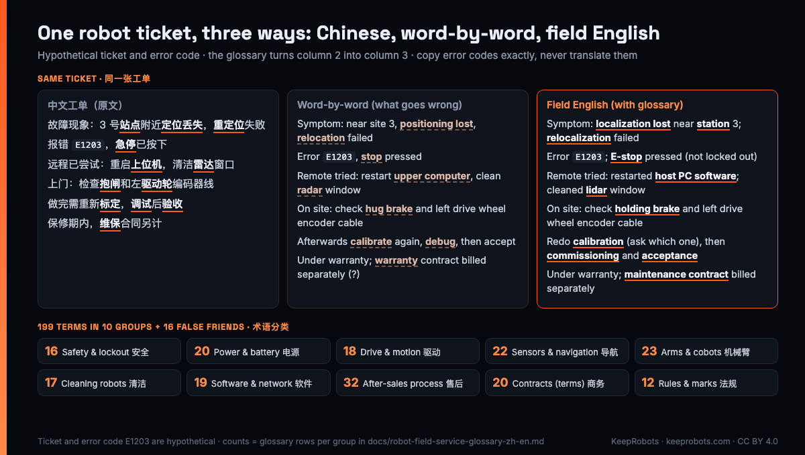

# Chinese–English Robot Field Service Glossary (中英机器人现场服务术语表) — KeepRobots

> Compiled by KeepRobots, a robot field-service company in Vancouver, Canada that works in English and Chinese — [keeprobots.com](https://keeprobots.com). 199 terms in 10 groups, plus 16 false friends. These are the standard renderings we use; where makers use different words, the note says "varies by maker, confirm with the maker". The maker's own manual always wins. Not legal, safety-certification or translation-certification advice. Also available as CSV: [`robot-field-service-glossary-zh-en.csv`](./robot-field-service-glossary-zh-en.csv) (UTF-8, opens in Excel).

A hypothetical ticket from a robot maker in Shenzhen reaches a technician in Vancouver at 7 a.m. Translated word by word, it says the robot "lost positioning near site 3", the "upper computer" was restarted and the "hug brake" should be checked. Every word is a real English word, and the technician still doesn't know whether to bring a laptop, a lidar or a torque wrench.

What the ticket meant: the robot **lost localization** near **station 3**, the **host PC software** was restarted, and the **holding brake** needs checking. This glossary exists for that gap. It is for two readers:

- **North American field technicians** reading a Chinese maker's manual, error screen or ticket, raw or machine-translated.
- **Engineers at the maker in China** writing an English ticket, escalation or field service report for a US or Canadian customer.

**中文摘要：** 这是给中国机器人厂商和北美现场技师用的中英术语表，共 199 条，分 10 类：安全与上锁挂牌、电源与电池、驱动与运动、传感器与导航、机械臂/协作机器人、清洁机器人、软件网络与固件、售后流程、合同与商务（只列术语）、法规与认证名称（只写名称）。大部分条目附现场备注，重点标出直译常错的译法（现场调试≠debugging、维保≠warranty、充电桩≠charging pile、抱闸≠hug brake 等），另有 16 条「机翻常见坑」。厂商之间叫法不同的，备注里写了「以厂商为准」。国内工程师写英文工单和服务报告时可以直接对照；错误码原样照抄，不翻译。附 CSV 版，可导入 Excel 或工单系统。

---

## How to read this

- **Columns:** 中文 / English / field note. Where Chinese has two common words for the same thing, both are listed (`充电桩 / 充电座`).
- **"A literal translation gives…"** marks word-by-word renderings (the kind a general-purpose translator or a rushed engineer can produce). The English looks like English but is wrong for a field job.
- **"Varies by maker, confirm with the maker"** means brands use different names, or the same name for different things. Ask before you act.
- **Error codes and UI strings are not translated.** Copy them exactly, then add the English meaning next to them.
- This complements the short EN/中文 glossary in section 6 of the [lockout/tagout procedure template](./robot-lockout-tagout-procedure-template.md). That one covers energy control in depth; this one covers the rest of a service visit and repeats only the core lockout terms.

Groups:

1. Safety and lockout · 安全与上锁挂牌 (16 terms)
2. Power and battery · 电源与电池 (20 terms)
3. Drive and motion · 驱动与运动 (18 terms)
4. Sensors and navigation · 传感器与导航 (22 terms)
5. Robot arms and cobots · 机械臂与协作机器人 (23 terms)
6. Cleaning robots · 清洁机器人 (17 terms)
7. Software, network and firmware · 软件、网络与固件 (19 terms)
8. After-sales process · 售后流程 (32 terms)
9. Contracts and commercial (terms only) · 合同与商务（只列术语） (20 terms)
10. Rules and marks (names only) · 法规与认证名称（只写名称） (12 terms)

Then: [False friends](#false-friends--机翻常见坑) · [How to use with the escalation sheet](#how-to-use-with-the-escalation-sheet)

---

## The glossary

### 1. Safety and lockout · 安全与上锁挂牌

| 中文 | English | Field note |
|---|---|---|
| 急停 / 急停按钮 | Emergency stop (E-stop) / E-stop button | A safety stop, not lockout and not energy isolation. A literal translation often gives just "stop": check whether the text means 急停 or 停止. |
| 停止 / 暂停 | Stop / pause | Normal operational stop. Not a safety function. |
| 安全回路 / 安全链 | Safety circuit / safety chain | The hardwired loop of E-stops, interlocks and bumpers. A "safety circuit open" fault usually means one device in the loop is tripped or a connector is loose. |
| 联锁 / 门锁开关 | Interlock / interlock switch | On cells and stations: a door or gate switch that stops the robot when opened. |
| 安全激光扫描仪 / 安全激光雷达 | Safety laser scanner | A certified safety device. On many AMRs the same scanner also feeds navigation data, but only its safety fields are the safety function. Chinese docs often call both the safety scanner and the navigation lidar 激光雷达; ask which one. |
| 保护区域 / 警告区域 | Protective field / warning field | Scanner field sets. Changing them changes the robot's safety behavior: maker sign-off, not a field tweak. |
| 防撞条 / 安全触边 | Bumper / safety edge | Pressure-sensitive strip on AMRs and cleaning robots. Triggers a stop. |
| 使能开关 / 三位置使能开关 | Enabling switch / three-position enabling device | On the teach pendant. Usually called an enabling device or "deadman" switch; "enable switch" is also understood. |
| 安全转矩关断（STO） | Safe torque off (STO) | Removes motor torque. Not lockout. See the LOTO template glossary. |
| 上锁挂牌（LOTO） | Lockout/tagout (LOTO) | Lock and tag together. Full procedure: robot-lockout-tagout-procedure-template.md. |
| 能量隔离 | Energy isolation | Breaker, disconnect, battery plug. A push button is not an isolating device. |
| 储存能量 / 残余能量 | Stored energy / residual energy | Battery, capacitors, springs, gravity, compressed air. |
| 零能量验证 | Zero energy verification / verification of isolation |  |
| 高压 | High voltage | Used loosely in Chinese manuals. Ask for the actual voltage (for example the battery pack voltage) instead of relying on the word. |
| 漏电保护器 | Residual current device (RCD) | Closest North American devices: GFCI (personnel protection) or ground-fault protection (GFP). Ratings differ; don't assume they are equivalent. |
| 作业许可 / 动火作业 | Work permit / hot work | Some customer sites need a permit before soldering, grinding or opening panels. |

### 2. Power and battery · 电源与电池

| 中文 | English | Field note |
|---|---|---|
| 磷酸铁锂（LFP） | Lithium iron phosphate (LFP) | Generally considered lower thermal-runaway risk than NMC, but still lithium-ion dangerous goods for shipping (Class 9, UN 3480 / UN 3481). |
| 三元锂（NMC / NCA） | NMC / NCA lithium-ion ("ternary") | A literal translation gives "ternary lithium"; English service docs say NMC or NCA. |
| 电芯 | Cell | A literal translation gives "battery core" or "electric core". |
| 电池管理系统（BMS） | Battery management system (BMS) | Many battery fault codes originate in the BMS. Ask the maker how to read the BMS log, not just the robot's error screen. |
| 电量 / 剩余电量（SOC） | Battery level / state of charge (SOC) | 电量 often comes out of a literal translation as "electricity" or "power". |
| 电池健康度（SOH） | State of health (SOH) | Usually a percentage of original capacity. The replacement threshold is the maker's, often in the warranty terms. |
| 过充 / 过放 | Overcharge / over-discharge | Common BMS fault codes. On many packs, deep over-discharge locks the pack out until the maker's recovery procedure is run. |
| 过流 / 短路 | Overcurrent / short circuit | Note when it trips: at power-on, under load or while charging. That narrows it to motor, wiring or charger side. |
| 过压 / 欠压 | Overvoltage / undervoltage | 欠压 can come out of a literal translation as "under-pressure". |
| 过温 / 过热 | Over-temperature / overheating | Record ambient temperature and what the robot was doing (charging, ramps, heavy payload). |
| 休眠 / 运输模式 | Sleep / shipping (storage) mode | Some packs only wake when connected to the charger. Varies by maker, confirm with the maker. |
| 充电桩 / 充电座 | Charging dock / charging station | A literal translation gives "charging pile". It means the dock. |
| 充电触点 / 充电电极片 | Charging contacts | Worn or dirty contacts are a common cause of docking or charging faults. |
| 空气开关 / 空开 | Circuit breaker (MCB) | A literal translation gives "air switch". On site in North America just say "breaker". A DIN-rail MCB in a panel built in China may be a supplementary protector (UL 1077 type), not a branch-circuit breaker (UL 489 type); don't treat it as the branch protection. |
| 预充电路 / 预充电阻 | Pre-charge circuit / pre-charge resistor | A failed pre-charge can show up as a power-on fault or a main contactor that won't close. |
| 直流母线 / 母线电容 | DC bus / DC bus capacitor | Can stay charged after power-off. Discharge time comes from the manual. |
| 维修开关 / 维修插头 | Service disconnect / service plug | Varies by maker, confirm with the maker. |
| 强电 / 弱电 | Power wiring (line voltage) / low-voltage, signal and data wiring | A literal translation gives "strong / weak electricity". |
| 火线 / 零线 / 地线 | Line (hot) / neutral / ground | A literal translation gives "fire wire / zero wire". |
| 单相 / 三相 | Single-phase / three-phase | All North America is 60 Hz. Homes: 120/240 V split-phase. Commercial buildings often have 208Y/120 V three-phase, so a "single-phase" 2-pole outlet may give 208 V, not 240 V. Industrial: 480 V three-phase (US), 600 V (Canada). China: 220 V single-phase / 380 V three-phase, 50 Hz. Check the charger's rated input range (for example 200–240 V, 50/60 Hz) before shipping. |

### 3. Drive and motion · 驱动与运动

| 中文 | English | Field note |
|---|---|---|
| 驱动器 / 伺服驱动器 | Drive / servo drive (amplifier) | For servo amplifiers say "servo drive". "Driver" alone can be confused with a software driver; "motor driver" or "stepper driver" is normal for small driver boards. |
| 万向轮 | Caster (swivel caster) | A literal translation gives "universal wheel". |
| 舵轮 | Steerable drive wheel (steer-drive unit) | A literal translation gives "rudder wheel". |
| 麦克纳姆轮 / 麦轮 | Mecanum wheel |  |
| 底盘 | Chassis / mobile base | In robotics 底盘 often means the whole mobile base module (motors, battery, sensors), not just the frame. |
| 减速机 / 减速器 | Gearbox / speed reducer |  |
| 谐波减速器 | Strain wave gear (often called "harmonic drive") | Harmonic Drive is a trademark; strain wave gear is the generic term. |
| RV 减速器 | Cycloidal (RV) reducer | RV is a Nabtesco product name, used generically in Chinese. |
| 编码器（绝对值 / 增量） | Encoder (absolute / incremental) |  |
| 抱闸 / 制动器 | Holding brake / brake | A literal translation gives "hug brake". See False friends. |
| 松抱闸 / 刹车释放 | Brake release | Gravity hazard on arm axes and lift tops: support the load first. |
| 堵转 | Stall (locked rotor) | A literal translation gives "locked rotation". |
| 跟随误差 / 位置超差 | Following error / position deviation error | Varies by maker, confirm with the maker. |
| 打滑 | Wheel slip | Check tire wear, floor contamination and payload. |
| 顶升机构 | Lift (jacking) mechanism | The lift top on shelf-lifting AMRs. |
| 关节 / 关节模组 | Joint / joint module (actuator) |  |
| 步态 | Gait | Legged robots. |
| 站立 / 趴下（四足） | Stand / lie down (quadruped) | Command names vary by maker. |

### 4. Sensors and navigation · 传感器与导航

| 中文 | English | Field note |
|---|---|---|
| 激光雷达 | Lidar | 雷达 on its own in robot docs usually means lidar, not radio radar. |
| 单线 / 多线激光雷达 | 2D (single-line) / 3D (multi-line) lidar |  |
| 毫米波雷达 | Millimeter-wave radar | This one is radar. |
| 防跌落传感器 | Cliff (drop-off) sensor | Dark or shiny floors can trigger false cliff detection. |
| 惯性测量单元（IMU）/ 陀螺仪 | Inertial measurement unit (IMU) / gyroscope |  |
| 建图 | Mapping (map building) |  |
| 定位 | Localization | In navigation it is localization, not "positioning". See False friends. |
| 重定位 | Relocalization | Not "relocation" (moving the robot to a new site). |
| 定位丢失 / 定位失败 | Localization lost / localization failed |  |
| 激光 SLAM / 视觉 SLAM | Lidar SLAM / visual SLAM |  |
| 二维码导航 | QR-code (fiducial marker) navigation | Floor or ceiling codes. Damaged or dirty codes cause localization faults. |
| 反光板 | Reflector (reflective target) | Used by some lidar navigation systems. |
| 避障 | Obstacle avoidance |  |
| 绕障 / 停障 | Detour around obstacles / stop at obstacles | Configuration choices, often per zone. |
| 虚拟墙 / 禁行区 | Virtual wall / no-go (keep-out) zone |  |
| 站点 / 点位 | Station / waypoint (point) | Varies by maker, confirm with the maker. |
| 回充 / 自动回充 | Return to dock / auto-docking | A literal translation gives "recharge back". |
| 对桩 | Docking alignment |  |
| 乘梯 / 梯控 | Elevator riding / elevator integration (elevator control interface) | 梯控 is not "ladder control". |
| 闸机 / 门禁 | Turnstile (gate) / access control |  |
| 外参标定 / 内参标定 | Extrinsic calibration / intrinsic calibration | Sensor mounting position vs the sensor's own parameters. Needed after replacing or remounting a sensor. Varies by maker, confirm with the maker. |
| 遮挡 / 脏污 | Occluded / dirty (sensor window) | Common cause of navigation faults; clean before deeper diagnosis. |

### 5. Robot arms and cobots · 机械臂与协作机器人

| 中文 | English | Field note |
|---|---|---|
| 协作机器人 | Collaborative robot (cobot) |  |
| 本体 | Robot arm / mechanical unit | As opposed to the controller. A literal translation gives "body" or "ontology". |
| 控制柜 / 控制箱 | Controller cabinet / control box |  |
| 示教器 | Teach pendant |  |
| 示教 / 拖动示教 | Teaching / hand guiding (lead-through) | A literal translation gives "drag teaching". Brand names for the mode vary. |
| 手动模式 / 自动模式 / 远程模式 | Manual / automatic / remote mode |  |
| 点动 | Jog | "Jog" is the usual robot term; "inching" is also used on some machines. A literal translation can give "click motion". |
| 末端执行器 / 末端工具 | End effector / end-of-arm tooling (EOAT) |  |
| 工具中心点（TCP） | Tool center point (TCP) | Not TCP/IP. |
| 基坐标系 / 世界坐标系 | Base frame / world frame | Frame names vary by maker. |
| 工具坐标系 / 用户坐标系 / 工件坐标系 | Tool frame / user frame / work object frame | Frame names vary by maker. |
| 回零 / 回原点 | Homing / move to home position | On absolute-encoder arms: moves to the home position, reference unchanged. On incremental-encoder axes (linear modules, external axes, lifts), homing (回原点) searches the home switch and sets the reference. Ask which. See False friends. |
| 零点标定 / 零位校准 | Zero calibration (mastering on some brands) | Changes the reference. Done wrong, every taught point shifts. Varies by maker, confirm with the maker. |
| 编码器电池 | Encoder backup battery | On many arms, letting it run flat (or swapping it the wrong way) loses position data and means zero calibration. Follow the maker's procedure. |
| 碰撞检测 / 碰撞灵敏度 | Collision detection / collision sensitivity |  |
| 负载 / 有效载荷 | Payload | For a motor, 负载 just means load. |
| 负载设置（质量 / 质心） | Payload settings (mass / center of gravity) | Wrong settings can cause false collision stops or poor motion. |
| 力传感器 / 六维力传感器 | Force sensor / 6-axis force-torque (F/T) sensor |  |
| 软限位 / 硬限位 | Soft limit / hard stop (mechanical stop) |  |
| 重复定位精度 | Repeatability | A literal translation gives "repeated positioning accuracy". It is not absolute accuracy. |
| 位姿 / 姿态 | Pose / orientation | Pose = position + orientation. |
| 安装方式：正装 / 倒装 / 侧装 | Mounting: floor / ceiling (inverted) / wall | Mounting must match the controller setting. |
| 外部轴 / 第七轴 | External axis / 7th axis (e.g. linear track) |  |

### 6. Cleaning robots · 清洁机器人

| 中文 | English | Field note |
|---|---|---|
| 洗地机 / 洗地机器人 | Floor scrubber / robotic scrubber (scrubber-dryer) |  |
| 扫地机 | Sweeper (commercial) / robot vacuum (consumer) |  |
| 滚刷 | Cylindrical (roller) brush |  |
| 盘刷 | Disc brush |  |
| 边刷 | Side brush |  |
| 针盘 / 百洁垫 | Pad driver / scrub pad | Varies by maker, confirm with the maker. |
| 吸水扒 | Squeegee assembly |  |
| 刮条 / 胶条 | Squeegee blade | Wear part. Varies by maker, confirm with the maker. |
| 清水箱 | Clean water tank / solution tank |  |
| 污水箱 | Recovery tank (dirty water tank) |  |
| 吸水电机 | Vacuum (suction) motor |  |
| 尘盒 / 垃圾箱 | Dust bin / debris hopper |  |
| 基站 / 工作站 | Base station (auto-empty / refill / drain) | 工作站 can also mean a workstation PC; in cleaning docs it is usually the base station. |
| 自动加排水 | Auto fill and drain |  |
| 清洁液 / 配比 | Cleaning solution / dilution ratio | Use the chemical the maker approves; wrong chemicals can damage seals and tanks. |
| 出水量 | Solution flow rate |  |
| 水渍 / 拖尾 | Water residue / streaking | Common checks: squeegee blade wear and angle, suction, hoses. |

### 7. Software, network and firmware · 软件、网络与固件

| 中文 | English | Field note |
|---|---|---|
| 升级 / OTA 升级 | Update / over-the-air (OTA) update | 升级 usually means software update, not a paid upgrade. See False friends. |
| 版本号 | Version number | Record before and after every update. |
| 刷机 | Flash / re-image | Usually needs the maker's tools and approval. |
| 日志 / 导出日志 | Log / export logs |  |
| 报错 / 告警 / 故障 | Error / warning (alarm) / fault | Severity levels vary by maker: ask which level stops the robot. |
| 错误码 / 故障码 | Error code / fault code | Copy codes exactly; never translate them. |
| 复位 | Reset (clear fault) | Not factory reset. On some arms it also means return to the start position. See False friends. |
| 恢复出厂设置 | Factory reset | Usually erases maps and configuration. Never on site without the maker's written OK. |
| 上位机 / 下位机 | Host PC software / embedded controller | A literal translation gives "upper / lower computer". |
| 工控机 | Industrial PC (IPC) |  |
| 调度系统 / 车队管理系统 | Fleet management system (dispatch) |  |
| 后台 / 管理后台 | Back end / admin console | A literal translation gives "backstage". |
| 远程协助 / 远程运维 | Remote support / remote operations and maintenance |  |
| 参数 / 配置文件 | Parameters / configuration file | Back up before changing anything. |
| 通讯 / 通讯异常 | Communication / communication fault |  |
| 静态 IP / 端口 | Static IP / port | Customer IT usually has to open ports and approve addresses. |
| 白名单 | Allowlist (whitelist) |  |
| 掉线 / 断网 / 离线 | Disconnected / network drop / offline |  |
| 4G 模块 / 物联网卡 | Cellular (LTE) modem / IoT SIM | Check the module supports North American carriers and bands before shipping. |

### 8. After-sales process · 售后流程

| 中文 | English | Field note |
|---|---|---|
| 售后 / 售后服务 | After-sales service / service and support | North American customers mostly say "service" or "support". |
| 报修 | Service request / fault report |  |
| 工单 | Service ticket / work order | The maker's ticket and the technician's work order may have different numbers: record both. |
| 上门 / 上门服务 | On-site visit / field service visit |  |
| 远程排查 | Remote troubleshooting |  |
| 故障现象 | Symptom |  |
| 维修 | Repair | Fixing a fault. Not the same as 维护 / 保养. |
| 维护 / 保养 | Maintenance / servicing |  |
| 预防性维护 / 定期保养 | Preventive maintenance (PM) / scheduled maintenance |  |
| 巡检 | Inspection round | Also the name of a robot type (inspection robot). |
| 点检 | Routine check (checklist inspection) |  |
| 易损件 / 耗材 | Wear parts / consumables | Usually excluded from warranty; check the contract. |
| 备件 / 备品备件 | Spare parts |  |
| 物料号 / 料号 | Part number (PN) | A literal translation gives "material number". |
| 序列号（SN） | Serial number (S/N) |  |
| 返厂 / 返修 | Return to factory / return for repair |  |
| 退货授权（RMA） | Return merchandise authorization (RMA) | Chinese makers may call the RMA number 返修单号 or similar. Varies by maker, confirm with the maker. |
| 故障件 / 坏件 | Defective part |  |
| 旧件返还 | Return of the removed (defective) part | Some makers require it before crediting a warranty part. |
| 保修 / 质保 | Warranty | 质保期 = warranty period. |
| 维保 / 维保合同 | Maintenance (service) / maintenance contract | Not warranty. See False friends. |
| 人为损坏 | Damage from misuse (customer-caused damage) |  |
| 调试 / 安装调试 | Commissioning / installation and commissioning | On a site job: commissioning, not debugging. In software tickets (程序调试 / 软件调试) it does mean debugging. See False friends. |
| 验收 | Acceptance / sign-off |  |
| 出厂验收（FAT）/ 现场验收（SAT） | Factory acceptance test (FAT) / site acceptance test (SAT) |  |
| 响应时间 / 到场时间 / 修复时间 | Response time / on-site arrival time / time to restore | 响应 alone is vague: write which clock and when it starts. |
| 上报 / 升级处理 | Escalation | 升级 also means software update: check the context. |
| 关单 / 结单 | Close the ticket |  |
| 服务报告 / 维修报告 | Field service report / repair report |  |
| 服务通告 / 技术通报 | Service bulletin / technical bulletin |  |
| 维修手册 / 用户手册 | Service manual / user manual | Record the manual version used. |
| 原理图 / 接线图 | Schematic / wiring diagram |  |

### 9. Contracts and commercial (terms only) · 合同与商务（只列术语）

Terms only, so both sides know which document is meant. Nothing here explains what a clause means legally; that is for your lawyer.

| 中文 | English | Field note |
|---|---|---|
| 询价（RFQ）/ 报价单 | Request for quote (RFQ) / quotation |  |
| 框架协议 / 主服务协议（MSA） | Framework agreement / master service agreement (MSA) | Not always the same thing; read the document. |
| 工作说明书（SOW） | Statement of work (SOW) |  |
| 服务水平协议（SLA） | Service level agreement (SLA) |  |
| 发票 | Invoice | A Chinese 发票 (fapiao) is an official tax document. A North American invoice is a commercial document. |
| 定金 / 订金 / 预付款 | Earnest money (定金) / advance deposit (订金) / prepayment | 定金 and 订金 can have different legal effects in Chinese law: have counsel check the wording. |
| 账期 | Payment terms (e.g. Net 30) |  |
| 含税 / 不含税 | Tax included / before tax (plus tax) |  |
| 人工费 / 工时 | Labor rate / labor hours | Canadian documents spell it labour. |
| 诊断费 | Diagnostic fee |  |
| 上门费 | Call-out fee (trip charge) |  |
| 保密协议（NDA） | Non-disclosure agreement (NDA) |  |
| 授权服务商 | Authorized service provider |  |
| 代理 / 经销商 | Distributor / reseller (dealer) | 代理 may mean a distributor (buys and resells) or a sales agent / rep (sells on commission, no title to the goods). Ask which. |
| 贴牌 / 白标 | White label / private label | See False friends: OEM / 代工. |
| 责任限制 | Limitation of liability |  |
| 违约金 | Liquidated damages | Legal effect differs between jurisdictions; counsel's job, not the glossary's. |
| 保险证明（COI） | Certificate of insurance (COI) |  |
| 国际贸易术语（Incoterms） | Incoterms (e.g. EXW, FOB, DDP) |  |
| 报关 / 清关 | Customs declaration / customs clearance |  |

### 10. Rules and marks (names only) · 法规与认证名称（只写名称）

Names you will see in manuals, labels and customer emails, each with one neutral line. This table says nothing about whether a product complies with anything.

| 中文 | English | Field note |
|---|---|---|
| OSHA 29 CFR 1910.147 | OSHA 29 CFR 1910.147 | US federal standard on the control of hazardous energy (lockout/tagout). |
| WorkSafeBC / OHS 法规第 10 部分 | WorkSafeBC / OHS Regulation Part 10 | BC's workplace safety agency; Part 10 covers de-energization and lockout. |
| NRTL | Nationally Recognized Testing Laboratory (NRTL) | A lab recognized under OSHA's NRTL program to test and certify products to US safety standards. |
| UL / UL 3300 | UL / UL 3300 | UL is a US standards and certification organization; UL 3300 is a UL standard for service, communication, information, education and entertainment robots. |
| CSA Z434 | CSA Z434 | Canadian industrial robot safety standard, based on ISO 10218. |
| ISO 10218 / ISO/TS 15066 | ISO 10218 / ISO/TS 15066 | International industrial robot safety standard / technical specification for collaborative robot applications. |
| ANSI/A3 R15.06 / R15.08 | ANSI/A3 R15.06 / R15.08 | US industrial robot safety standard (based on ISO 10218) / US industrial mobile robot safety standard. |
| FCC ID | FCC ID | Identifier on radio equipment authorized by the US FCC through certification. Equipment authorized under SDoC has no FCC ID, so a missing FCC ID is not by itself a problem. |
| ISED 认证号（IC） | ISED certification number (IC:) | Innovation, Science and Economic Development Canada radio certification number on the label. |
| CCC / 3C | China Compulsory Certification (CCC) | Chinese mark. Not a North American mark. |
| UN38.3 | UN 38.3 | UN test series for lithium batteries in transport. |
| 安全数据表（SDS / MSDS） | Safety data sheet (SDS) | MSDS is the older name. |

---

## False friends / 机翻常见坑

The terms that cause wrong parts, wrong quotes or an unsafe step. If a ticket contains one of these, check it before dispatch.

| 中文 | Correct English | A literal translation can give | What it means on site |
|---|---|---|---|
| **调试** | Commissioning (on site) / debugging (software) | "debugging" | On a site job: **commissioning**, i.e. installing, configuring, testing and handing over the robot. A quote for "debugging" reads like a software bug fix; a quote for commissioning is what the customer expects. In software tickets (程序调试 / 软件调试) it does mean debugging. |
| **标定** | Calibration (ask which kind) | "calibration" (one thing) | Several different jobs: sensor extrinsic calibration, camera intrinsics, arm zero calibration (mastering), hand-eye calibration, map alignment to the site. Ask **which 标定**, what tool it needs and whether it changes taught points. |
| **急停 vs 停止** | Emergency stop vs stop | both come out as "stop" | 急停 is the **emergency stop** (a safety function); 停止 / 暂停 is a normal stop or pause. Neither is lockout. |
| **维保** | Maintenance service (contract) | "warranty" | **Maintenance service**, often a paid contract. Warranty is 保修 / 质保. Some makers say 免费维保期 (free maintenance period): ask what it covers and whether parts are included. |
| **升级** | Software update / escalation | "upgrade" | Usually a **software update**. In a ticket, 升级 can also mean **escalation** (升级处理). Neither implies a paid upgrade. |
| **复位** | Clear fault (reset alarm) | "reset" (factory reset) | Usually **clear the fault / reset the alarm**. On some arms it means move back to the start position. Factory reset is 恢复出厂设置, and it can wipe maps and settings. Varies by maker, confirm with the maker. |
| **回零 vs 零点标定** | Homing vs zero calibration | both come out as "zeroing" | 回零 = **homing**: move to home. On absolute-encoder arms nothing changes; on incremental-encoder axes (linear modules, external axes, lifts) it also re-finds the home switch and sets the reference. 零点标定 = **zero calibration**: changes the stored zero; done wrong, every taught point moves. Ask which. |
| **抱闸** | Holding brake | "hug brake" | **Holding brake**. On many servo axes it is designed to hold a stopped load, not to stop motion in normal operation. Releasing it on an arm axis or lift top lets gravity act. |
| **本体** | Robot arm (mechanical unit) | "body" / "ontology" | The **robot arm (mechanical unit)** as opposed to the controller cabinet. "本体 + 控制柜" = arm + controller. |
| **雷达** | Lidar | "radar" | In robot docs usually **lidar** (激光雷达). Radio radar is 毫米波雷达. |
| **定位 / 重定位** | Localization / relocalization | "positioning" / "relocation" | For mobile robots: **localization** / **relocalization** (finding itself on the map again). Nothing is being moved to a new site. |
| **充电桩** | Charging dock | "charging pile" | **Charging dock / charging station**. |
| **上位机 / 下位机** | Host PC software / embedded controller | "upper / lower computer" | **Host PC software** (setup or diagnostic tool on a laptop or IPC) / **embedded controller** (MCU, drive, robot controller). |
| **强电 / 弱电** | Power wiring / low-voltage wiring | "strong / weak electricity" | **Power wiring** / **low-voltage, signal and data wiring**. On a customer site these are often different trades. |
| **空开** | Circuit breaker (MCB) | "air switch" | A **circuit breaker** (MCB). On site in North America just say "breaker"; see the note in Power and battery about UL 1077 vs UL 489 devices. |
| **OEM / 代工** | Contract manufacturer (代工) vs OEM (brand owner) | "OEM" (read the opposite way) | In Chinese, OEM / 代工 usually means **making products for another brand**. In English service documents, **OEM** usually means the brand owner or original manufacturer. "Contact the OEM" can point at two different companies: name the company. |

---

## How to use with the escalation sheet

This repo already has the two documents a ticket flows through: the [US Customer Support Escalation Sheet](./us-customer-escalation-sheet.md) (who the customer calls and what happens next) and the [Robot Fault Report & Dispatch Template](./robot-fault-report-template.md) (what the technician gets before a visit). The glossary is what keeps the words consistent between them.

**1. Fix the vocabulary once, in the escalation sheet.** Put two sets of terms into the sheet you give the customer, and keep them apart: your robot's own alarm levels (报错 / 告警 / 故障 → error / warning / fault) and the ticket severities in the sheet (P1–P4: Critical / High / Medium / Low). Say which alarm level maps to which severity, for example "a fault that stops the robot with no workaround is P1". Then add your clocks (响应时间 / 到场时间 / 修复时间 → response / on-site arrival / time to restore) next to them. Then use the same words in every ticket. A US customer who reads "response within 4 hours" may read it as someone arriving; if you mean a reply by email, write that.

**2. In the fault report, keep the Chinese original next to the English.** Sections 3 (symptom) and 4 (what remote support already tried) are where meaning gets lost. Write it like this:

| Field | Write it as |
|---|---|
| Error code | `E1203` (hypothetical code, copied exactly), English meaning: localization lost |
| Symptom | Localization lost (定位丢失) near station 3 (3 号站点); relocalization (重定位) failed twice |
| Already tried | Rebooted the industrial PC (工控机); cleaned the lidar (激光雷达) window |
| Safety state | E-stop pressed (急停已按下). Not locked out |
| Request | Check left drive wheel encoder cable (编码器线); replace drive wheel if needed, part number (物料号) TBC; under warranty (保修期内) |

The bracketed Chinese costs a few characters and lets the engineer in China confirm in seconds that the English means what they meant.

**3. Flag false friends before dispatch.** If the Chinese text contains 调试, 标定, 复位, 升级, 维保 or 回零, the English needs one more sentence saying which meaning applies. Those six decide whether the technician brings the right tool, and whether the job is billed as warranty or paid.

**4. Close the loop in English, with the same words.** The field service report section of the fault report template asks for parts used (part number, serial number of new and removed part), firmware before and after, and the RMA number. Use the glossary terms there too, so the maker's ticket, the customer's copy and the RMA all match.

**5. Load the CSV into your ticket tool.** [`robot-field-service-glossary-zh-en.csv`](./robot-field-service-glossary-zh-en.csv) has the same rows (columns `category, zh, en, field_note`; in the false-friend rows, `en` is the correct English and `field_note` starts with the literal translation to avoid). Add your own model-specific terms and error codes at the bottom: your list beats any generic glossary.

---

## What KeepRobots can do here

KeepRobots provides robot field service from Vancouver in English and Chinese. Our engineers read Chinese technical documents, so we can work from your Chinese manual and tickets and write the field service report in English for your US or Canadian customer. We serve Western Canada day to day; for US and other Canadian work, travel is quoted per project and the rates below still apply (we have no US office).

Rates (before tax): diagnostic $200 CAD / $200 USD per unit per visit, credited on approved repair; labor $150 CAD / $150 USD per hour; core Greater Vancouver call-out $100 CAD; travel quoted per project. partners@keeprobots.com

Found a wrong or missing term? Open an issue and we'll check it.

### Related docs in this repo

- [US Customer Support Escalation Sheet for Overseas Robot Makers](./us-customer-escalation-sheet.md): who the customer contacts, severity, clocks
- [Robot Fault Report & Dispatch Template](./robot-fault-report-template.md): the ticket and the field service report
- [Robot Lockout/Tagout (LOTO) Procedure Template](./robot-lockout-tagout-procedure-template.md): section 6, the energy control glossary
- [Factory-to-Field Handover Kit (EN/中文)](./factory-to-field-handover-kit.md): what the factory engineer hands the local technician

## Related pages on keeprobots.com

- [Field-service partner for robot makers entering North America](https://keeprobots.com/partners/north-america/)
- [Robot repair, after-sales and field service in the USA](https://keeprobots.com/service/usa/)
- [中文：美国机器人售后服务（从温哥华上门）](https://keeprobots.com/zh/partners/usa/)
