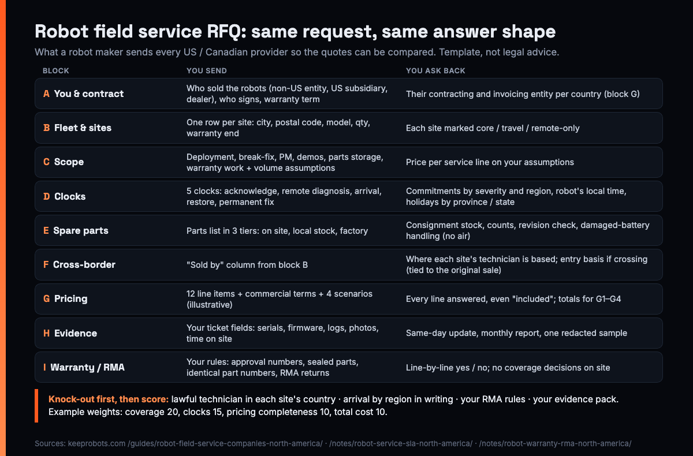

# Robot Field Service RFQ Template for North America (US / Canada) — KeepRobots

> Written by KeepRobots, a robot field-service company in Vancouver, Canada — [keeprobots.com](https://keeprobots.com)

Email three robot field service companies "what do you charge to service our robots in the US and Canada?" and you will get three answers you can't put side by side. One sends a monthly service plan. One sends an hourly rate with "travel TBD". One prices per ticket, and its "nationwide" turns out to mean the 50 US states, with no one in Toronto. None of them is wrong. You didn't tell them what to price.

Most robot field service providers in North America don't publish rates; they quote per contract, plan or project. So the only way to compare them is to send every provider the **same request** and ask for the answer in the **same shape**. This template is that request. It is for after-sales managers and overseas business leads at robot companies, especially from China, choosing a first field service partner in the US or Canada. Copy it into an issue, a shared doc or the body of an email.

We are one of the companies you might send it to, so read our defaults with that in mind. Everything else here comes from our published field notes and the official sources they cite (listed at the end). Bracketed numbers like `[15]` are examples, not recommendations. **This is not legal, customs or immigration advice.**



---

## How to use it

1. **Fill blocks A–C once** (you, your fleet, the scope). They are the same for every provider.
2. **Send the whole pack to every provider on your shortlist**, with the answer tables (blocks D–I) left blank for them to fill.
3. **Ask for answers in your tables, not their brochure.** A provider that won't fill a line has told you something too.
4. **Score the replies** with the sheet in section 3. Apply the knock-out gates first.
5. **Keep the winning reply.** Its answers become schedules in the service agreement: arrival by region, rate card, evidence pack, RMA rules.

### Who to send it to

Robot field service in the US and Canada comes from five kinds of company. They contract and charge differently, so expect different shapes of reply (summarized from our [provider guide](https://keeprobots.com/guides/robot-field-service-companies-north-america/), which lists named companies of each type from their own websites):

| Provider type | Examples named in the guide | Usually contracts with | Usually charges by |
|---|---|---|---|
| Robot makers' own service organizations | FANUC America, ABB, Pudu, Avidbots, Locus Robotics | Robot owner or maker | Service contract or rate card |
| Nationwide third-party field service networks | Burroughs, Hemmersbach | Usually the robot maker | Contract, per ticket |
| Multi-brand robot service companies | Roboworx, Robo Reliance, Service Robot Co. | Maker or robot owner | Contract, plan or per job |
| Integrators and resellers with service teams | RobotLAB, JR Automation, Acieta, Motion Controls Robotics, Cobot Intelligence | Robot owner | Project quote or service agreement |
| Regional on-site service points | KeepRobots (Vancouver) | Maker or robot owner | Hourly or per job; some publish rates |

A maker's own service organization only services its own brand, so if you are a maker from outside North America your shortlist usually comes from the other four types: you want a partner that **reports to you** and follows your RMA and warranty rules. Two checks matter more than the label: many US providers' "nationwide" means the 50 states (ask who is on the ground in Vancouver, Calgary, Toronto or Montreal), and some providers also sell or lease robots, possibly competing ones (ask).

---

## 1. The RFQ pack (copy-paste)

### Block A. About you and the contract

```markdown
# Robot field service RFQ: [company], [date], replies due [date]
Robot maker (legal entity, country): [ ]
North American seller of the robots: [ ] maker's non-US company sells direct  [ ] maker's US subsidiary  [ ] Canadian subsidiary  [ ] dealer / distributor: [ ]
Who will sign the service agreement: [ ] maker  [ ] NA subsidiary  [ ] dealer  [ ] end customer
Who you will invoice: [ ]           Currency: [ ] CAD  [ ] USD
Warranty term sold to customers: [ ] months from [commissioning / shipment]
Customer SLA we have promised or expect to promise (attach): [ ]
Languages your technicians must work in: [ ] English  [ ] Mandarin (reading Chinese fault tables / wiring diagrams; calls with our engineers in China)
Our engineering team's time zone: [e.g. China Standard Time, UTC+8]
Contact for questions: [ ]          Format for replies: fill blocks D–I below
```

**Why "who sold the robot" is in block A:** it decides whether a technician from the other country can do the work at all (block F). Ask it now, not after the first breakdown.

### Block B. Fleet and site list

One row per site. Include signed customers and the pipeline you expect in the next [12] months, marked as such.

| Site ID | City, province / state, postal code | Robot model(s) | Qty | Installed / expected | Warranty ends | Sold by (entity) | Access hours | Elevator / doors in route? | Remote access available? | Status |
|---|---|---|---|---|---|---|---|---|---|---|
| S01 | [Burnaby, BC, V5x] | [model] | [4] | [2026-11] | [2027-11] | [maker's non-US co.] | [Mon–Fri 7–16] | [yes, 2 elevators] | [yes, VPN] | signed |
| S02 | [Bellevue, WA, 980xx] | [model] | [2] | [2027-Q1] | [ ] | [US subsidiary] | [ ] | [ ] | [ ] | pipeline |

Ask each provider to mark every row: **core area / travel area / remote-only**. That one column tells you more than their coverage map.

### Block C. Scope of work

Tick what you want priced. Give your volume assumptions so everyone prices the same thing.

| Service line | Want priced? | Your assumption to price against (example) | Ask for |
|---|---|---|---|
| Deployment and commissioning | [ ] | [6] robots, [2] sites, Q1 | Days on site per site, travel, what's in the handover ([SAT template](robot-commissioning-sat-template.md)) |
| Break-fix (on-site repair) | [ ] | [1] visit per robot per year | Per-visit cost on the scenarios in block G |
| Preventive maintenance | [ ] | [2] visits per robot per year, to our manual | Per round, per robot |
| Remote triage support | [ ] | First line, our script | Included or billed? |
| Pre-sales demo at prospect sites | [ ] | [4] demos per year | Per demo, with or without your sales team on site |
| Spare parts and demo unit storage | [ ] | [1] pallet of spares, [2] demo units | Monthly fee, how stock is counted and reported |
| Warranty / RMA field work | [ ] | Under our approval rules (block I) | Willingness to work to our fault tree and RMA process |

Attach site-specific conditions you already know (floors, Wi-Fi, elevators, licensed trades). Our [site readiness checklist](site-readiness-checklist.md) is a ready-made list.

### Block D. Response and arrival: which clock

"4-hour response" means nothing until you say when the clock starts and stops. Ask every provider to quote the same five clocks:

| Clock | Starts when | Stops when | Provider's commitment: P1 / P2 / P3–P4 | Binding or target? |
|---|---|---|---|---|
| Acknowledgement | Ticket number created in the agreed channel | A person confirms receipt, severity, next step | [ ] / [ ] / [ ] | |
| Remote diagnosis | Remote access or logs provided | First diagnosis: remote fix, or dispatch with likely parts | [ ] / [ ] / [ ] | |
| On-site arrival | Dispatch decision + customer confirms access window | Technician on site and checked in | [per region, schedule below] | |
| Restore | Arrival (or start of remote work) | Main function back, possibly via workaround | [ ] | |
| Permanent fix | After restore | Root cause dealt with, ticket closed | [update cadence] | |

Usually only the first three clocks (acknowledgement, remote diagnosis, on-site arrival) are binding; restore is a target and permanent fix is an update cadence. A provider that makes all five binding is either pricing in resident staff and spare units, or overpromising.

Then ask them to confirm, in writing:

- **Time zone:** the robot's local time. BC stops changing its clocks from 1 November 2026, so in winter Vancouver is one hour ahead of Seattle and California; Vancouver and Toronto are three hours apart in summer and two in winter.
- **Business hours:** stated to the hour, e.g. Mon–Fri 8:00–17:00 at the robot's site. Which severities, if any, are covered outside them, and at what rate.
- **Holidays:** by province or state. They differ: BC has 11 statutory holidays in 2026, Ontario's Employment Standards Act lists 9 public holidays, and there are 11 US federal holidays. Canadian and US Thanksgiving are six weeks apart.
- **Pause rules:** waiting for site access, IT approval of remote access, customer confirmation, or a site that isn't workable.
- **Arrival by region:** a city or postal-code list split into core area / travel area / remote support plus shipped parts.

A provider that answers with one arrival number "anywhere in North America" has not read your site list.

### Block E. Spare parts

Ask for answers per tier, not one number:

| Tier | Typical parts | Ask the provider |
|---|---|---|
| On site at the customer | Consumables: brushes, filters, tires, fuses | Will the technician replace these during any visit? |
| Local stock at the provider | Drive wheels, lidar, batteries, main boards, chargers | Can you hold our consignment stock? Where? How often counted? Same-day usage report? Storage fee? |
| Shipped from the factory | Large or low-turnover parts | Who receives, clears and delivers? (Customs time is excluded from parts commitments.) |

Also ask:

- **Revision matching:** how they check local stock against the hardware and firmware revision of robots in the field.
- **Damaged lithium batteries:** how they handle a swollen or crashed pack. These can't go back by air (IATA; Canada TDG special provision 137; in the US, 49 CFR 173.185(f) allows highway, rail or vessel only), so ask whether they can arrange documented local recycling.
- **Imports:** the US ended duty-free de minimis for all countries from the end of August 2025, so even small parts go through customs entry. Who is importer of record for parts you ship to them?

### Block F. Cross-border: who can work in which country

A provider near the border can look like one partner for two countries. For hands-on repair, both countries tie the after-sales business-visitor route to the **original sales or warranty contract** (US: 8 CFR 214.2(b)(4)(i)(F) and 9 FAM 402.2-5(E)(1); Canada: IRPR s.186(a) and s.187; summarized in section 4 of the [warranty RACI](warranty-repair-raci.md)). One point matters while you are still choosing: on the Canada side, a service provider hired after the sale doesn't qualify under the after-sales provision, but if the **original sales agreement already names the provider**, the visit is assessed under s.187 (not guaranteed). So name your partner in the sales contracts you sign from now on.

So ask each provider, **for every row in block B**:

| Site ID | Country of site | Where the assigned technician is based | Technician's entry basis if cross-border | Conditions you need from us (contract excerpt, letter, training proof) |
|---|---|---|---|---|
| S01 | CA | | | |
| S02 | US | | | |

Rows sold through a US subsidiary or a US distributor, rows whose warranty has expired, and Canadian rows where the provider was hired after the sale usually need a provider based in that country. Work that includes anchoring, wiring or other construction goes to local licensed trades in any case. The practical default is a provider column per country. The border officer decides each entry; not legal or immigration advice. More detail in the [after-sales base location worksheet](robot-after-sales-base-worksheet.md).

### Block G. Pricing: line items and standard scenarios

Ask for **every line**, even if the answer is "included" or "not charged". Blank lines are where quotes stop being comparable.

| Line item | Provider's answer |
|---|---|
| Diagnostic / first-visit fee: per robot or per visit? Credited against an approved repair? | |
| Call-out / trip charge: which zone? Does one call-out cover several robots on one visit? | |
| On-site labour per hour: from arrival or from departure? Billing increment? Minimum hours? | |
| After-hours, weekend and holiday multiplier | |
| Travel outside the core area: transport, lodging, border time. Quoted and approved before booking? | |
| No-fault-found visit (triage done / triage skipped) | |
| Parts: markup on parts they supply; fitting customer-supplied parts | |
| Consignment storage: monthly fee, counting, insurance | |
| Preventive maintenance: per round / per robot | |
| Deployment, demos: per project basis | |
| Retainer, entry fee, annual fee, minimum volume | |
| Taxes not included (GST/PST/HST or state sales tax) | |

Also ask for the commercial terms, which change what the prices are worth:

- **Contracting and invoicing entity per country:** which legal entity signs and invoices for Canadian sites, and which for US sites.
- **Employee or subcontractor:** for each site, will the technician who arrives be the provider's employee or a subcontractor, and will that be disclosed? This also feeds block F.
- **Service credits** for missed binding clocks: base (service fee), percentage per miss, monthly cap, claim period.
- **Liability and insurance limits**, not just a certificate of insurance.
- **Term, termination and price-change notice.**

Then ask every provider to price the **same scenarios**, so their structures turn into comparable totals. These are illustrative, not measured data:

| Scenario (illustrative) | What to price |
|---|---|
| G1. Core-area repair approved | One robot at your nearest core-area site, P2 fault, repair approved after diagnosis, 2 h on site, part from local stock |
| G2. No fault found | Same site, triage done, no defect found on site |
| G3. Preventive maintenance round | [10] robots at one site, [1] day |
| G4. Out-of-region repair | One robot at a US site outside the provider's home region, repair approved, 3 h on site, travel included |

One example row, to show the format. **KeepRobots' published rates**, before tax and parts (diagnostic C$200 / US$200 per robot, per visit, credited against an approved repair; C$100 call-out in the Greater Vancouver core zone; on-site labour C$150/h in Canada, US$150/h in the US; travel outside the core zone and for US projects quoted per project):

| Provider | G1 | G2 | G3 | G4 |
|---|---|---|---|---|
| KeepRobots (published rates; Greater Vancouver core zone for G1–G2) | C$100 + 2 × C$150 = **C$400** (diagnostic credited) | C$200 + C$100 = **C$300** | Quoted per project | US: US$150/h × 3 = US$450 + travel quoted per project (diagnostic credited) |
| Provider 2 | | | | |
| Provider 3 | | | | |

### Block H. Reporting and evidence

Your warranty desk will accept or reject claims on what the technician sends back. Ask each provider to commit to these fields on every ticket, in your format:

```yaml
ticket: [your ticket no.]          oem_approval_no: [ ]       rma_no: [ ]
site_id: S01                        robot_model: [ ]           robot_serial: [ ]
firmware_before: [ ]                firmware_after: [ ]        run_hours: [ ]
fault_codes: [ ]                    log_file_exported: [yes/no, filename]
triage_steps_done_remotely: [ ]
arrived: [local time]               left: [local time]         time_on_site_h: [ ]
photos_before_removal: [label + any damage]                  video_if_intermittent: [ ]
parts_replaced: [{part_no, old_serial, new_serial}]
post_repair_test: [route / duty cycle run, result]
open_items: [ ]                     customer_signoff: [name, time]
language_of_report: [EN / ZH]
```

And ask:

- **Same-day ticket update** with arrival time, work done, photos and serials of replaced parts.
- **Monthly report:** tickets by severity and site; attainment per clock with every miss and its cause (including customer-caused pauses); share solved remotely; parts used and remaining stock; repeat faults (same robot twice within [30] days); next month's planned maintenance.

Our [fault report & dispatch template](robot-fault-report-template.md) covers the inbound side of the same ticket.

### Block I. Warranty and RMA handoff

The provider documents; the maker decides coverage. Ask each provider to confirm, line by line:

| Rule | Provider accepts? |
|---|---|
| Will not tell the customer "covered" or "not covered"; coverage is decided by the maker | |
| Works to our triage script and fault tree before and during a visit | |
| Labour beyond the standard repair time needs our approval number before work continues | |
| Sealed assemblies stay closed unless we approve in writing | |
| Swaps use identical part numbers only, and no parts from Covered List entities (for robots in scope of the FCC Covered List decision, the FCC FAQ says repairs and replacement with identical parts are not prohibited; since 13 Oct 2026, 91 FR 57798, changes that would make a device covered equipment need a new certification, so check any non-identical swap with your test lab) | |
| Failed parts tagged with our RMA number and returned within [15] business days | |
| Evidence pack (block H) submitted within [30] days of the repair, so we can file the claim | |
| Workmanship period: same fault within [30] days of their repair = their return visit at their labour cost | |
| Who invoices whom for covered work vs exclusions (one invoice per visit to the customer) | |
| Certificate of insurance available for US and Canadian sites as customers require | |

Who does what at each of the 12 steps of a warranty repair is in the [warranty repair RACI](warranty-repair-raci.md); the border paperwork for parts going back to the factory is in [shipping a robot back to the factory](robot-factory-return-paperwork.md).

---

## 2. Cover email (copy-paste)

```text
Subject: RFQ: robot field service for [N] [model] robots at [N] sites in [US / Canada], replies by [date]

We are [company], maker of [robot type]. We are selecting a field service partner for
[deployment / repair / preventive maintenance / parts storage] at the sites in the attached
list (block B).

To compare replies fairly, please fill blocks D–I in the attached template, including lines
you would mark "included" or "not offered", and price scenarios G1–G4. Please mark every site
as core area, travel area or remote-only, and tell us where the technician for each site is based.

Questions: [name, email]. Our engineering team works in [time zone]; we can do calls in
English or Mandarin. Replies by [date].
```

---

## 3. Comparison scoring sheet

### Knock-out gates (any "no" = out for those sites)

1. Has a technician who can lawfully work in the country of each site you score them on (block F).
2. Commits to an arrival time **by region**, in writing (block D).
3. Accepts your warranty and RMA rules: no coverage decisions on site, approval numbers, RMA returns (block I).
4. Commits to the evidence pack (block H).

### Weighted score (weights are an example; set your own before replies arrive)

| Criterion | Weight (example) | 0 | 1 | 2 | 3 | Provider 1 | Provider 2 | Provider 3 |
|---|---|---|---|---|---|---|---|---|
| Coverage at **your** sites (block B marks) | 20 | Most sites remote-only | Most in travel area | Most core | All signed sites core | | | |
| Clocks committed in writing (block D) | 15 | Marketing numbers only | Arrival only | Ack + arrival | All three binding clocks, by region, with pause rules | | | |
| Pricing completeness (block G) | 10 | Won't price | Prices some | All, with "TBD" lines | All lines and commercial terms answered, totals comparable | | | |
| Total cost on G1–G4 | 10 | Highest | | | Lowest (score others in proportion) | | | |
| Spare parts (block E) | 10 | No local stock | Stock, no reporting | Stock + monthly count | Consignment, revision check, same-day usage report | | | |
| Evidence and reporting (block H) | 10 | Own format only | Partial fields | All fields | All fields + monthly report sample attached | | | |
| Warranty process fit (block I) | 10 | Several "no" | Mostly yes | All yes | All yes + workmanship period offered | | | |
| Language and hours with your team | 10 | English only, no overlap | Translated reports | Reads Chinese docs | Reads Chinese docs and joins calls with your engineers | | | |
| Independence | 5 | Sells competing robots to your customers | Sells robots, other categories | Sells nothing in your category | Service only, non-exclusive | | | |
| **Total (weight × score, max 300)** | | | | | | | | |

**Read the sheet against us too.** Two rows (language, independence) fit KeepRobots' profile. Coverage, weighted higher, does not: with no US office, KeepRobots would mark most US sites travel area or remote-only and score low there. If most of your sites are in the US, weight coverage accordingly.

**Ask for a sample.** The cheapest way to test block H is to ask each finalist for one redacted service report they have written. The cheapest way to test block D is to ask how they would handle your site S02 next Tuesday.

---

## 4. One mistake to avoid

**Copying the provider's commitment into your customer contract.** Give the provider a commitment one notch tighter than the one you give the customer. Any half-day slip in dispatch approval or booking otherwise puts you in breach.

---

## About KeepRobots

KeepRobots is a robot field service company in Vancouver, BC: deployment and commissioning, hourly on-site repair, preventive maintenance, pre-sales demos and spare-parts storage for robots made by other companies, in English and Mandarin. Greater Vancouver and the Fraser Valley get the fastest response; the rest of BC and Alberta on scheduled trips; the rest of Canada and the US per project, with travel quoted before booking. We have no US office. We don't make or sell robots and aren't an exclusive agent for any brand. If you send us this RFQ, we'll fill every block, including the sites we would mark remote-only.

Related templates in this repo: [Site Readiness Checklist](site-readiness-checklist.md) (block C), [Commissioning & SAT Template](robot-commissioning-sat-template.md) (deployment scope), [Fault Report & Dispatch Template](robot-fault-report-template.md) (block H inbound), [US Customer Escalation Sheet](us-customer-escalation-sheet.md) (what you tell customers once the partner is chosen), [After-Sales Base Location Worksheet](robot-after-sales-base-worksheet.md) and [Warranty Repair RACI](warranty-repair-raci.md) (block F and block I in depth), [Factory Return Paperwork](robot-factory-return-paperwork.md) (block I returns).

---

## Sources

- KeepRobots, Robot field service companies in North America: who services robots in the US and Canada (2026) (5 provider types, named examples, decision table, "nationwide" and Canada coverage notes; researched 2026-10-20 from official sites) — https://keeprobots.com/guides/robot-field-service-companies-north-america/
- KeepRobots, Robot after-sales SLA in North America (five clocks, P1–P4, timing rules, holidays, spare-parts tiers, de minimis, back-to-back SLA, monthly report; official sources: gov.bc.ca, ontario.ca, opm.gov, news.gov.bc.ca 2026AG0013-000209, Executive Orders 14256 and 14324) — https://keeprobots.com/notes/robot-service-sla-north-america/
- KeepRobots, Robot warranty and RMA in North America: who pays for what (four-party split, NFF, advance replacement and RMA return deadline, evidence pack, damaged lithium batteries with IATA, 49 CFR 173.185 and TDG SP 137, FCC identical-parts point) — https://keeprobots.com/notes/robot-warranty-rma-north-america/
- KeepRobots, Robot repair, after-sales and field service in the USA and in Canada (coverage, published rates, cross-border notes) — https://keeprobots.com/service/usa/ , https://keeprobots.com/service/canada/
- US eCFR, 8 CFR 214.2(b)(4)(i)(F) — https://www.ecfr.gov/current/title-8/chapter-I/subchapter-B/part-214/section-214.2
- US Department of State, 9 FAM 402.2-5(E)(1) — https://fam.state.gov/fam/09FAM/09FAM040202.html
- Immigration and Refugee Protection Regulations, sections 186 and 187 — https://laws-lois.justice.gc.ca/eng/regulations/SOR-2002-227/section-186.html , https://laws-lois.justice.gc.ca/eng/regulations/SOR-2002-227/section-187.html
- IRCC program delivery instructions, business visitors (after-sales service) — https://www.canada.ca/en/immigration-refugees-citizenship/corporate/publications-manuals/operational-bulletins-manuals/temporary-residents/foreign-workers/work-without-permit/business.html

Bracketed numbers, example weights and scenarios are illustration, not regulation or measured data. KeepRobots rates are current published rates and may change; taxes, parts and travel outside the core zone are extra. Provider facts are as published on each company's site at the time of our research; check each provider's current offer. Found an error? Open an issue. We check and correct.

## Related pages on keeprobots.com

- [Robot field service companies in North America: who services robots in the US and Canada (2026)](https://keeprobots.com/guides/robot-field-service-companies-north-america/)
- [robot repair and field service in the USA](https://keeprobots.com/service/usa/)
- [robot repair and after-sales service in Canada](https://keeprobots.com/service/canada/)
- [North America field service for robot manufacturers](https://keeprobots.com/partners/north-america/)

*KeepRobots is a robot field-service company in Vancouver, BC (deployment, commissioning, repair, maintenance). We don't make or sell robots. Licensed CC BY 4.0, like the rest of this repository.*
