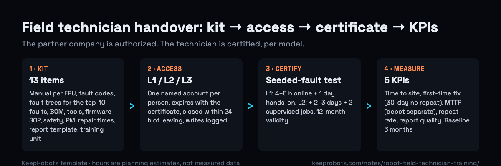

# Robot Field Technician Training & Certification Template (US / Canada) — KeepRobots



A robot maker signs a field service partner in North America. The first real fault arrives six weeks later; the partner's technician reads the fault code, takes photos and waits for the factory to wake up. The partner was not the problem: nobody handed over the kit, the access or the test.

This template is the working version of that handover, per technician and per model. Copy it into your own system, one file per partner. It is written by **KeepRobots**, a robot field service company in Vancouver, Canada (Western Canada base; travel to the US and the rest of Canada). The levels, training hours and KPI definitions are our templates and planning estimates, not any maker's program and not measured data. Regulations were checked against public sources on 2026-10-30. Not legal, safety-compliance or immigration advice.

Full explanation: [Training a third-party robot field technician: what robot makers should hand over](https://keeprobots.com/notes/robot-field-technician-training/) · [中文版](https://keeprobots.com/zh/notes/robot-after-sales-training-service-partner/)

**Rule behind the whole file:** the partner company is authorized; the technician is certified. If the certified technician leaves, the partner's authorization for that model drops until someone else passes.

---

## 1. Partner and model register

| Field | Value |
|---|---|
| Partner company | |
| Service zone(s) | core / outer / travel (list cities) |
| Country of each site | US / Canada (cross-border visits follow different rules; see section 7) |
| Models under warranty | |
| Training unit location and owner | (owned by the maker) |
| Consigned spares location | |
| Escalation contacts (L2 / L3), online hours in both time zones | |
| Agreement annexes signed | repair-time schedule ☐ report template ☐ KPI definitions ☐ escalation table ☐ |

## 2. Training kit handed over (per model)

Mark each item **done** only when a technician new to the model could use it without calling the factory.

| # | Item | Done when | ☐ |
|---|---|---|---|
| 1 | Service manual | Per field-replaceable unit: photos, torque, cable routing, checks before/after; English (French user/warranty documents for products sold in Quebec, per OQLF) | ☐ |
| 2 | Fault-code table | Every code: meaning, likely causes, on-site checks, when to escalate | ☐ |
| 3 | Fault trees | Symptom entry points (won't move, lost localization, won't charge, noise, e-stop), numbered steps; top-10 faults written in full | ☐ |
| 4 | Spare-parts BOM | Part no., English name, model/hardware revision, field-replaceable Y/N, minimum level to swap, return required Y/N; matches consigned stock | ☐ |
| 5 | Tool list | Standard and special tools, jigs, calibration targets, cables, dongles; who supplies each | ☐ |
| 6 | Diagnostic software | Installer + named accounts by level; **tested from a North American network** | ☐ |
| 7 | Firmware procedure | Released versions, compatibility matrix, flash + rollback, approver | ☐ |
| 8 | Safety procedures | Energy-source diagram per model, de-energize-and-verify steps, damaged lithium battery criteria and packaging | ☐ |
| 9 | Preventive maintenance checklist | Checks and limits by run-hours/month, printable sign-off | ☐ |
| 10 | Standard repair times | Hours per job type, used for warranty labour | ☐ |
| 11 | Field service report template | Fields in section 6 | ☐ |
| 12 | Training unit / practice parts | At the partner, maker-owned | ☐ |
| 13 | Escalation contacts | Names, roles, hours in both time zones, how to wake someone for a P1 | ☐ |

## 3. Access levels (diagnostic software)

| Function | L1 field | L2 certified | L3 maker |
|---|---|---|---|
| View status, read fault codes, export logs | Yes | Yes | Yes |
| Self-tests and function tests | Yes | Yes | Yes |
| Operating parameters (speed, volume, schedules) | If customer approves | Yes | Yes |
| Map, edit maps, virtual walls | No | Yes | Yes |
| Flash released firmware, pair modules, calibrate | No | Yes, under SOP, versions logged | Yes |
| Safety-related settings (e-stop logic, safety zones, speed limits) | No | No | Yes |
| Test firmware, raw data and map export | No | No | Yes |
| Remote session into customer network | No | With customer IT approval | With customer IT approval |

Account rules: one account per person; account expires with the certificate; partner notifies the maker when a certified technician leaves and the account is closed within 24 hours; every write action logged.

## 4. Technician certification record (one row per person per model)

| Technician | Model | Level | Training done (date) | Test passed (date) | Seeded fault used | Time to fix | Report acceptable | Expires | Account ID |
|---|---|---|---|---|---|---|---|---|---|
| | | L1 / L2 | | | | | Y / N | | |

**Planning estimates (adjust per model):**

| Level | Scope | Training | Test | Validity |
|---|---|---|---|---|
| L1 field | Inspection, cleaning, consumables/wear parts, reboots, logs, PM | 4–6 h online + 1 day hands-on | Written (fault codes, safety) + seeded fault via fault tree + one wear-part swap | 12 months |
| L2 module repair | Module swaps, released firmware, calibration, new-site deployment | L1 + 2–3 days hands-on + 2 supervised live jobs | Timed module swap passing the function test + one complete field report | 12 months |
| L3 board level | Board repair, refurbishment, root cause | Usually stays at the maker's depot | — | — |

**Seeded-fault test sheet**

```
Model / serial of training unit:
Fault seeded by trainer (not shown to technician):  [ ] connector unplugged  [ ] bad module fitted  [ ] wrong parameter
Fault-tree entry the technician chose:
Steps followed (by step number):
Found at (min):          Fixed at (min):          Function test passed: Y / N
Report fields complete: Y / N      Trainer:            Date:
```

**Re-coach / re-test when:** a new model or major software release ships; the technician has not worked on that model for 6 months; the same fault comes back twice within 30 days on their tickets.

**Coverage rule:** at least one, ideally two, L2-certified technicians per model under warranty in each zone.

## 5. Safety and dangerous-goods training (partner as employer owns it; maker supplies model-specific content)

| Rule | What it requires | Who keeps the record |
|---|---|---|
| OSHA 29 CFR 1910.147(c)(7) (US lockout/tagout) | Training on recognizing hazardous energy, type and magnitude, isolation and control; retraining when equipment or procedures change; certification with name and dates | Partner |
| WorkSafeBC OHS Regulation Part 10 (s.10.4), Workers Compensation Act s.21(2)(e), OHS Reg. s.3.25 (BC) | Written lockout procedures available to every worker on the equipment; employer provides instruction, training, supervision; training records | Partner |
| 49 CFR 172.704 (US hazmat, shipping damaged batteries back) | Training within 90 days of starting or changing job function (direct supervision until then), recurrent at least every 3 years, records | Employer of the person who packs/ships |
| Transportation of Dangerous Goods Regulations Part 6 (Canada) | Training certificate, or direct supervision by a certificate holder; certificate valid 24 months (air) / 36 months (road, rail, water). A US hazmat training record is accepted in Canada only for US-licensed drivers and train crew, not for shippers | Employer of the person who packs/ships |

## 6. Field service report: required fields

Ticket no. · site · model · serial · hardware revision · arrival/start/finish/departure with time zone (travel, work, waiting separate) · run-hours/odometer · customer's own words + fault codes · steps done by fault-tree step number · root-cause code (wear / environment / operation / software / incoming quality / not found) · parts removed and fitted (part no. + serial + RMA no.) · firmware before/after · function-test results · photos (before, after, nameplate, damage) · fixed Y/N and why not (no part / waiting on factory / customer) · customer sign-off. **Due in the maker's system within 24 hours of leaving site.**

## 7. Who trains on site, and the visitor rules to check first

- **United States:** 9 FAM 402.2-5(E)(1) allows B-1 visitors to install, service or repair commercial or industrial equipment purchased from a company outside the US, "or to train U.S. workers to perform such services", where the contract of sale specifically requires the seller to provide the services or training, the visitor has unique knowledge and is not paid from a US source; building or construction work excluded. → If you plan to rely on this, the end customer's sales contract must require the seller to provide the service or training; confirm with a US immigration lawyer before training a partner's staff on a B-1.
- **Canada:** IRCC's business visitor page lists after-sales service under a warranty or sales agreement, and being trained by a Canadian company that sold you equipment. Training a third-party service company is not listed, and the training named in IRPR s.187 is limited to a parent or subsidiary of the visitor's employer; ask a Canadian immigration lawyer before a training-only trip.
- **Practical mix:** recorded theory with subtitles → hands-on coaching during the first North American deployment → remote refreshers + training-unit practice + spot-check tests.

## 8. KPIs (write these definitions into the agreement)

| KPI | Definition | Watch out for |
|---|---|---|
| Time to site | Ticket accepted → technician on site, by zone | Customer local business hours; exclude customer reschedules |
| First-time fix rate | Restored on first visit, no repeat of the same fault on the same robot within 30 days ÷ tickets needing a visit | Report "not fixed: no part" separately (parts problem) |
| MTTR | Ticket accepted → customer confirms robot back in service | Report return-to-factory / parts-from-overseas tickets separately |
| 30-day repeat rate | Same robot, same fault, again within 30 days ÷ visit tickets | High = root cause missed or manual step missing |
| Report quality | Reports within 24 h with all required fields ÷ all reports | Accept warranty claims only with a complete report |

First three months: baseline only, no targets or penalties. Then targets by model and zone.

## 9. Handover sign-off

☐ 1–2 L2-certified technicians per model under warranty, names and expiry dates recorded
☐ English fault trees and procedures for the top-10 faults, rehearsed on the training unit
☐ Diagnostic software logs in from the partner's laptops on a North American network; personal accounts
☐ Spare-parts BOM matches consigned stock part numbers; reorder points set
☐ Two real visits with the factory online (one PM, one fault), both reports acceptable
☐ Repair-time schedule, report template, KPI definitions and escalation table signed as annexes

Signed (maker): ____________  Signed (partner): ____________  Date: ________

Only after this, write "local field service in North America" on your website.

---

### Sources (checked 2026-10-30)

- OSHA 29 CFR 1910.147: https://www.ecfr.gov/current/title-29/subtitle-B/chapter-XVII/part-1910/subpart-J/section-1910.147
- WorkSafeBC OHS Regulation Part 10: https://www.worksafebc.com/en/law-policy/occupational-health-safety/searchable-ohs-regulation/ohs-regulation/part-10-de-energization-and-lockout
- 49 CFR 172.704: https://www.ecfr.gov/current/title-49/subtitle-B/chapter-I/subchapter-C/part-172/subpart-H/section-172.704
- Transportation of Dangerous Goods Regulations, Part 6 (s.6.5): https://laws-lois.justice.gc.ca/eng/regulations/SOR-2001-286/section-6.5.html
- 9 FAM 402.2-5: https://fam.state.gov/fam/09FAM/09FAM040202.html
- IRPR s.187: https://laws-lois.justice.gc.ca/eng/regulations/SOR-2002-227/section-187.html
- IRCC business visitors: https://www.canada.ca/en/immigration-refugees-citizenship/services/visit-canada/business/eligibility.html

### Related pages on keeprobots.com

- [Robot field service companies in North America (comparison)](https://keeprobots.com/guides/robot-field-service-companies-north-america/)
- [Robot repair and field service in the USA](https://keeprobots.com/service/usa/)
- [Robot field service and after-sales in Canada](https://keeprobots.com/service/canada/)
- [Field service partner for robot makers entering North America](https://keeprobots.com/partners/north-america/)
