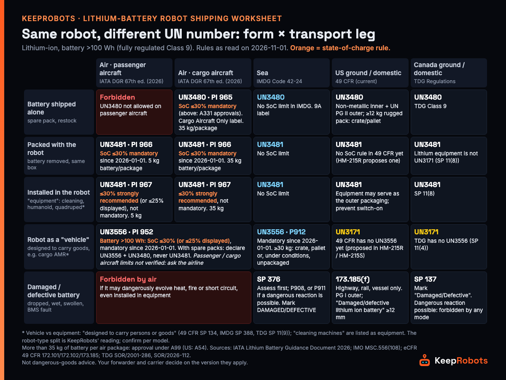

# Lithium-Battery Robot Shipping Worksheet: US / Canada (2026) — KeepRobots Template



Take one cargo-carrying delivery robot and two spare battery packs. Sent by sea from China under the IMDG Code, the robot is **UN3556** and the spares are **UN3480**. Moved later from a US warehouse to a US customer by truck under 49 CFR, the same robot is **UN3171**, because the US rules don't contain UN3556 yet; inside Canada under TDG it is also UN3171. Put it on a cargo plane instead and you may not declare the whole lot as UN3481 ("batteries contained in equipment"): IATA's 2026 guidance says a vehicle with spare batteries is UN3556 + UN3480, and since 2026-01-01 the vehicle's battery (over 100 Wh) must be at 30% state of charge or less. A cleaning robot of the same size is "equipment" and is UN3481 everywhere.

None of this is exotic. It is the normal case for robot makers shipping demo units, fleets and spares into North America, and the classification changes with two things: **what form the battery is in** and **which leg it is travelling**. This worksheet puts those two variables in one table you fill per SKU and per shipment, so the person booking freight, the forwarder and the receiving warehouse are looking at the same answer.

KeepRobots is a Vancouver robot field service company, not a freight forwarder; the rules below are from IATA, IMDG 42-24, 49 CFR, TDG and IFC 2024 texts read on 2026-11-01 (sources at the end). **Not dangerous-goods transport or fire-code advice: each shipment follows the version your forwarder and carrier apply at the time.**

---

## 0. How to use it

1. Classify each robot model once as **equipment** or **vehicle** (section 1), in writing with your forwarder.
2. Fill one row per SKU per shipment from the matrix (section 2) and run the checklist (section 3).
3. Keep one YAML/CSV record per shipment (section 6).

Everything below assumes **lithium-ion batteries over 100 Wh** (cells over 20 Wh), which is where almost every robot battery pack sits: fully regulated Class 9, with a dangerous-goods declaration, UN specification packaging and the Class 9 lithium battery label. Smaller batteries have simplified rules (49 CFR 173.185(c), TDG special provision 34, IMDG special provision 188); for ground and rail in the US the small-battery exception can go up to 300 Wh if the package is marked as forbidden for air and sea.

---

## 1. Equipment or vehicle?

All three rule sets use the same test: a **vehicle** is a self-propelled apparatus **designed to carry one or more persons or goods** (49 CFR 172.102 special provision 134, IMDG special provision 388, TDG special provision 11(9)). All three list "cleaning machines" as an example of **equipment**.

| Robot type | Our reading (not rule text) | UN number |
|---|---|---|
| Floor-cleaning robot | Equipment | UN3481 |
| Humanoid, quadruped | Equipment | UN3481 |
| Robot arm shipped with its battery-powered parts | Equipment | UN3481 |
| Delivery / room-service robot, cargo AMR, warehouse transport robot | **May be a vehicle**: it is designed to carry goods | Air and sea: UN3556. US domestic (49 CFR) and Canada domestic (TDG): UN3171 |

The robot-type column is KeepRobots' reading of the definitions, not wording from any of the rules. Confirm per model with your forwarder or a dangerous-goods classification body; a wrong declaration gets the shipment refused.

Why the vehicle number differs by leg:

- **IMDG 42-24** (mandatory from 2026-01-01): UN3171 now covers only wet-battery and sodium-battery vehicles; lithium-ion vehicles are **UN3556**, packing instruction P912.
- **49 CFR (current text)**: there is **no UN3556** in the Hazardous Materials Table; lithium vehicles are still UN3171. PHMSA's proposed rules HM-215R (2026-02-10) and HM-215S (2026-10-27) would add it; neither is final. For an international movement into or out of the US, shipping under the IMDG Code or ICAO rules is permitted (49 CFR 171.22, 171.25).
- **TDG**: no UN3556; lithium vehicles are UN3171 (special provision 11(4)); lithium **equipment** must not use UN3171 (special provision 11(8)).
- **IATA 2026**: a vehicle shipped with spare batteries **cannot be declared UN3481**. Declare the vehicle UN3556 and the spares UN3480.

---

## 2. The decision matrix (fill one row per SKU per shipment)

### 2a. Reference: form × leg

| Form | Air, passenger aircraft (IATA 2026) | Air, cargo aircraft (IATA 2026) | Sea (IMDG 42-24) | US ground (49 CFR) | Canada ground (TDG) |
|---|---|---|---|---|---|
| **Battery alone** (spare pack) | **Forbidden** | UN3480, PI 965. **SoC ≤30% mandatory** (above 30% needs approval of both the state of origin and the operator's state, A331). Cargo Aircraft Only label. 35 kg per package | UN3480. No SoC limit | UN3480. Non-metallic inner packaging + UN Packing Group II outer packaging; a battery of 12 kg or more in a strong, impact-resistant case may go in a strong outer packaging, crate or on a pallet | UN3480 |
| **Packed with the robot** (same box, not installed) | UN3481, PI 966. **SoC ≤30% mandatory** (Section I) since 2026-01-01. 5 kg battery per package | UN3481, PI 966. **SoC ≤30% mandatory** since 2026-01-01. 35 kg per package | UN3481. No SoC limit | UN3481. No SoC requirement in 49 CFR yet (HM-215R proposes one) | UN3481 |
| **Installed in the robot** (equipment) | UN3481, PI 967. SoC ≤30% (or ≤25% displayed) **strongly recommended, not mandatory**. 5 kg | UN3481, PI 967. Same recommendation. 35 kg | UN3481. No SoC limit | UN3481. A strong outer packaging, or none if the equipment gives equivalent protection; secure it and prevent accidental activation | UN3481 |
| **Robot as a vehicle** | UN3556, PI 952. Battery over 100 Wh: **SoC ≤30% or ≤25% displayed, mandatory** since 2026-01-01. With spares: UN3556 + UN3480. Passenger-aircraft limits not verified: ask the airline | UN3556, PI 952, same SoC rule. Cargo-aircraft limits not verified: ask the airline | UN3556, P912. Vehicles of 30 kg or more may be crated, palletised or, under conditions, unpackaged | **UN3171** | **UN3171** |
| **Damaged / defective battery** | **Forbidden** if it may dangerously evolve heat, fire or short circuit, even installed in equipment | **Forbidden** (same) | Special provision 376: assess first, then P908, or P911 if a dangerous reaction is possible; mark DAMAGED/DEFECTIVE | 173.185(f): **highway, rail and vessel only** | Special provision 137: mark "Damaged/Defective"; forbidden by any mode if a dangerous reaction is possible |

Three more air rules that catch robot shipments:

- **Over 35 kg of battery in one package** needs a state approval under special provision **A99** (the US equivalent is **A54**). Ask your forwarder before booking, not after.
- **US rules vs airline practice.** 49 CFR itself has no SoC requirement yet for batteries packed with equipment or for vehicles (HM-215R proposes one), but airlines apply the IATA rules, so in practice plan for IATA.
- **Hand-carry.** An engineer can't take a large spare pack on a trip: a lithium battery over 160 Wh can't travel as passenger baggage and must go as dangerous-goods cargo. Ship field spares ahead.

Sea has **no state-of-charge limit** for UN3480 or UN3481 in IMDG 42-24 (the phrase "state of charge" appears only among the assessment parameters for damaged batteries). For large packs, many packs or a whole cargo robot, sea is often the realistic route. The trade-off is time: we estimate China to Vancouver door to door at about 4.5–6.5 weeks. Containers carry the general Class 9 placard; packages carry the 9A lithium battery label (special provision 384). A damaged battery inside a vehicle must be removed and shipped under special provision 376 (special provision 388).

### 2b. The worksheet

| A. SKU | B. Battery Wh (marked on case?) | C. Form | D. Equipment / vehicle (who confirmed) | E. Leg(s) | F. UN number per leg | G. Packing instruction | H. SoC rule and measured SoC | I. Package battery mass (>35 kg air?) | J. 38.3 summary on file | K. Open questions |
|---|---|---|---|---|---|---|---|---|---|---|
| | | | | | | | | | | |

Filled example (fictional SKUs; Wh values are placeholders, use your own):

| SKU | Wh | Form | Eq./veh. | Leg | UN | PI | SoC | Mass | 38.3 |
|---|---|---|---|---|---|---|---|---|---|
| Cleaning robot, battery installed | 900 Wh | Installed | Equipment | Sea, CN → Vancouver | UN3481 | (IMDG) | No limit | n/a | Yes |
| Same robot, demo trip | 900 Wh | Installed | Equipment | Air cargo | UN3481 | PI 967 | ≤30% recommended; ship at ≤30% anyway | under 35 kg | Yes |
| Spare pack for that robot | 900 Wh | Alone | — | Air cargo | UN3480 | PI 965 | **≤30% mandatory** | under 35 kg | Yes |
| Same spare pack | 900 Wh | Alone | — | Air passenger | **Forbidden** | — | — | — | — |
| Delivery robot + 2 spares | 1,200 Wh each | Vehicle + alone | Vehicle (forwarder confirmed) | Sea, CN → US port | UN3556 + UN3480 | P912 (vehicle) | No limit | n/a | Yes |
| Same delivery robot, US warehouse → customer | 1,200 Wh | Vehicle | Vehicle | US ground | **UN3171** | 49 CFR | No 49 CFR SoC rule yet | n/a | Yes |
| Swollen pack pulled from a site | 900 Wh | Damaged | — | Any air | **Forbidden** | — | — | — | — |

K (open question) on the delivery robot: if your forwarder classifies it as equipment instead, every row above becomes UN3481. Get the classification in writing before the first shipment.

---

## 3. Before every shipment

- [ ] **UN 38.3 test summary** for every battery type, with the 10 items listed in 49 CFR 173.185(a)(3). Manufacturers and subsequent distributors must make it available; IATA accepts a website plus a QR code or URL. Cell tests do not replace tests on the battery pack.
- [ ] **SDS.** IATA does not require the SDS to contain the 38.3 data, but many forwarders ask for both; check with yours.
- [ ] **Wh marked on the case.** Since 2024-05-10, US rules require the watt-hour rating on the outside of each lithium-ion battery case.
- [ ] **Form and UN number per leg** taken from section 2, and the equipment-or-vehicle decision on file.
- [ ] **Air:** SoC measured and recorded (≤30% where mandatory; we also apply it to PI 967); any package over 35 kg of battery has its A99 / A54 approval before booking; Cargo Aircraft Only label on UN3480.
- [ ] **Prototype or low-production battery** (not 38.3 tested, or production of no more than 100 batteries a year): 49 CFR 173.185(e) / IMDG special provision 310. In the US it is exempt from 38.3 and needs no approval for highway, rail or vessel, but it is forbidden on passenger aircraft, needs approval for cargo aircraft, has stricter packaging and the shipping papers must say it moves under 173.185(e).
- [ ] **Training.** US: every hazmat employee trained, new staff within 90 days, recurrent at least every 3 years (49 CFR 172.704). Canada: a training certificate issued by the employer, or direct supervision by a certificate holder; valid 24 months for air, 36 months for other modes (TDG Part 6). Check this for the shipper, the forwarder and the consignee if it re-ships.
- [ ] **Canada leg:** TDG was amended by SOR/2026-112 (published and in force 2026-06-17) with a 12-month transition, to about 2027-06-17; under conditions, cross-border shipments may use 49 CFR classification, marking and documents.
- [ ] **Post and couriers.** USPS international mail takes only batteries installed in equipment, at 100 Wh or less; Canada Post ships lithium batteries only within Canada and to the US and does not take lithium battery-powered vehicles; neither takes damaged, defective or recalled batteries. Robot packs are almost always over 100 Wh, so the postal route is out. Couriers: whether they accept fully regulated batteries and whether you need a dangerous-goods agreement first depends on each carrier's rules; ask before you ship.
- [ ] **Receiving warehouse** confirmed it accepts dangerous goods, and the spare-battery quantity is checked against local fire rules and its insurance (section 5).
- [ ] **Contract** says what happens to a damaged battery: recycled locally or returned by sea, who finds the forwarder, who pays (section 4).

---

## 4. Damaged batteries: plan for them not to travel

A pack that was dropped, got wet, swelled or shows a BMS fault is the hardest thing to ship:

- **By air:** forbidden if it may dangerously evolve heat, fire or short circuit, even installed in equipment (IATA).
- **US:** 49 CFR 173.185(f) allows **highway, rail and vessel only**. Each battery in its own non-metallic inner packaging, surrounded by non-combustible, non-conductive absorbent cushioning, in a **Packing Group I** outer packaging, marked "Damaged/defective lithium ion battery" in letters at least 12 mm high.
- **Canada:** TDG special provision 137 (as amended by SOR/2026-112) defines damaged or defective batteries, requires the mark "Damaged/Defective" (French: "endommagées/défectueuses"), and forbids transport by any mode where a dangerous reaction is possible. Batteries shipped for recycling also follow 137 (special provision 138).
- **International sea:** special provision 376: assess (to the manufacturer's safety standard or by a technical expert), then P908, or P911 where a dangerous reaction is possible; mark DAMAGED/DEFECTIVE.

Sending a damaged pack back to China for failure analysis means few forwarders, a lot of paperwork and a timeline in months. The steadier arrangement, written into the service contract before the first fault: keep compliant spare packs in North America and swap on site; quarantine the damaged pack locally and have it recycled under local rules, with a record; if analysis really needs the pack, the manufacturer's nominated forwarder moves it by sea.

---

## 5. Storing spare batteries in North America

**US: IFC 2024 Section 320** "Lithium-ion and lithium metal battery storage" (Section 322 is powered micromobility devices; don't mix them up). It applies only where the 2024 IFC has been adopted, and states and cities adopt on their own timelines.

| IFC 2024 | What it says |
|---|---|
| 320.1 exceptions | Exempt: **new or refurbished** batteries installed in the equipment or vehicles they power, or packed for use with them; and temporary storage of batteries during the vehicle manufacturing or repair process. So a new or refurbished robot with its battery installed, or with new packs in the same box, is outside Section 320. **Used batteries are not covered by the first two exceptions**: packs in field-returned robots, spent packs and packs waiting for repair count as battery storage unless another exception applies. Whether a robot's repair counts as the "vehicle" repair process is for the local fire official |
| 320.2 permit | Loose lithium batteries over **15 ft³ (about 0.42 m³)** in total need a fire permit and fire safety plan |
| 320.4.1 small indoor storage | Total ≤15 ft³; each container or group ≤7.5 ft³, open-top, non-combustible; 3 ft between groups (10 ft if combustibles are nearby); at least 5 ft from exits |
| 320.4.2 dedicated storage room | Above those quantities: technical opinion and report, 2-hour fire separation, sprinklers, detection, explosion control |
| 320.4.2.6 | If you can show the batteries are at **SoC ≤30%**, the technical report, fire separation and explosion control requirements do not apply |

A robot's charging dock is not an energy storage system: IFC Section 1207 (based on NFPA 855) applies to lithium-ion systems above **20 kWh** (Table 1207.1.3), and a service robot or quadruped battery is usually hundreds to a few thousand watt-hours (Boston Dynamics' Spot battery is 564 Wh). NFPA 855's current edition is 2026. NFPA 800, a proposed battery safety code, is not yet published; its draft definition of battery-powered equipment includes robots.

**Canada:** we searched the full text of the National Fire Code of Canada 2020 and 2025 and found no occurrence of "lithium", so no lithium-battery storage provision. The BC Fire Code 2024 is NFC 2020 plus BC amendments; we have not read the amendment schedule line by line. In practice, requirements come from the local fire department's general rules, the warehouse lease and the insurer's conditions. Ask all three before you store spares.

**Our storage practice** (not regulation): store spare packs at the manufacturer's recommended storage charge and temperature in a non-combustible battery cabinet or separated area away from exits and combustibles; check for swelling and damage on receipt; top up on a schedule rather than leaving packs full or flat; quarantine damaged packs and recycle them promptly.

---

## 6. Shipment record (YAML)

Copy one block per shipment into your ticket or ERP. Field names are a suggestion.

```yaml
shipment_id: ""            # your reference
date_booked: ""            # YYYY-MM-DD
rules_version_checked: ""  # e.g. "IATA DGR 67 / IMDG 42-24 / 49 CFR as of YYYY-MM-DD / TDG incl. SOR/2026-112"
forwarder: ""
legs:
  - mode: ""               # air-passenger | air-cargo | sea | us-ground | ca-ground
    from: ""
    to: ""
    rule_set: ""           # IATA | IMDG | 49 CFR | TDG
items:
  - sku: ""
    battery_model: ""
    wh_rating: 0           # as marked on the case
    wh_marked_on_case: true
    form: ""               # alone | packed-with | installed | vehicle | damaged
    equipment_or_vehicle: ""   # equipment | vehicle | n/a
    classification_confirmed_by: ""  # forwarder / DG classification body, date
    un_number_by_leg: {}   # e.g. {sea: UN3556, us-ground: UN3171}
    packing_instruction: ""    # PI 965 / 966 / 967 / 952, P912, 173.185(b)...
    soc_rule: ""           # mandatory <=30% | recommended | none
    soc_measured_pct: null
    battery_mass_per_package_kg: null
    approval_ref: ""       # A99 / A54 / A331 / 173.185(e), if any
    un38_3_summary: ""     # URL or file name
    sds: ""
    prototype_173_185e: false
damaged_battery_plan: ""   # recycle locally | return by sea via nominated forwarder
trained_people:
  shipper: ""              # name, certificate/training date
  consignee: ""
storage_on_arrival:
  site: ""
  loose_battery_volume_ft3: null   # compare with IFC 320 (15 ft3 total, 7.5 ft3 per group) where adopted
  storage_soc_pct: null
```

The same fields as a CSV header:

```csv
shipment_id,date_booked,rules_version_checked,forwarder,mode,from,to,rule_set,sku,battery_model,wh_rating,wh_marked_on_case,form,equipment_or_vehicle,classification_confirmed_by,un_number,packing_instruction,soc_rule,soc_measured_pct,battery_mass_per_package_kg,approval_ref,un38_3_summary,sds,prototype_173_185e,damaged_battery_plan,shipper_training,consignee_training,storage_site,loose_battery_volume_ft3,storage_soc_pct
```

---

## 7. What we could not verify

These are open. We say so rather than guess:

- **Canada, damaged batteries:** after SOR/2026-112, which document holds the detailed packaging requirements for damaged or defective lithium batteries. We have not confirmed it; ask a Canadian dangerous-goods forwarder.
- **FedEx, UPS and other couriers:** their dangerous-goods agreements and pre-approval requirements. Check each carrier's current rules.
- **IATA special provision A214:** we read IATA's guidance document, which cites it for the vehicle-vs-equipment split, not the A214 text itself.
- **Air rules for UN3556 beyond PI 952 and the SoC rule** (for example passenger vs cargo aircraft quantities): not covered here; check with the airline.
- **NFPA 855 content:** we confirmed the 2026 edition but did not read its storage chapter (login required).
- **BC Fire Code 2024 amendments:** the adopting order was read; the amendment schedule was not read line by line.
- **Robot type → equipment or vehicle:** section 1 is our reading of the definitions; no regulator has published a list of robot types.

---

## 8. Re-check dates

| When | What to re-check |
|---|---|
| Every January | New IATA DGR edition; new IMDG amendment |
| Every six months | 49 CFR 173.185; TDG Regulations |
| When HM-215R / HM-215S become final | UN3556 in 49 CFR; US SoC rules for batteries packed with equipment and for vehicles |
| By 2027-06-17 | End of the TDG transition under SOR/2026-112 |
| When NFPA 800 is published | Battery storage rules that may name robots |

Last checked: 2026-11-01.

---

## 9. Where KeepRobots fits

The cheapest battery shipment is the one that doesn't cross a border twice. KeepRobots can receive and inspect your shipment in Vancouver, store spare packs and demo or idle units at the manufacturer's recommended storage charge, check them on a schedule, swap packs at the customer's site, and quarantine a damaged pack and arrange compliant local recycling with a record, handing over to your forwarder if you need it back for analysis. We are based in Greater Vancouver; elsewhere in Canada and in the United States we travel per project (we have no US office). Common spares can be kept in Vancouver and carried or shipped to a US site, declared as imports (battery packs ship as dangerous goods; the engineer does not carry them). We don't do dangerous-goods declarations or packaging.

Published rates, before tax: C$200 / US$200 diagnostic per unit per visit (credited if you approve the repair), C$100 call-out in core Greater Vancouver, C$150 / US$150 per hour on site, travel quoted per project; see [USA](https://keeprobots.com/service/usa/) and [Canada](https://keeprobots.com/service/canada/).

---

## Sources (read 2026-11-01)

- IATA Lithium Battery Guidance Document 2026 (based on DGR 67th edition): https://www.iata.org/contentassets/05e6d8742b0047259bf3a700bc9d42b9/lithium-battery-guidance-document.pdf
- IMO resolution MSC.556(108), IMDG Code Amendment 42-24: https://wwwcdn.imo.org/localresources/en/KnowledgeCentre/IndexofIMOResolutions/MSCResolutions/MSC.556(108).pdf
- 49 CFR 171.22, 171.25, 172.101, 172.102, 172.704, 173.185 (eCFR): https://www.ecfr.gov/current/title-49
- PHMSA HM-215R proposed rule (2026-02-10): https://www.federalregister.gov/documents/2026/02/10/2026-02575/hazardous-materials-harmonization-with-international-standards
- PHMSA HM-215S proposed rule (2026-10-27): https://www.federalregister.gov/documents/2026/10/27/2026-21922/hazardous-materials-harmonization-with-international-standards
- Transportation of Dangerous Goods Regulations, SOR/2001-286: https://laws-lois.justice.gc.ca/eng/regulations/SOR-2001-286/FullText.html
- SOR/2026-112, Canada Gazette Part II (2026-06-17): https://gazette.gc.ca/rp-pr/p2/2026/2026-06-17/html/sor-dors112-eng.html
- USPS Publication 52, 349: https://pe.usps.com/text/pub52/pub52c3_028.htm
- Canada Post, mailing batteries: https://www.canadapost-postescanada.ca/cpc/en/support/articles/abcs-of-mailing/batteries.page
- ICC, IFC 2024 chapter 3 (Section 320) and chapter 12 (Section 1207): https://codes.iccsafe.org/content/IFC2024V2.0/chapter-3-general-requirements , https://codes.iccsafe.org/content/IFC2024V2.0/chapter-12-energy-systems
- NFPA 855: https://www.nfpa.org/codes-and-standards/nfpa-855-standard-development/855 ; NFPA 800 (2026-05-11): https://www.nfpa.org/news-blogs-and-articles/blogs/2026/05/11/nfpa-800-upcoming-battery-safety-code
- National Fire Code of Canada 2025: https://nrc-publications.canada.ca/eng/view/ft/?id=e8a18373-a824-42d5-8823-bfad854c2ebd ; 2020: https://nrc-publications.canada.ca/eng/view/ft/?id=d77ca42c-caef-4769-930e-2eb618111c8e
- BC Fire Code 2024 adopting order: https://www2.gov.bc.ca/assets/gov/farming-natural-resources-and-industry/construction-industry/building-codes-and-standards/revisions-and-mo/bcfc_2024_signed_order.pdf

This worksheet summarises public sources for orientation only, as of 2026-11-01. **It is not dangerous-goods transport, fire-code or legal advice.** Classification, packing and documentation are decided by a trained shipper with your forwarder and carrier. SKUs and Wh values in the examples are fictional.

### Related pages on keeprobots.com

- [锂电池机器人发往北美（Chinese, full article with sources）](https://keeprobots.com/zh/notes/robot-lithium-battery-shipping-north-america/)
- [Robot repair, after-sales and field service in the USA](https://keeprobots.com/service/usa/)
- [Robot field service companies in North America (comparison)](https://keeprobots.com/guides/robot-field-service-companies-north-america/)
- [Robot repair and field service in Canada](https://keeprobots.com/service/canada/)

---

*Maintained by KeepRobots (Vancouver robot field service).*
