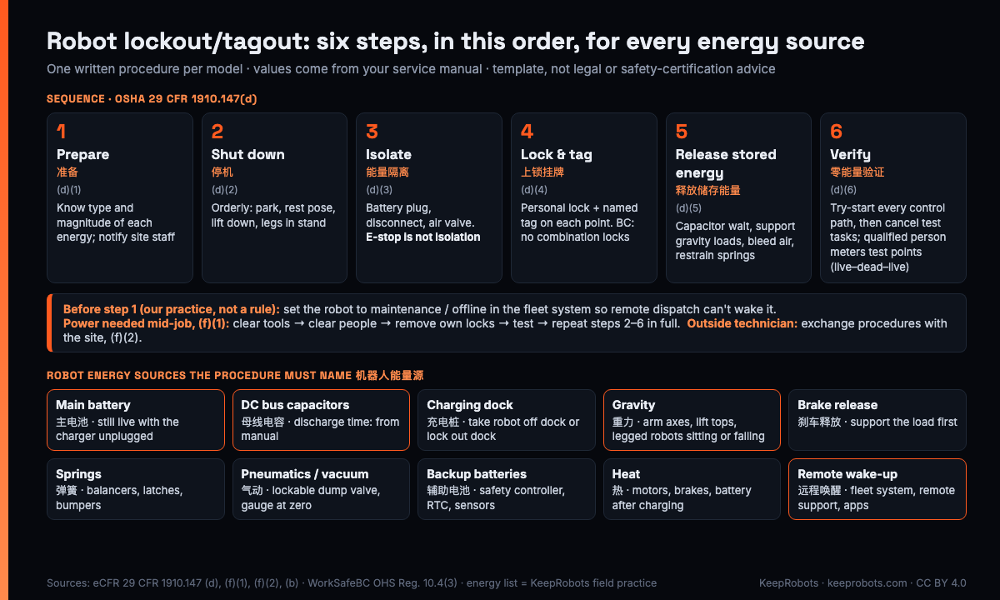

# Robot Lockout/Tagout (LOTO) Procedure Template: AMRs, Cobots, Legged Robots (EN/中文) — KeepRobots

> Written by KeepRobots, a robot field-service company in Vancouver, Canada — [keeprobots.com](https://keeprobots.com). This is a fill-in template and our proposed practice, not survey data. Every value marked `<fill from manual>` must come from your own service manual and engineering team. Not legal or safety-certification advice: the procedure has to be completed by the maker and reviewed by the customer's EHS team for each model and site.

A hypothetical Tuesday: your field technician gets to a US warehouse to replace a drive module on one of your AMRs. Before anyone touches the robot, the customer's EHS coordinator asks one question: "Can I see the energy control procedure for this machine?" The only document anyone has is a Chinese service manual that says 关机后更换 ("replace after shutting down"), and the job stops at the door.

The [US On-Site Visit Pack](./us-onsite-visit-pack.md) in this repo has two checkbox lines for that document. This file is the procedure itself: one per model, in English, written once by the maker, worked to by your field partner and checkable by the customer's EHS.

**中文摘要：** 这是给中国机器人厂商的「上锁挂牌（LOTO）/ 能量控制程序」模板，每个型号一份，英文为主。美国 OSHA 29 CFR 1910.147 要求维修保养时控制危险能量，程序原则上要书面化；外来维修人员进场时，客户和服务方要互相告知各自的上锁挂牌程序（(f)(2)）。BC 省见 WorkSafeBC OHS Regulation Part 10。机器人的难点在于：拔掉充电线不等于断电（电池还在）、驱动器电容放电要时间、机械臂和腿式机器人断电后受重力下落、车队系统可能远程唤醒。本文给出：法规要点（条款号 + 原文）、机器人能量源清单、可直接填写的模板（Markdown 表 + YAML）、两个虚构示例（AMR、六轴协作臂）、四足/人形的补充行、厂商/服务伙伴/客户三方分工表和中英术语对照。所有数值按你自己的手册填写。



---

## 1. What the rules actually ask for

### US: OSHA 29 CFR 1910.147 (eCFR, checked 2026-11-13)

**Scope.** The standard "covers the servicing and maintenance of machines and equipment in which the unexpected energization or start up of the machines or equipment, or release of stored energy could cause injury to employees" ((a)(1)(i)). Its (b) definition of servicing (installing, adjusting, inspecting, cleaning, unjamming and more) covers most robot repair visits. One carve-out matters for batteries and DC buses: (a)(1)(ii)(D) excludes "exposure to electrical hazards from work on, near, or with conductors or equipment in electric-utilization installations, which is covered by subpart S of this part". In our reading, metering a bus or opening a pack is electrical work under the employer's electrical safe-work rules, done by a person qualified for that voltage. Lockout doesn't make live electrical work safe.

**Exceptions, in one paragraph.** Minor servicing is excluded only if "routine, repetitive, and integral to the use of the equipment for production" (note to (a)(2)(ii)); a drive module swap isn't. The cord-and-plug exclusion ((a)(2)(iii)(A)) assumes unplugging controls the hazard; on a battery robot the charging cord isn't the energy source. And (c)(4)(i) lets an employer skip *documenting* the procedure only when all eight listed conditions hold, the first being "no potential for stored or residual energy". A battery, a DC bus or an arm under gravity fails that on its own. In practice: **write it down.**

**What the written procedure must contain.** (c)(4)(ii): scope, purpose, authorization, rules, techniques and means of enforcement, including at least (A) a statement of intended use, (B) steps for shutting down, isolating, blocking and securing, (C) steps for placing, removing and transferring lockout/tagout devices and who is responsible, and (D) requirements for testing that the energy controls work. Section 3 maps each to a field.

**The order.** (d) says the procedure "shall cover the following elements and actions and shall be done in the following sequence":

1. **(d)(1) Preparation**: the authorized employee knows "the type and magnitude of the energy, the hazards of the energy to be controlled, and the method or means to control the energy".
2. **(d)(2) Shutdown**: using the machine's established procedure; "an orderly shutdown must be utilized".
3. **(d)(3) Isolation**: all energy isolating devices "physically located and operated".
4. **(d)(4) Lockout/tagout device application**: devices hold the isolating device in the "safe" or "off" position.
5. **(d)(5) Stored energy**: "relieved, disconnected, restrained, and otherwise rendered safe". If it can reaccumulate, verification continues until the work is done.
6. **(d)(6) Verification**: before starting work, the authorized employee verifies isolation and de-energization.

Release is (e): check the work area, clear and notify people, and each device is removed by the person who applied it (with a documented exception procedure). Re-energizing **in the middle** of a job is (f)(1), covered in section 3d below, because robot repairs need it more often than most machines.

**Two definitions in (b) that matter for robots:**

- **"Push buttons, selector switches and other control circuit type devices are not energy isolating devices."** An E-stop, a pendant's enable switch or a "maintenance mode" in software stops motion but doesn't isolate energy.
- **Energized**: "connected to an energy source or containing residual or stored energy". A robot with a charged battery is energized whether or not anything is plugged in.

**Group lockout and shift changes.** Multi-day jobs and two-person jobs trigger (f)(3) (group lockout: one authorized employee responsible, each worker's personal lock on the group device) and (f)(4) (orderly transfer of lockout protection between off-going and oncoming employees). If a robot stays locked out overnight, the procedure says who holds it.

**Outside personnel.** (f)(2)(i): when outside servicing personnel do covered work, "the on-site employer and the outside employer shall inform each other of their respective lockout or tagout procedures." That's why the EHS coordinator asks for yours.

**Training.** (c)(7)(i)(A): each authorized employee is trained in "the recognition of applicable hazardous energy sources, the type and magnitude of the energy available in the workplace, and the methods and means necessary for energy isolation and control". (c)(7)(iv): the employer certifies the training, with each employee's name and dates. Retraining is required on "a change in machines, equipment or processes that present a new hazard" or a change in the procedures ((c)(7)(iii)(A)). A new model with a different energy layout usually qualifies.

**One line for robot makers.** (c)(2)(iii): whenever new machines or equipment are installed, or after major repair, renovation or modification, "energy isolating devices for such machine or equipment shall be designed to accept a lockout device." The duty is the installing employer's, but it's your product they have to lock. No lockable battery disconnect or service plug? Raise it with engineering.

Appendix A to 1910.147 has a non-mandatory "Typical Minimal Lockout Procedure". It's a useful shape, but it assumes a machine with a breaker, not a battery.

### Canada: British Columbia, WorkSafeBC OHS Regulation Part 10 (checked 2026-11-13)

Other provinces have their own rules. In BC, Part 10 (De-energization and Lockout):

- **10.1** defines "lockout" as using locks to make machinery inoperable or isolate an energy source "in accordance with a written procedure".
- **10.3(1)**: if machinery is shut down for maintenance, no work until all parts "have been secured against inadvertent movement", energy hazards are controlled and isolating devices are locked out.
- **10.4**: locks are applied following procedures "made available to all workers who are required to work on the machinery"; **combination locks must not be used** (10.4(3)); each personal lock is marked or tagged to identify who applied it (10.4(4)); shift and personnel changes need a transfer procedure (10.4(5)).
- **10.6**: workers verify lockout before starting work.
- **10.10(2)**: if a procedure relies on **control system isolating devices** instead of locking the energy isolating devices, those devices and procedures "must be approved in writing by the Board", and 10.10(1) allows that route only where lockout is not practicable. Our reading: a software "safe state" doesn't replace a lock without that approval.
- **10.11** is BC's cord-and-plug exception; the battery problem is the same.

A detail that catches US-written procedures: OSHA's definition of a lockout device allows "a lock, either key or combination type". BC doesn't allow combination locks. If one procedure has to work on both sides of the border, specify keyed personal locks.

---

## 2. Robot energy sources the procedure has to name

This is our field checklist, not regulatory text. Not every model has every row; mark what doesn't apply and say why.

| # | Energy source 能量源 | Why it surprises people | What the procedure must say |
|---|---|---|---|
| E1 | Main battery pack 主电池包 | Unplugging the charger or the dock leaves the robot live. A damaged, swollen or hot pack is a chemical/thermal hazard that lockout doesn't control: stop and follow the maker's damaged-battery procedure | Where the battery disconnect or service plug is; whether it's lockable; how to remove the pack if not |
| E2 | Drive / DC bus capacitors 驱动器、母线电容 | Stay charged after the battery is disconnected | Wait time and test points: `<fill from manual>`. Don't guess a number |
| E3 | Auxiliary and backup batteries 辅助电池 | RTC, safety controller or lidar may have their own | List each one, and whether the job requires disconnecting it |
| E4 | Charging dock / mains 充电桩、市电 | The dock is a separate machine on building power | Before isolation, take the robot off the dock, or unplug and lock out the dock. A docked robot can be fed through its charging contacts even with the battery service plug pulled. If the dock is hard-wired, lock its breaker or disconnect. Who holds the plug or key: `<role>` |
| E5 | Gravity 重力 | Arm axes, lift tops, raised payloads, legged robots squatting or falling when power drops | Lower to the manual's rest position, or block/support (stand, prop, sling) **before** isolation |
| E6 | Brakes and brake release 刹车、手动释放 | Holding brakes keep axes up only until someone releases them | Brake release is a hazardous step: support the load first, and say who may do it |
| E7 | Springs 弹簧 | Gravity compensation springs, bumpers, latch mechanisms | Which springs are preloaded; whether this job opens them; how to restrain them |
| E8 | Pneumatics / vacuum / hydraulics 气动、真空、液压 | Grippers hold air; losing vacuum drops the part | Lockable dump valve, bleed, gauge reading of zero; remove the part first |
| E9 | Thermal 热 | Motors, brakes, battery after fast charge | Cool-down time: `<fill from manual>` |
| E10 | Remote wake-up / fleet dispatch 远程唤醒、车队调度 | Fleet software, remote support or a scheduled task can wake or move a robot that looks "off" | See below |

**On E10.** 1910.147 doesn't mention fleet software, so this is engineering common sense rather than a legal requirement. Robots that can be woken, undocked or sent on a task over Wi-Fi, LTE or a vendor cloud need a step in the procedure: **set the unit to maintenance/offline in the fleet system, and tell remote support it is being serviced, before isolating it.** Name who can override the flag, and confirm it in the fleet console. Don't send a test task to a powered robot to "see if it's refused": if the flag didn't take, the robot moves. The fleet try-start belongs in step 6, after physical isolation. After the try-start, cancel the test task in the fleet console and confirm the queue for this unit is empty. Because (b) says control devices aren't energy isolating devices, this step **adds to** physical isolation and never replaces it. It matters most during (f)(1) testing, when the robot is powered again with people nearby.

---

## 3. The template (one per model)

Copy this section into your own document. Fill one copy per model and per hardware revision. If an option like a gripper, lift top or arm changes the energy sources, write a separate procedure or an annex for it.

### 3a. Header (YAML)

```yaml
procedure_id: LOTO-<model>-<rev>        # e.g. LOTO-XX200-A
model: "<model name / 型号>"
hardware_revisions: ["<rev>"]
options_covered: ["<lift top / gripper / none>"]
intended_use: >                          # 1910.147(c)(4)(ii)(A)
  Servicing and maintenance of <model> where unexpected movement,
  start-up or release of stored energy could cause injury.
  Not for <tasks excluded, e.g. live diagnostics, see section X>.
written_by: "<maker engineering, name, date>"
technical_review: "<maker after-sales lead, name, date>"
site_review: "<customer EHS, name, date>"    # per site
language: "en (zh source: <manual title, version>)"
manual_refs: ["<service manual title, version, section>"]
lock_type: keyed personal lock          # BC 10.4(3): no combination locks
next_review: "<date, or when hardware/firmware changes>"
```

### 3b. Energy source table

| # | Energy source | Magnitude | Isolation point (location) | Lock / device | Stored energy release | Verification method |
|---|---|---|---|---|---|---|
| 1 | | `<fill from manual>` | | | | |
| 2 | | | | | | |
| … | | | | | | |

**Rule:** every row in section 2 (E1–E10) is either in this table or listed under "not applicable" with a reason.

### 3c. Steps, in 1910.147(d) order

| Step | What the technician does on this model | Fill in |
|---|---|---|
| 0 Before arrival | Fleet system: unit set to maintenance/offline; remote support told; site EHS has this procedure (f)(2) | Who sets the flag: `<role>` |
| 1 Prepare (d)(1) | Read the energy table; tell affected site staff (c)(9) | Who on site to notify: `<role>` |
| 2 Shut down (d)(2) | Orderly shutdown, and before power-off: move off the dock, set any load down, lower lifts fully (prop if they can't be lowered), go to `<park position / rest pose>` | `<steps from manual>` |
| 3 Isolate (d)(3) | Operate every isolation point in the table | `<order, if it matters>` |
| 4 Lock & tag (d)(4) | Personal keyed lock + tag with name on each point; group lockbox if several people (f)(3); overnight/shift handover (f)(4) | `<lock positions>` |
| 5 Release stored energy (d)(5) | Wait for capacitor discharge; block or support gravity loads; bleed air; restrain springs | `<times and methods from manual>` |
| 6 Verify (d)(6) | Try to start from every control path (power button, pendant, app, fleet task): no response. Electrical test at the manual's test points by a qualified person under the employer's electrical rules: check the meter on a known live source before and after (live–dead–live). A capacitor timer is not verification; the meter reading is. Gauges at zero. Return controls to off after the try. After the try-start, cancel the test task in the fleet console and confirm the queue for this unit is empty. | `<test points, expected readings>` |
| Test/position (f)(1) | If power is needed mid-job, follow 3d | See 3d |
| Release (e) | Check area, account for people, remove own locks, notify site staff, set unit back online in fleet system | `<return-to-service check>` |

### 3d. Powering up mid-job: the (f)(1) sequence

Robot repairs often need power partway through: jogging an axis to reach a bolt, homing after a joint swap, re-calibrating a lidar, driving an AMR off a jack. 1910.147(f)(1) fixes the order when lockout devices must be temporarily removed "to test or position the machine": (i) clear tools and materials per (e)(1), (ii) remove employees from the area per (e)(2), (iii) remove the devices per (e)(3), (iv) energize and test or position, (v) de-energize and reapply the full (d) sequence to continue. Write the robot version per model:

| # | (f)(1) step | Fill in for this model |
|---|---|---|
| i | Clear tools and materials | Loose parts, covers, jack stands that the robot could hit or drive over: `<list>` |
| ii | Clear people | Who stays outside which zone: `<arm reach + margin / AMR path>`; who holds the E-stop or enabling device |
| iii | Remove own locks | Same person who applied them; fleet system stays in maintenance mode |
| iv | Energize and test | Which tests need power: `<list>`; reduced speed / manual mode if the model has it; one action at a time |
| v | De-energize, relock | Steps 2–6 again in full, including the stored-energy wait and verification. Not just "press E-stop" |

The trap here is the fleet flag (E10). If the robot reconnects to Wi-Fi during step iv, it must not pick up a queued task.

### 3e. Sign-off block

| Role | Name | Date | Signature |
|---|---|---|---|
| Written by (maker) | | | |
| Reviewed by (field partner, authorized employee) | | | |
| Accepted for this site (customer EHS) | | | |

---

## 4. Two hypothetical examples (fictional models)

**Hypothetical example. These models don't exist. Every number is a placeholder.** They show the level of detail a reviewer expects. They are not real procedures.

### Example 1: fictional delivery AMR "XX-200" with a lift top

| # | Energy source | Magnitude | Isolation point | Lock / device | Stored energy release | Verification |
|---|---|---|---|---|---|---|
| 1 | Main battery | `<V, Ah from manual>` | Service plug, rear panel | Plug removed and kept by the person who locked out (or in their lock pouch); lockable plug cover + personal lock | Pack side stays live after the plug is pulled: robot-side circuits only. Pack work needs its own procedure | Power button: no response; qualified person meters `<robot-side test point>` |
| 2 | Drive capacitors | `<from manual>` | (follows row 1) | — | Wait `<minutes from manual>` | Meter at `<bus test point>` reads `<expected>` |
| 3 | Charging dock | `<V AC from dock nameplate>` | Dock plug at wall | Robot moved off the dock at step 2; if work is at the dock: plug lockout cover + personal lock | — | Plug visibly out and inside the lockout cover; if touching dock contacts or internals, qualified person meters the output contacts |
| 4 | Lift top, gravity | `<rated payload from manual>` | — | — | At step 2, before power-off: lower fully; prop if it can't be lowered | Visual: lift at lowest stop |
| 5 | Fleet dispatch | Wi-Fi / cloud | Fleet console | Unit set to "maintenance" | — | Console shows maintenance; after isolation, fleet try-start: no response; then cancel the test task and confirm the unit's queue is empty |
| N/A | Pneumatics, hydraulics | — | — | — | — | Not fitted on XX-200 |

### Example 2: fictional 6-axis cobot "CA-6" with vacuum gripper

| # | Energy source | Magnitude | Isolation point | Lock / device | Stored energy release | Verification |
|---|---|---|---|---|---|---|
| 1 | Controller mains | `<V, A from nameplate>` | Disconnect on control box | Disconnect locked OFF, personal lock + tag | — | Pendant dark; try power-on: no response |
| 2 | Controller DC bus | `<from manual>` | (follows row 1) | — | Wait `<minutes from manual>` | Meter at `<test point>` |
| 3 | Gravity, axes 2–3 | `<payload + arm mass>` | — | — | At step 2: set the part down on a stable surface (don't drop it by cutting vacuum), then move to rest pose; support the arm before any brake release | Arm in rest pose; support in place |
| 4 | Brake release | — | Manual release `<location>` | Not used in this job unless arm is supported | — | — |
| 5 | Vacuum gripper | `<supply pressure>` | Lockable dump valve on air drop | Supply valve locked closed; downstream line exhausted through the dump valve | Part already set down at step 2 | Gauge at zero |
| N/A | Battery, fleet | — | — | — | — | Mains-powered, not fleet-managed |

### Legged robots and humanoids (rows to add)

- **Down posture first.** Use the manual's sit, lie-down or stand/gantry position before shutdown. Without support, a legged robot that loses power may fall or collapse. Write the posture name and the support stand part number (`<fill from manual>`).
- **Hoists and gantries.** If a humanoid hangs from a gantry or hoist, the support must be rated for its mass; nobody works under it.
- **Hot-swap battery.** If the robot has two packs, the procedure says "remove both", or explains why one stays.
- **Joint brakes and backdrivable joints.** Say which joints hold position without power and which don't.
- **Remote controller / app.** Handheld remote controllers and phone apps go under E10: switched off, out of reach, or unpaired.

---

## 5. Who writes, reviews and executes it

| Task | Maker (HQ / engineering) | Field partner | Customer site (EHS) |
|---|---|---|---|
| Write the per-model procedure, in English | **Writes** | Reviews for field use, flags missing steps | — |
| Energy magnitudes, discharge times, test points | **Supplies from design data** | Asks when values are missing | — |
| Train technicians on the model | Supplies content | **Trains and certifies its staff** (c)(7) | Instructs its affected employees (c)(7)(i)(B) |
| Exchange procedures before the visit | Sends with the dispatch | Sends its own LOTO program | **Sends site rules** (f)(2) |
| Site-specific additions (dock location, building disconnects, permits) | — | Drafts | **Accepts or adds** |
| Execute on the day | — | **Authorized employee applies and removes own locks** | Notified before and after (c)(9) |
| Fleet system maintenance flag | Gives the role and access | Requests and confirms | If customer-run: **sets it** |
| Annual review / after changes | **Updates on hardware/firmware change** | Runs its own (c)(6) periodic inspection; reports gaps | Runs its own (c)(6) inspection for its staff |

The legal duties sit with each employer under OSHA or WorkSafeBC; this table only shows who drafts what. Contracts decide liability.

---

## 6. Glossary EN / 中文

| English | 中文 | Note |
|---|---|---|
| Lockout/tagout (LOTO) | 上锁挂牌 | Both together, not the tag alone |
| Energy control procedure | 能量控制程序 | What EHS asks for |
| Energy isolation / isolating device | 能量隔离 / 能量隔离装置 | Breaker, disconnect, valve, service plug. **Not** a button |
| Stored / residual energy | 储存能量 / 残余能量 | Capacitors, springs, gravity, air |
| Zero energy verification | 零能量验证 | (d)(6) "verification of isolation" |
| Qualified person (electrical) | 合格电气人员 | Does meter work on live-capable circuits |
| Authorized employee | 授权人员 | Does the servicing, applies the lock |
| Affected employee | 受影响人员 | Operators, site staff nearby |
| Personal lock | 个人锁 | Marked with the owner's name; owner keeps the key |
| Group lockout / lockbox | 集体上锁 / 锁箱 | |
| Brake release | 刹车释放 | Gravity hazard |
| Safe torque off (STO) | 安全转矩关断 | Stops torque; not lockout |
| Maintenance mode (fleet) | 维护模式（车队系统） | Extra control, not isolation |
| EHS | 环境健康安全（EHS） | Customer's safety team |

---

## 7. Quick checks before you send it to a customer

- Does every isolation point have a lock position? If it can't take a lock, the procedure says tagout and why ((c)(2)(i)). Using tags on a lockable device needs the "full employee protection" showing in (c)(2)(ii) and (c)(3).
- Is there a number, not "wait a while", for every discharge and cool-down time? Is that number from your manual?
- Does step 2 move gravity loads to rest **before** power goes off, and step 6 try every control path?
- Does it name the Chinese source manual and version?
- Has someone outside engineering, such as your field partner, walked through it on a real unit?

---

## What KeepRobots can do here

KeepRobots provides robot field service from Vancouver. Our engineers read Chinese technical documents, so we can turn a Chinese service manual into an English draft of this procedure for your engineering team to approve, then work to it on site and exchange procedures with the customer's EHS. You and the customer's EHS still own and approve it. We serve Western Canada day to day; US and other Canadian work is travel, quoted per project (we have no US office).

Rates (before tax): diagnostic $200 CAD/USD per unit per visit, credited on approved repair; labour $150 CAD/USD per hour; Greater Vancouver call-out $100 CAD; travel quoted per project. partners@keeprobots.com

### Related docs in this repo

- [US On-Site Visit Readiness Pack](./us-onsite-visit-pack.md): COI, entry folder and the lockout checklist lines this procedure fills
- [Robot Field Technician Training & Certification Template](./robot-field-technician-certification-template.md): section 5, who trains on lockout, with the training record
- [Robot Arm & Cobot Installation Sign-off Sheet](./cobot-installation-signoff-sheet.md): the "lockout points confirmed" row in the safety parameter record

### Sources (checked 2026-11-13)

- OSHA 29 CFR 1910.147, The control of hazardous energy (lockout/tagout), eCFR (text as of 2026-11-10): https://www.ecfr.gov/current/title-29/subtitle-B/chapter-XVII/part-1910/subpart-J/section-1910.147 — paragraphs (a)(1)(i), (a)(1)(ii)(D), (a)(2)(ii) note, (a)(2)(iii)(A), (b), (c)(2), (c)(3), (c)(4), (c)(6), (c)(7), (c)(9), (d), (e), (f)(1)–(f)(4), Appendix A
- WorkSafeBC OHS Regulation Part 10, De-energization and Lockout: https://www.worksafebc.com/en/law-policy/occupational-health-safety/searchable-ohs-regulation/ohs-regulation/part-10-de-energization-and-lockout — sections 10.1, 10.3, 10.4, 10.6, 10.10, 10.11

Quotes are from the regulation text. The robot energy source list, fleet-system step, examples and responsibility table are our practice, not regulatory text. Found an error? Open an issue and we'll check it.

## Related pages on keeprobots.com

- [What US customer sites require of a robot technician (COI, licences, lockout, unions)](https://keeprobots.com/notes/robot-technician-us-customer-site-requirements/)
- [Robot repair, after-sales and field service in the USA](https://keeprobots.com/service/usa/)
- [Field-service partner for robot makers entering North America](https://keeprobots.com/partners/north-america/)
- [Robot repair and field service in Canada: coverage, process, pricing](https://keeprobots.com/service/canada/)
- [中文：北美现场服务合作](https://keeprobots.com/zh/partners/north-america/)
