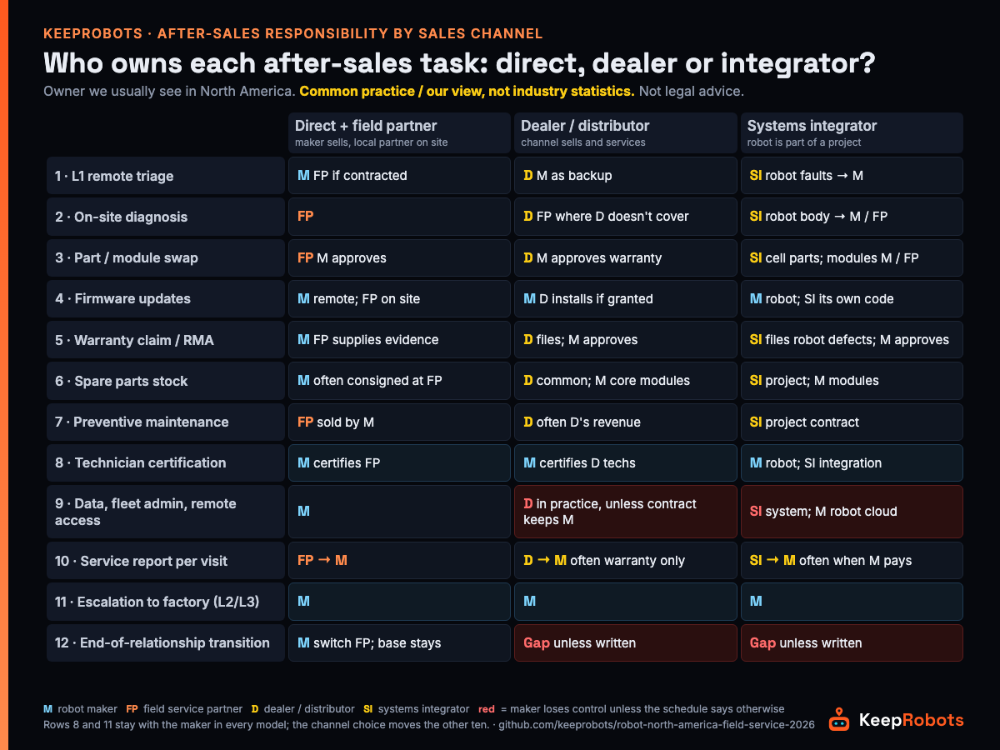

# After-Sales Responsibility Matrix for Robot Sales Channels in North America (Dealer / Integrator / Direct) — KeepRobots Template



A hypothetical, but a very ordinary one: two years after you signed a dealer for "all of North America", the dealer stops carrying your brand. Two hundred of your robots are still running at its customers' sites, the fleet-platform admin login belongs to a dealer employee who has since left, the spare parts on its shelf are its property, and the first customer to notice is emailing your support desk in China, where it is 2 a.m. Nothing in the dealer agreement was wrong. It was just missing one page: the service schedule.

This template is that page. It does two things:

1. **A responsibility matrix**: 12 after-sales tasks against the three ways robot makers usually sell in North America (direct with a field service partner, through a dealer or distributor, through a systems integrator), with the owner we usually see for each.
2. **A service schedule checklist** you can attach to a dealer, distributor or integrator agreement, so that the matrix becomes contract terms rather than good intentions.

It is written by KeepRobots, a robot field service company in Vancouver, Canada, for founders, international business leads and after-sales managers at robot companies, especially from China. We don't sell robots, aren't a dealer for any brand and don't name or assess any channel company here. **The matrix is common practice / our view, not industry statistics. Not legal advice.**

For a step-by-step RACI of a single warranty repair (fault report to credit note), see the companion [Warranty Repair RACI](warranty-repair-raci.md). This document sits one level up: *which channel model puts which task with whom*, before any ticket exists.

---

## 0. How to use it

1. **Pick your column** in section 1. Many makers run more than one model at once (a dealer in one region, direct for key accounts, an integrator for projects); fill one copy per agreement.
2. **Change owners, not rows.** If your dealer has certified technicians in every state it claims, it can own L1 on-site work. If it only sells, write that down and name who does it instead.
3. **Turn every row into a clause** using the service schedule in section 2. A task with an owner but no clause is still a gap.
4. **Copy the YAML** in section 4 into your contract tracker so the matrix lives next to the agreement, not in a slide deck.

---

## 1. The matrix: who typically owns each after-sales task

*Common practice / our view, not industry statistics.* **M** = robot maker (HQ or North American entity), **FP** = field service partner (a local third-party company), **D** = dealer / distributor, **SI** = systems integrator, **C** = end customer. "→" means "hands off to".

| # | Task | Direct (maker sells) + field partner | Dealer / distributor | Systems integrator | What to pin down |
|---|---|---|---|---|---|
| 1 | L1 remote triage (first call, scripted checks, log export) | M (FP if contracted) | D, M as backup | SI for the whole system; robot-level faults → M | Whose phone number is on the robot; triage script version |
| 2 | On-site diagnosis | FP | D, or FP where D doesn't cover | SI; robot-body faults often → M or FP | Coverage map by state/province, not "North America" |
| 3 | Part / module swap | FP, M approves | D, M approves for warranty | SI for cell/integration parts; robot modules → M or FP | Which modules each certification level may open |
| 4 | Firmware / software updates | M (remote); FP on site if needed | M pushes; D installs if granted access | M for robot firmware; SI for its own PLC/WMS/integration code | Who may flash; who re-tests the integration after an update |
| 5 | Warranty claim and RMA | M accountable; FP supplies evidence | D files claim; M approves and issues RMA | SI files for robot defects (M approves); SI's own workmanship is SI's | Claim window, evidence pack, defective-part return ([return paperwork](robot-factory-return-paperwork.md)) |
| 6 | Spare parts stock | M (often consignment held by FP) | D stocks common parts; M stocks or consigns core modules | SI holds project spares; robot modules from M | Who owns stock, who carries slow movers |
| 7 | Preventive maintenance visits | FP, sold by M | D (often D's own service contract revenue) | SI (often in a project service contract) | Whose PM checklist and interval; who keeps the revenue |
| 8 | Technician certification per model | M trains and certifies FP | M trains and certifies D's technicians | M certifies SI for the robot; SI owns its integration skills | Levels, re-certification after major releases ([certification template](robot-field-technician-certification-template.md)) |
| 9 | Customer data, fleet platform and remote access | M | Often D in practice, unless the contract keeps admin with M | Often SI (system access), M (robot cloud) | Admin accounts stay with M; named credentials, revoked on exit |
| 10 | Service report after each visit | FP → M | D → M (often only for warranty work) | SI → M (often only when M pays) | Fixed fields, return within [ ] business days, all visits not just warranty ([fault report template](robot-fault-report-template.md)) |
| 11 | Escalation to factory (L2 diagnosis, L3 root cause / design change) | M | M | M | Handover window across time zones; failure analysis turnaround |
| 12 | End-of-relationship transition | M (switch FP; installed base stays with M) | **Gap unless written**: installed base, parts, admin rights sit with D | **Gap unless written**: project records and system access sit with SI | Notice period, data and parts handover, who services the installed base |

Three patterns stand out (again, our reading, not survey data):

- **Rows 8 and 11 stay with the maker in every model.** Whatever the channel, the maker certifies technicians on its robot and owns L2/L3. The channel choice moves the other ten rows.
- **Rows 9 and 12 are where makers lose control quietly.** In dealer and integrator models, whoever holds the admin login and the customer list effectively holds the installed base. That is fine while the relationship works and costly when it ends.
- **Rows 1, 2 and 8 decide real coverage.** A dealer or integrator that is strong in one region rarely covers the whole continent, and coverage is only as good as remote triage plus certified hands on site. One cleaning-robot maker's service guide says about 70% of faults are resolved remotely, and that technicians assigned by local dealers vary in skill ([Gausium service guide, 2026-08](https://gausium.com/2026/08/10/commercial-cleaning-robot-service-support-guide/)): triage (row 1) carries most of the load, and certification (row 8) decides whether the on-site visit (row 2) fixes the rest.

---

## 2. Service schedule checklist (attach to a dealer or integrator agreement)

Use this as a schedule to the channel agreement. Brackets `[ ]` are blanks for your numbers; **any numbers shown are placeholders, not recommendations**. Have counsel in each country review the final text.

### A. Scope and service levels

- [ ] L1 / L2 / L3 defined in one sentence each, with an owner for each (matrix rows 1, 2, 11).
- [ ] Coverage: list of states / provinces / metro areas the channel actually serves with its own technicians. Outside that list: the maker may appoint a field service partner (backfill clause).
- [ ] Response commitments written as separate clocks (acknowledge, remote triage, on site, restored, fixed). Our suggestion: the channel's commitment to you is one step tighter than yours to the customer.
- [ ] Who the customer calls first; how the maker can contact an end customer directly for safety notices, recalls or field actions.

### B. Warranty labour: pick one reimbursement method

Three methods we commonly see (our summary, not industry statistics; we found no public data on typical warranty labour rates, so none is given here):

- [ ] **Standard repair time × agreed rate, reimbursed by the maker.** The maker publishes a labour-time table per repair (for example "drive wheel swap: [ ] h"); the channel claims against it with the service report, photos and serials. Auditable; the maker must build the table first.
- [ ] **Warranty allowance built into the channel price.** The channel absorbs warranty labour; the maker ships parts free. Simple to run; the maker sees less fault data, and the channel has an incentive to classify faults as out of warranty.
- [ ] **Maker pays a third party directly** for areas or tasks the channel doesn't cover, at actual hours.

Whichever you pick:

- [ ] Rate or allowance: `[ ]` per hour / `[ ]` % of price (from your own numbers).
- [ ] Labour over standard time needs a maker approval number before the work.
- [ ] Call-out and travel are separate lines, never folded into labour hours.
- [ ] Claim window `[ ]` days after repair; maker accept/reject within `[ ]` business days; what happens if the maker doesn't answer.
- [ ] Revenue from customer-paid PM contracts: who keeps it (matrix row 7).

### C. Spare parts: consignment or dealer-owned

| | Consignment (maker owns, channel holds) | Channel-owned (channel buys) |
|---|---|---|
| Who carries the cost | Maker | Channel |
| Write in the schedule | Location, insurance, movement records, monthly reconciliation, count rights, return on exit | Minimum stock list per model, price list, lead times, buyback of obsolete parts on model change or exit |
| Common gap | Stock is used and nobody reports it | Channel under-stocks a slow-moving but critical module |

- [ ] Defective warranty parts: returned with an RMA tag, or photographed and destroyed with the maker's written OK. Serial out / serial in recorded on every swap.

### D. Technician certification

- [ ] Levels per model (for example: L1 = inspect, clean, swap consumables; L2 = swap listed modules; L3 = sealed assemblies only with written maker approval).
- [ ] Minimum number of certified technicians per covered territory: `[ ]`.
- [ ] Re-certification after a major hardware or firmware release; certificates are per person, not per company.
- [ ] Training format and language (manuals, video, sample unit, supervised first jobs).

### E. Diagnostic tool and remote access levels

- [ ] Level 0: customer app (status, basic resets).
- [ ] Level 1: read logs, fault codes, run hours.
- [ ] Level 2: configuration, calibration, maps.
- [ ] Level 3: firmware flashing, factory parameters: maker only, or by written approval per job.
- [ ] Fleet-platform **admin accounts stay with the maker**; channel staff get named, per-person credentials; access reviewed every `[ ]` months and revoked within `[ ]` days of a person leaving or the agreement ending.

### F. Service report fields (every visit, not only warranty)

- [ ] Ticket number; site; model and serial; firmware before / after; run hours.
- [ ] Reported symptom; fault codes; diagnosis; suspected root cause.
- [ ] Parts out / in with serials; consumables used.
- [ ] Time on site (start / end) and travel, as separate entries.
- [ ] Photos before removal; test result after repair; open items.
- [ ] Customer signature; report returned to the maker within `[ ]` business days in a fixed format (the maker's template, not the channel's).

### G. Exclusivity and territory

- [ ] Exclusive territory tied to proof of coverage (certified technicians and stock in that territory), reviewed every `[ ]` months.
- [ ] **Exclusivity vs backfill:** if the channel misses its response commitment inside its exclusive territory, may the maker send a field service partner? After how long: `[ ]` hours. Who pays the partner: `[ ]` (maker / channel / deducted from channel credits). Does the visit count against the channel's exclusivity review: `[ ]`. This is the clause most likely to be argued over, so fill it in before the first ticket.
- [ ] Before granting exclusivity, tying or territory restrictions in Canada, ask Canadian counsel (see section 3).
- [ ] **For integrators: one public benchmark.** A3 (the Association for Advancing Automation) runs a Certified Robot Integrator program. According to a description from its predecessor RIA, integrators are scored on 25 weighted criteria (including quality, risk assessment, number of integrations, and engineering and programming capability), audited by a third party and re-audited every two years ([RIA, "Certified Robot Integrator Defined", PDF, 2017](https://www.automate.org/userAssets/a3/a3Uploads/pdf/RIA-Certified-Robotic-Integrator-Defined.pdf)). Use it as a reference point, not a substitute for your own assessment.

### H. Exit and transition

- [ ] Notice period `[ ]` days; service obligations for robots already sold continue during notice.
- [ ] US: ask US counsel about state dealer and franchise laws before you sign and before you terminate; they can affect termination and inventory repurchase.
- [ ] Hand over to the maker within `[ ]` days: installed-base list (customer, site, serials, firmware, contract end dates), open tickets, service history.
- [ ] Consignment stock returned; channel-owned parts: maker buyback option at `[ ]`.
- [ ] Admin rights and credentials transferred or revoked; no customer data kept beyond legal requirements.
- [ ] Installed-base and customer data handover only works if the channel's customer contracts allow transfer to the maker; check privacy law in each country/province before signing.
- [ ] Joint customer notice naming the new service contact.
- [ ] Warranty obligations to end customers survive termination; who performs them is named (the maker, a new channel or a field service partner).

---

## 3. Legal context (not legal advice)

> **Canada: Competition Act, section 77.** Exclusive dealing, tied selling and market restriction are listed as matters the Competition Tribunal can review (Part VIII; civil, not criminal). That is exactly the territory of section 2G: check with Canadian counsel before you grant exclusive territories or require a channel to carry only your brand. Source: [Competition Act, R.S.C. 1985, c. C-34, s. 77](https://laws-lois.justice.gc.ca/eng/acts/c-34/page-15.html).
>
> **United States: Magnuson-Moss applies to home robots, generally not commercial ones.** 15 U.S.C. 2302(c) bars conditioning a consumer-product warranty on using brand-named parts or service (unless provided free; the FTC can waive this), but 2301(1) limits "consumer product" to goods normally used for personal, family or household purposes. Sources: [15 U.S.C. 2302](https://www.law.cornell.edu/uscode/text/15/2302), [15 U.S.C. 2301](https://www.law.cornell.edu/uscode/text/15/2301). For dealer termination, see the state-law note in section 2H.

---

## 4. Copy-paste: the matrix as a contract tracker entry

The YAML below is a tracker entry, not a repeat of the table: it records the choices you made for one agreement. **Every value is a blank `"[ ]"` or an example for a dealer agreement (marked `# example`); replace them with your own.**

```yaml
# After-sales responsibility matrix + service schedule: KeepRobots template
# One file per channel agreement. Owners: M=maker, FP=field partner, D=dealer/distributor, SI=integrator
agreement:
  channel_model: "[direct_with_field_partner | dealer | integrator]"
  counterparty: "[legal entity]"
  territory_served: ["[state/province/metro with the channel's own certified technicians]"]
  backfill_partner: "[field service partner or none]"
  backfill_trigger_hours: "[ ]"        # section 2G
  backfill_paid_by: "[maker | channel]"
  backfill_counts_against_exclusivity: "[yes | no]"
  owner: "[name, role]"
  review_date: "[YYYY-MM-DD]"
matrix:                                  # example owners for a dealer agreement; change per row
  l1_remote_triage:         {owner: D, backup: M}          # example
  onsite_diagnosis:         {owner: D, outside_territory: FP}  # example
  part_swap:                {owner: D, approval: M}        # example
  firmware_updates:         {owner: M, onsite_install: "[ ]", retest_integration: "[ ]"}
  warranty_claim_rma:       {owner: M, files_claim: D}     # example
  spare_parts_stock:        {model: "[consignment | channel_owned]", core_modules: "[ ]"}
  pm_visits:                {owner: "[ ]", checklist_from: M, revenue_to: "[ ]"}
  technician_certification: {owner: M, certified_techs_min: "[ ]"}
  data_and_remote_access:   {admin: M, channel_access_level: "[0-3]"}
  service_reports:          {owner: "[ ]", to: M, within_business_days: "[ ]", all_visits: "[yes | no]"}
  factory_escalation:       {owner: M, handover_window: "[time zone, hours]"}
  exit_transition:          {owner: M, notice_days: "[ ]", handover_days: "[ ]"}
warranty_labour:                         # section 2B
  method: "[standard_time_x_rate | allowance_in_price | maker_pays_third_party]"
  rate_or_allowance: "[ ]"
  approval_over_standard_time: "[yes | no]"
  callout_and_travel_separate: "[yes | no]"
  claim_window_days: "[ ]"
  maker_response_business_days: "[ ]"
```

---

## 5. Where KeepRobots fits

Under any of the three models, KeepRobots can be the on-site service layer for the rows you don't want to staff yourself, working to your labour-time table and sending reports back to you. We are based in Greater Vancouver and travel to the rest of Canada and to the US per project (no US office); English and Chinese. Rates, before tax: diagnostic C$200 / US$200 per robot, per visit, credited against an approved repair; Greater Vancouver core-area call-out C$100 per visit; on-site labour C$150/h / US$150/h; travel outside the core area and for US projects quoted per project ([Canada](https://keeprobots.com/service/canada/) · [USA](https://keeprobots.com/service/usa/)).

*Example calculation, not a real job:* a warranty visit in Greater Vancouver that swaps one module in 1.5 hours = C$225 labour + C$100 call-out = **C$325 before tax and parts** (the diagnostic fee is credited because the repair was approved). That is the kind of line you can put straight into a warranty labour table (the first method in section 2B).

---

## 6. Sources and review

Read 2026-11-05:

- 15 U.S.C. 2302 and 2301 (Cornell LII): https://www.law.cornell.edu/uscode/text/15/2302 , https://www.law.cornell.edu/uscode/text/15/2301
- Competition Act, s. 77 (Justice Laws Canada): https://laws-lois.justice.gc.ca/eng/acts/c-34/page-15.html
- RIA, Certified Robot Integrator Defined (A3): https://www.automate.org/userAssets/a3/a3Uploads/pdf/RIA-Certified-Robotic-Integrator-Defined.pdf
- Gausium, commercial cleaning robot service and support guide (2026-08-10): https://gausium.com/2026/08/10/commercial-cleaning-robot-service-support-guide/
- KeepRobots rates: https://keeprobots.com/service/canada/ , https://keeprobots.com/service/usa/

The matrix, the reimbursement methods and the checklist are KeepRobots' summary of common practice and our recommendations, not industry statistics. Company names are mentioned only as sources of public statements; no dealer, distributor or integrator is named or assessed. **This template is for orientation only and is not legal advice;** have counsel in the US and Canada review any channel agreement. Next review: **2027-02** (legal references and A3 program description), or earlier if the law changes.

### Related pages on keeprobots.com

- [Robot repair, after-sales and field service in the USA](https://keeprobots.com/service/usa/)
- [Robot field service companies in North America (comparison)](https://keeprobots.com/guides/robot-field-service-companies-north-america/)
- [Authorized robot service network in North America (OEM view)](https://keeprobots.com/notes/robot-authorized-service-provider-network/)
- [Robot repair and field service in Canada](https://keeprobots.com/service/canada/)

---

*Maintained by KeepRobots (Vancouver robot field service).*
