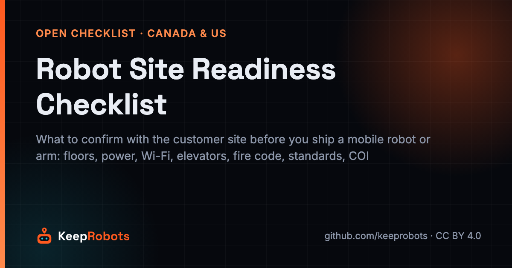
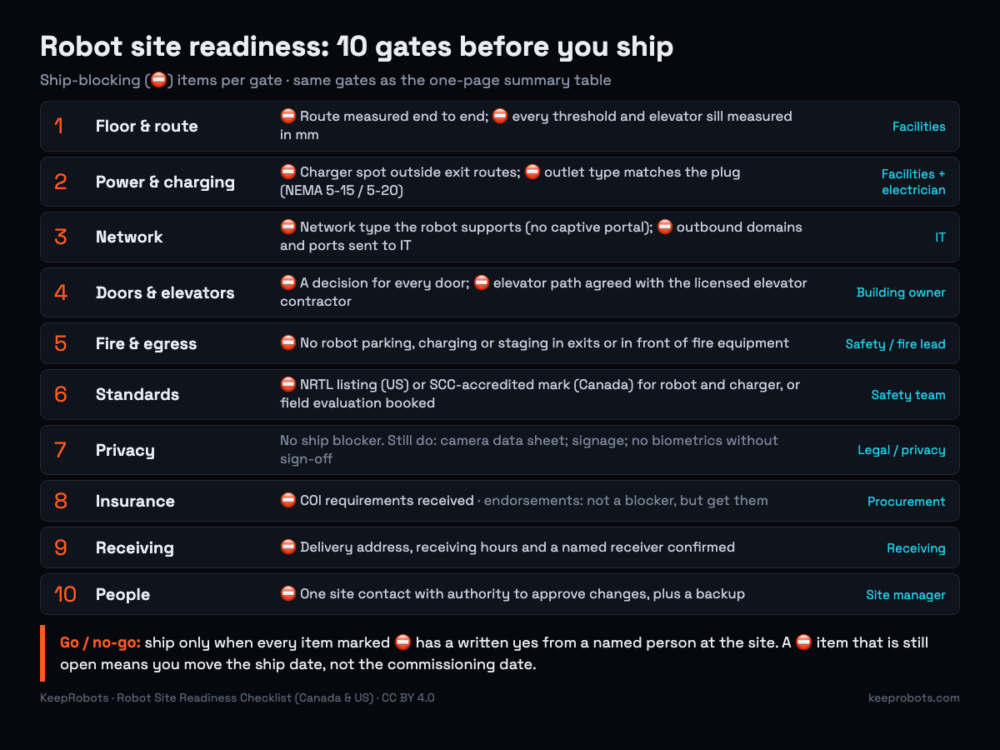

# Robot Site Readiness Checklist (Canada & US)

> Maintained by KeepRobots (Vancouver robot field service) — [keeprobots.com](https://keeprobots.com)

The robot works in the demo hall. Then it arrives at a hotel in Vancouver or a warehouse in Ohio and stops at a 2 cm threshold, or can't get past the guest Wi-Fi login page, or the only free outlet is in a fire exit corridor. None of these are robot faults, and each turns a commissioning day into a survey day.

This is a copy-paste **robot deployment checklist** for the site side: what a robot maker or integrator should confirm with the customer's building **before the crate leaves the factory**, for mobile robots (AMR, cleaning, delivery, humanoid, quadruped) and arms. Paste it into an issue or an email to the facility manager and tick items as the site confirms them in writing.

For the maker-side list (contract, FCC/ISED, customs, batteries, spares), see the [30-item robot deployment checklist](https://keeprobots.com/notes/robot-deployment-checklist/). For lead times and ownership by trade, see the [robot commissioning checklist for Canadian sites](https://keeprobots.com/notes/robot-commissioning-checklist-canada/).

Not legal, electrical or fire-safety advice; the local authority having jurisdiction (AHJ) has the final say. Sources checked 2026-10-21, listed at the end.

---

## The go / no-go rule

**Ship only when every item marked ⛔ below has a written yes from a named person at the site.** Everything else can be fixed on site. A ⛔ item that is still open means you move the ship date, not the commissioning date. Hold a go/no-go call about 10 business days before shipping and another 3 business days before the visit.

---

## 1. Floor and route survey

- [ ] ⛔ Route walked and measured end to end: narrowest point, door clear widths, corridor turns (compare with robot footprint and turning radius)
- [ ] ⛔ Every threshold, expansion joint and elevator sill measured in mm. *Why: check your spec; many list 10–20 mm, and older buildings often have taller transitions.*
- [ ] Slopes and ramps measured (%), including cross slope. *Why: in the US, accessible ramps can be as steep as 1:12 (8.3%). That is legal for wheelchairs but may exceed a loaded delivery robot's rating.*
- [ ] Floor types per zone (carpet, tile, epoxy, wet areas) and wet-floor periods noted
- [ ] Glass walls, mirrors, polished or black floors, and full-height windows marked on the floor plan. *Why: lidar and depth cameras can miss or misread them; they need virtual walls or markers.*
- [ ] Stairs, drop-offs, loading-dock edges and escalators marked. *Why: cliff sensors are the last line.*
- [ ] Ceiling height and overhead obstructions recorded (tall humanoids, arms, ceiling-camera localization)
- [ ] Quiet mapping window agreed (nights or a weekend)
- [ ] Arms only: floor or mounting surface confirmed for load and anchoring (slab thickness, rebar, raised floors).

## 2. Power and charging

- [ ] ⛔ Charger location chosen and photographed, outside exit routes and away from doors that must swing freely
- [ ] ⛔ Receptacle type confirmed. *Why: Canada and the US use 120 V / 60 Hz; general-purpose outlets are NEMA 5-15 (15 A) or 5-20 (20 A, T-slot). A charger with a 5-20P plug will not fit a 5-15 outlet.*
- [ ] Charger draw compared with the circuit; dedicated circuit requested if the circuit is shared or near its rating
- [ ] Arms and large cells: supply voltage and phase confirmed (208, 480 or 600 V three-phase are common) and disconnect location; electrician booked for new wiring
- [ ] No extension cords or power bars as the permanent solution. *Why: inspectors and insurers routinely flag them.*
- [ ] Battery charging location accepted by the site's fire or safety lead. *Why: some AHJs and insurers restrict where lithium-ion batteries are charged; ask before you pick the spot.*

## 3. Network and IT

- [ ] ⛔ Network type confirmed in writing: dedicated SSID/VLAN with pre-shared key, enterprise login (WPA2/WPA3-Enterprise, 802.1X), or cellular. *Why: many robots cannot get through a guest captive portal (the "accept terms" page), and some cannot do 802.1X certificates.*
- [ ] Bands confirmed (2.4 GHz and/or 5 GHz). *Why: some robot modules are 2.4 GHz only; on 5 GHz, DFS channels can cause short drops when the access point changes channel.*
- [ ] Wi-Fi survey along the full route, including elevator lobbies, inside elevator cars, stairwell doors and back-of-house corridors
- [ ] ⛔ Outbound domains and ports sent to IT (from the maker's network sheet); confirm no inbound access needed. *Why: firewall approval can take weeks.*
- [ ] Cellular fallback: SIM carrier and signal checked at the site, especially in basements, docks and elevator cars; module certified for that country (ISED in Canada, FCC in the US)
- [ ] Remote-access method agreed with IT

## 4. Doors, elevators and access control

- [ ] ⛔ Every door on the route has a decision: always open, automatic opener, robot-triggered, or human assist
- [ ] ⛔ Multi-floor routes: elevator integration path agreed with the building owner and its licensed elevator contractor. *Why: elevators follow ASME A17.1/CSA B44, and controller changes go through licensed contractors and local inspection. This is often the longest lead item.*
- [ ] Fire doors identified. *Why: fire doors must not be propped open; any hold-open or opener must release on fire alarm. Confirm with the AHJ before connecting a robot to one.*
- [ ] Access-control system (badges, turnstiles, security gates) and its vendor identified; integration or bypass method agreed
- [ ] Robot behaviour on fire alarm agreed (stop, park, leave the elevator)

## 5. Fire code and egress

- [ ] ⛔ Robot parking, charging and staging spots are not in exits, exit corridors or in front of fire equipment (extinguishers, pull stations, electrical panels)
- [ ] A stopped or faulted robot never blocks required exit width
- [ ] Sprinkler clearance kept for anything stacked or stored: crates, spares, shelving. *Why: the International Fire Code (315.3.1) requires storage at least 18 in (457 mm) below sprinkler deflectors; under ESFR sprinklers, common in warehouses, NFPA 13 requires at least 36 in (914 mm) or more if the sprinkler's listing requires.*
- [ ] Spare batteries stored where the fire lead approves

## 6. Safety standards and approvals

Match the standard to the robot type, ask the customer's safety team which one they expect, and send them the named document:

- [ ] ⛔ Electrical approval for the country. US: OSHA requires workplace electrical equipment to be approved, normally by an OSHA-recognized NRTL. Canada: a mark from a certification body accredited by the Standards Council of Canada (for example CSA, cUL, cETL). **Send:** the listing or certificate, showing the model numbers of both robot and charger
- [ ] Service robots (cleaning, delivery, reception): UL 3300 (ANSI/CAN/UL 3300:2025), on OSHA's list of NRTL test standards since December 2025. **Send:** the UL 3300 listing or certificate, if the robot has one
- [ ] Industrial mobile robots (AMRs in warehouses and factories): ANSI/A3 R15.08-1 (the robot) and R15.08-2 (systems and applications). **Send:** the maker's R15.08-1 conformity statement and the integrator's R15.08-2 risk assessment for this site
- [ ] Point the customer's safety team to ANSI/A3 R15.08-3-2026 (use of IMR applications; a paid standard). *Why: it puts risk assessment, its documentation and re-assessment after changes to the robot, application or environment on the user.*
- [ ] Industrial arms and cells: ANSI/A3 R15.06-2025 in the US, CSA Z434 in Canada (2026 edition adopts ISO 10218-1/-2:2025). **Send:** the arm's declaration plus the cell risk assessment, including any collaborative operation
- [ ] Not yet certified? Book a **field evaluation** before shipping: CSA SPE-1000 in Canada, or an NRTL or field evaluation body following NFPA 791 in the US. *Why: a field evaluation labels only the units actually evaluated, and it is not product certification. SPE-1000 is meant for low volumes (its scope clause, in earlier editions, cites up to 500 units per model per year, per inspection body), so each new shipment needs its own evaluation.*

## 7. Data and privacy

- [ ] One-page data sheet for cameras and microphones: what is captured, where stored, how long, who can access it
- [ ] Canada: private-sector collection falls under PIPEDA, or provincial laws: BC PIPA, Alberta PIPA, Quebec's private-sector act (amended by Law 25). Privacy commissioners treat camera monitoring as collecting personal information even when nothing is recorded. Expect notice signs and short retention
- [ ] US: no single federal law; state laws vary. Face recognition or other biometrics is the red flag. Illinois BIPA, for example, covers face geometry and requires written notice and a written release. Keep face recognition off unless counsel signs off
- [ ] Customer's privacy or legal contact named if cameras face public or staff areas

## 8. Insurance (COI)

- [ ] ⛔ Certificate of insurance (COI) requirements received from the customer: general liability limits, additional insured wording, waiver of subrogation, workers' comp for whoever goes on site
- [ ] Additional insured endorsement requested from the broker, not just the certificate. *Why: the ACORD 25 certificate itself says it confers no rights; the endorsement does.*
- [ ] Field-service subcontractor's COI collected if a third party does the on-site work

## 9. Receiving, crate and liftgate

- [ ] ⛔ Delivery address, receiving hours and a named receiver confirmed
- [ ] Loading dock, or liftgate truck booked; curb-to-room path checked for crate size and weight
- [ ] Crate dimensions vs. doors and freight elevator (cab size and rated load)
- [ ] Unpacking, packaging disposal and secure storage until the technician arrives agreed

## 10. People and handoff

- [ ] ⛔ One site contact with authority to approve changes, plus a backup
- [ ] IT and facilities contacts named
- [ ] Trainees named per shift (night cleaning crews count); language needs noted; in Quebec, plan French signage and training material
- [ ] Escalation path across time zones written down. *Why: Shenzhen is 15 hours ahead of Vancouver year-round (BC stopped changing clocks in 2026), and 15–16 hours ahead of US Pacific sites, which still fall back in November. Decide what the local technician may do without R&D.*
- [ ] Written acceptance criteria: tasks, routes, days, success rate, how measured

---

## One-page printable summary

| # | Gate | Key checks (⛔ = ship blocker) | Owner at site |
|---|---|---|---|
| 1 | Floor & route | ⛔ Route measured; ⛔ thresholds and sills in mm; slopes, glass, drops marked | Facilities |
| 2 | Power & charging | ⛔ Charger spot outside exits; ⛔ outlet matches plug (5-15 / 5-20); arm supply | Facilities + electrician |
| 3 | Network | ⛔ Network type the robot supports; ⛔ outbound list sent to IT; route surveyed | IT |
| 4 | Doors & elevators | ⛔ Every door decided; ⛔ elevator path agreed with licensed contractor | Building owner |
| 5 | Fire & egress | ⛔ No parking, charging or staging in exits; sprinkler clearance for storage | Safety / fire lead |
| 6 | Standards | ⛔ NRTL / SCC-accredited mark, or field evaluation booked; IMR/arm risk assessment | Safety team |
| 7 | Privacy | Camera data sheet; signage; no biometrics without sign-off | Legal / privacy |
| 8 | Insurance | ⛔ COI requirements received; endorsements, not just the certificate | Procurement |
| 9 | Receiving | ⛔ Receiver, address and hours confirmed; dock or liftgate; crate fits | Receiving |
| 10 | People | ⛔ Site contact with authority; IT contact, trainees, escalation, acceptance criteria | Site manager |

**Rule:** any ⛔ item still open → move the ship date.

---

## Sources

- ANSI/A3 R15.08-1-2020 (R2026), reaffirmed without technical changes — https://webstore.ansi.org/standards/ria/ansia3r15082020r2026
- A3 store: ANSI/A3 R15.08-3-2026, Part 3: Use of IMR Applications (published April 23, 2026) — https://www.automate.org/store/products/ansi-a3-r15-08-3-2026-american-national-standard-for-industrial-mobile-robots-safety-requirements-part-3-use-of-imr-applications-pdf-download ; ANSI summary — https://blog.ansi.org/ansi/ansi-a3-r15-08-3-2026-industrial-mobile-robot/
- A3: ANSI/A3 R15.06-2025 industrial robot safety — https://www.automate.org/robotics/news/new-ansi-a3-r15-06-2025-american-national-standard-for-industrial-robot-safety-now-available-for-purchase
- CSA Z434-2026 (adopts ISO 10218-1/-2:2025) — https://webstore.ansi.org/standards/csa/csaz4342026
- ANSI/CAN/UL 3300:2025 — https://scc-ccn.ca/standardsdb/standards/4032203
- OSHA final notice adding UL 3300 to NRTL appropriate test standards (Dec 31, 2025) — https://www.govinfo.gov/content/pkg/FR-2025-12-31/pdf/2025-24077.pdf
- OSHA, NRTL approval of electrical equipment (29 CFR 1910.303) — https://www.osha.gov/laws-regs/standardinterpretations/2011-01-28-0
- CSA SPE-1000-2025 field evaluation code — https://blog.ansi.org/ansi/csa-spe-1000-2025-field-evaluation-code/ ; CSA field evaluation services (500 labelled units per model per year) — https://www.csagroup.org/testing-certification/testing/north-american-field-evaluation-services/special-inspection-and-field-evaluation-services-for-alternative-energy/
- NFPA 791 (unlabeled electrical equipment evaluation) — https://standards.globalspec.com/std/14336848/nfpa-791
- ASME A17.1-2025/CSA B44-2025 — https://webstore.ansi.org/standards/csa/csaasmea172025b44-2603916
- US Access Board, ADA ramps guide (1:12 running slope) — https://www.access-board.gov/ada/guides/chapter-4-ramps-and-curb-ramps/
- International Fire Code 315.3.1 (ICC model code) as adopted in Minnesota (18 in below sprinkler deflectors) — https://www.law.cornell.edu/regulations/minnesota/Minn-R-7511-0315
- PHC News, "Are ESFR sprinklers OK? Part II: Obstructions" (NFPA 13, 36 in ESFR clearance) — https://www.phcppros.com/articles/11344-are-esfr-sprinklers-ok-part-ii-obstructions
- OPC / Alberta / BC OIPC, Guidelines for Overt Video Surveillance in the Private Sector — https://www.oipc.bc.ca/guidance-documents/1453
- IANA Time Zone Database 2026b (British Columbia permanent UTC-7) — https://www.iana.org/time-zones/releases/2026b
- Illinois BIPA, 740 ILCS 14 — https://www.ilga.gov/Legislation/ILCS/Articles?ActID=3004&ChapterID=57
- ACORD 25 certificate wording (sample) — https://www.nyc.gov/assets/dycd/downloads/pdf/General_Liability_Insurance_Sample.pdf

Found an error? Open an issue. We check and correct.

## Related pages on keeprobots.com

- [Field-service partner for robot makers entering North America](https://keeprobots.com/partners/north-america/)
- [Robot repair and field service in Canada: coverage, process, pricing](https://keeprobots.com/service/canada/)
- [Robot service companies in Canada and Vancouver (2026 comparison)](https://keeprobots.com/guides/robot-service-companies-canada/)
- [中文首页](https://keeprobots.com/zh/)

*KeepRobots is a robot field-service company in Vancouver, BC (deployment, commissioning, repair, maintenance). We don't make, sell, test or certify robots. Licensed CC BY 4.0, like the rest of this repository.*
