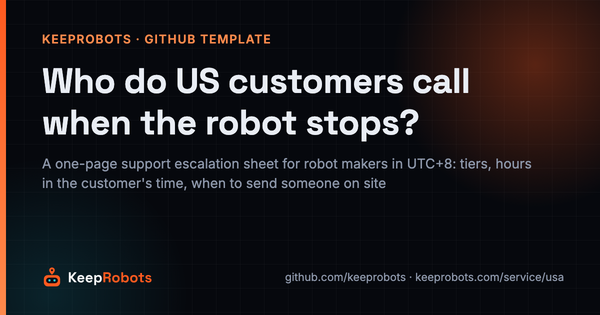
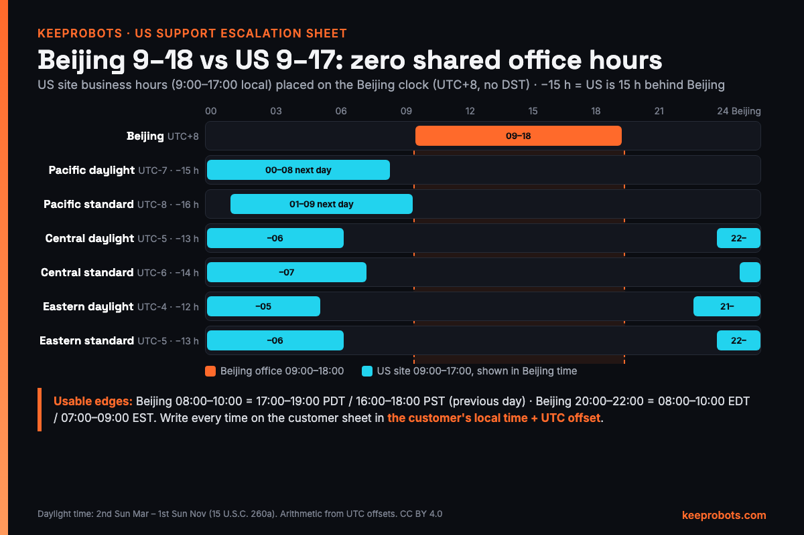

# US Customer Support Escalation Sheet for Overseas Robot Makers (Template)

> Maintained by KeepRobots (Vancouver robot field service) — [keeprobots.com](https://keeprobots.com)



In July, 9:00 a.m. in Shenzhen is 6:00 p.m. the previous evening in Los Angeles. A US customer whose robot stops at 10:00 a.m. Pacific is reporting it at 1:00 a.m. Beijing time, and the maker's support team won't be at their desks for another eight hours. If nobody has told the customer what happens in those eight hours, they work it out for themselves, usually with a phone call to the salesperson.

This is a one-page **support escalation sheet** a robot maker headquartered in China (or anywhere in UTC+8) gives its US customers at go-live, plus the reasoning behind each field. It covers who to contact, at what hours in the customer's own time zone, what to send, what happens next, and when someone comes on site. It is for after-sales and international business leads setting up **robot after-sales service in the USA** before they have a US team, and it works for Canada too.

The sheet deliberately contains **blanks, not numbers**. Response and arrival times depend on your staffing, your field partner's contract and where the robot is. Fill them in only with what you can keep.

Related templates in this repo: the [Robot Fault Report & Dispatch Template](robot-fault-report-template.md) (what goes to the field technician) and the [Robot Site Readiness Checklist](site-readiness-checklist.md) (what to confirm before shipping). Not legal advice. Facts were checked on 2026-10-26; sources are at the end.

---

## 1. Why the sheet matters

A US buyer's first after-sales question is often not about the warranty. It is **"who fixes it here, and how fast?"** It comes up in procurement, before the purchase order, and the answer often has to go into the proposal.

A maker without a US team tends to answer with goodwill: "our engineers respond 24/7", "we will send someone quickly". Then the first fault arrives at 10 a.m. Pacific, which is the middle of the night in China, and the customer learns what "24/7" meant.

A written sheet does three things:

- **Decides in advance when someone gets on a plane.** For example: a P1 or P2 ticket with no remote diagnosis after a set number of business hours goes on-site (the clock rule in section 4).
- **Starts the clock in one place.** A message to a salesperson's personal phone or email shouldn't count as a ticket; the agreed channel should.
- **Shows that a local on-site tier exists**, even when it's a partner and not your own staff. That's what the buyer is checking for.

---

## 2. The time-zone reality

China has one time zone, UTC+8, and no daylight saving time. Most of the US changes clocks: daylight time runs from the second Sunday in March to the first Sunday in November. So the gap to Beijing changes twice a year, by one hour, on the US side.



**Standard office hours never overlap.** With Beijing working 9:00–18:00 and the US site working 9:00–17:00 local time, there are zero shared hours in any of the three main US time zones, in either season:

| US site | Season | UTC offset | Beijing is ahead by | Beijing 09:00 is (US, previous day) | Beijing 18:00 is (US, same day) | US 09:00–17:00 is (Beijing; +1 = next day) | Shared hours (9–17 US vs 9–18 Beijing) |
|---|---|---|---|---|---|---|---|
| Pacific | Daylight (Mar–Nov) | UTC-7 | 15 h | 18:00 | 03:00 | 00:00 (+1) – 08:00 (+1) | 0 |
| Pacific | Standard (Nov–Mar) | UTC-8 | 16 h | 17:00 | 02:00 | 01:00 (+1) – 09:00 (+1) | 0 |
| Central | Daylight | UTC-5 | 13 h | 20:00 | 05:00 | 22:00 – 06:00 (+1) | 0 |
| Central | Standard | UTC-6 | 14 h | 19:00 | 04:00 | 23:00 – 07:00 (+1) | 0 |
| Eastern | Daylight | UTC-4 | 12 h | 21:00 | 06:00 | 21:00 – 05:00 (+1) | 0 |
| Eastern | Standard | UTC-5 | 13 h | 20:00 | 05:00 | 22:00 – 06:00 (+1) | 0 |

The usable windows sit at the edges of each day. If your L1/L2 team runs a two-hour shift in the Beijing morning or evening, this is what the US customer sees:

| US site | Season | Beijing 08:00–10:00 (morning shift) = US | Beijing 20:00–22:00 (evening shift) = US |
|---|---|---|---|
| Pacific | Daylight | 17:00–19:00, previous day | 05:00–07:00, same day |
| Pacific | Standard | 16:00–18:00, previous day | 04:00–06:00, same day |
| Central | Daylight | 19:00–21:00, previous day | 07:00–09:00, same day |
| Central | Standard | 18:00–20:00, previous day | 06:00–08:00, same day |
| Eastern | Daylight | 20:00–22:00, previous day | 08:00–10:00, same day |
| Eastern | Standard | 19:00–21:00, previous day | 07:00–09:00, same day |

What follows from it:

- **West Coast customers:** the natural handoff is US end-of-day to China start-of-day. A ticket logged by about 4 p.m. Pacific can get a first diagnosis overnight and an answer at the start of the next US business day.
- **East Coast customers:** a Beijing evening shift (20:00–22:00) covers the US morning, 8–10 a.m. Eastern in summer, 7–9 a.m. in winter.
- **Central:** neither edge lands cleanly. The 20:00–22:00 Beijing shift falls at 07:00–09:00 CDT (06:00–08:00 CST), mostly before the site opens. Shift it one hour later: Beijing 21:00–23:00 = 08:00–10:00 CDT / 07:00–09:00 CST.
- **The switch weeks shift everything by an hour.** US clocks fall back on 1 November 2026 and spring forward on 14 March 2027 (then fall back on 7 November 2027). A sheet printed in summer is wrong in winter unless it gives hours in the customer's local time.
- **Other zones:** Mountain is UTC-6 in summer / UTC-7 in winter (Beijing ahead by 14 / 15 h); most of Arizona stays on UTC-7, Hawaii on UTC-10 (18 h) all year. A partner in Vancouver: most of British Columbia, including Vancouver, has stayed on UTC-7 since the 8 March 2026 spring-forward and doesn't fall back on 1 November 2026, so until 14 March 2027 Vancouver is one hour ahead of US Pacific time (southeastern BC still follows Alberta).
- **A fixed handoff with a BC partner:** Vancouver is now 15 h behind Beijing all year, so Beijing 08:00 is always the partner's 17:00 the previous day and the daily handoff never moves. But between 1 November 2026 and 14 March 2027 a Vancouver technician's 08:00 is 07:00 at a Seattle or Los Angeles site. Write site appointment times in the site's time zone, not the partner's.
- **Season calendar for the sheet:** re-check or reissue it on 1 November 2026, 14 March 2027 and 7 November 2027. In US winter Beijing is 16 / 14 / 13 h ahead of Pacific / Central / Eastern; in US summer 15 / 13 / 12 h.

Rule for the sheet: **write every time in the customer's local time and add the UTC offset** (for example "07:00–09:00 Eastern, UTC-4 / UTC-5 in winter"). Never write "Beijing time" on a customer-facing document.

---

## 3. The sheet (fill-in template)

Copy, fill the `[ ]` blanks, and give it to the customer at go-live (PDF, a laminated card by the charging dock, and a link in the customer portal). One page; no internal details.

```markdown
# [Maker] Robot Support: who to contact and what happens next
Site: [site name, city, state]          Robots covered: [model(s), serials]
Your time zone: [e.g. Pacific, UTC-7 Mar–Nov / UTC-8 Nov–Mar]
All times below are YOUR local time.    Sheet version: [date]

## If someone could get hurt
Stop the robot (e-stop), keep people away, do not charge it.
For smoke, fire or injury call 911 first, then us.
Safety line: [number], [hours, your local time]

## How to report a problem (this starts the clock)
1. Ticket portal / form: [URL]
2. Support email: [address]
3. Phone (urgent, P1 only): [number], [hours, your local time]
Messages to individual staff (personal phone, chat apps) are not tickets.
We will move them into a ticket, but the clock starts when the ticket exists.

## Send with every report
- Robot serial number (label location: [where]) and robot name on site
- What happened, when (your local time), what changed recently
- Error code or screenshot of the screen/app
- Photo and a short video of the robot and the spot where it stopped
- Logs: [how to export, or "we pull them remotely if the robot is online"]
- Site contact for today: name, role, mobile
- Access: badge/escort needed, hours we may work, loading dock, parking

## Who handles it
| Tier | Who | How | Hours (your local time) |
|---|---|---|---|
| L1 Remote support | [Maker] support team | Portal / email / phone; remote login | [ ] |
| L2 Remote engineering | [Maker] engineering | Logs, firmware, maps; works with L1 | [ ] (overnight for you) |
| L3 On-site | [Field partner name], our local field service partner, on our behalf | Visit to your site | Scheduled by us with you |

## Severity and our targets
You propose a severity when you report; we may adjust it using these definitions.
| Severity | Meaning | We reply (acknowledge) | First diagnosis | On-site, if needed |
|---|---|---|---|---|
| P1 Critical | Operation stopped, no workaround | [ ] | [ ] | [ ] |
| P2 High | Some robots/functions down, work continues | [ ] | [ ] | [ ] |
| P3 Medium | Fault, no effect on today's work | [ ] | [ ] | Scheduled |
| P4 Low | Question, change, training | [ ] | — | Next planned visit |
Business hours: [Mon–Fri, __:__–__:__ your local time], excluding [state/federal holidays, list attached].
The clock pauses while we are waiting on you (site access, remote access approval, a test, power or network at the site).
On-site targets apply inside [service area: cities]. Elsewhere we confirm a date in writing.

## What happens after you report
1. Ticket number + severity confirmed by [L1] within the reply target.
2. Remote diagnosis: [many] configuration, map, network and firmware issues can be fixed remotely.
3. If someone needs to come: we tell you who, when, and what they need from you.
4. After the visit: written report (what was found, what was replaced, next steps).
5. Updates every [ ] until the ticket is closed.

## Escalation if you are not satisfied
Support lead: [name, email]   Head of after-sales: [name, email]
```

Notes on the fields:

- **L1 hours.** If L1 sits in China, it's honest to show two windows (for example the Beijing morning and evening shifts converted to the customer's time) rather than "business hours". If you can't staff a reply during the US day, say "reply within the next [ ] business hours", not "24/7".
- **L3 named.** US customers want to know a local tier exists. Naming the partner is optional; some makers have the partner work under the maker's brand and paperwork. Either way, the sheet should say on-site visits are arranged by you, so the customer has one point of contact.
- **Blanks only you can fill.** The [SLA guide](https://keeprobots.com/notes/robot-service-sla-north-america/) explains how to set them: split the promise into separate clocks, make acknowledgement, diagnosis and arrival binding, and keep restore as a target.
- **Holidays.** Use the holidays of the state where the robot is. Chinese New Year and the National Day week don't belong on this sheet, but they do affect L2 and parts shipments, so plan cover internally.

---

## 4. When to dispatch on-site: a decision rule

Remote first, but with a limit on how long. Dispatch L3 when **any** of these is true; otherwise keep working remotely:

1. **Safety:** smoke, heat, swelling battery, leak, injury, uncontrolled motion. The site isolates the robot first.
2. **Physical cause:** collision, fall, water, broken or loose part, visible damage.
3. **Remote has run out:** the remote fix failed, or the same fault came back after a remote fix.
4. **Robot unreachable:** offline after the site has checked power and network.
5. **Clock rule:** a P1 or P2 ticket still has no remote diagnosis after `[ ]` business hours (your number, set so the on-site promise can still be met).

Before the technician goes, check four things or the visit may be wasted:

- [ ] Site access window confirmed by the customer (badge, escort, hours)
- [ ] Likely parts identified and located (technician's bag, local stock, or in transit)
- [ ] Authorization agreed: what the technician may open, replace or roll back without calling back
- [ ] A maker engineer reachable during the visit, given the time-zone tables above

The full field list and a triage table are in the [fault report template](robot-fault-report-template.md).

What an L3 tier can look like in practice: KeepRobots, for example, is a field service company that sends engineers from Vancouver to US sites per project (closest: Washington, Oregon, California). Its US rates (US$200 diagnostic visit credited to an approved repair, US$150/h on site, travel quoted per project) are published on its US page. It doesn't publish a blanket arrival time; it replies to requests within one business day and confirms each visit date in writing. When you fill in the on-site column, your partner's written commitment is the limit.

---

## 5. Mistakes to avoid

| Mistake | What happens | Instead |
|---|---|---|
| Hours written in Beijing time | The customer converts wrongly, or not at all | Customer's local time + UTC offset |
| "24/7 support" with a team that sleeps during the US day | The first night-time fault breaks the promise | Show the real windows; offer 24/7 only where staffed |
| A WeChat group or a sales rep's mobile as the main channel | Tickets are lost, and the clock is disputed | One ticket channel; the clock starts when the ticket exists |
| One on-site time for the whole US | You can't meet it outside the partner's area | On-site targets by city or region; elsewhere "date confirmed in writing" |
| Promising the customer exactly what the partner promises you | Any half-day slip puts you in breach | Keep your partner's commitment one notch tighter than yours |
| Not updating the sheet at the DST change | Windows are off by an hour for months | Local times only, and a version date on the sheet |
| "Response time" with no definition | Customer means fixed; you mean replied | Separate reply, diagnosis and on-site columns |
| No list of what to send | The first exchange is spent asking for the serial number | The "Send with every report" box |
| L3 left out because there's no US office yet | The buyer assumes nobody will come | Name the on-site tier, even if it's a partner |

---

## Sources

- 15 U.S.C. 260a, US daylight saving time (second Sunday in March to first Sunday in November) — https://www.law.cornell.edu/uscode/text/15/260a
- IANA Time Zone Database 2026b (America/Vancouver permanent UTC-7) — https://www.iana.org/time-zones/releases/2026b
- Government of British Columbia, permanent daylight time announcement — https://news.gov.bc.ca/33415
- KeepRobots, Robot repair, after-sales and field service in the USA (coverage, rates, reply time; updated 2026-10-20) — https://keeprobots.com/service/usa/
- KeepRobots, Robot after-sales SLA in North America (five clocks, severity, timing rules, holidays, back-to-back SLA) — https://keeprobots.com/notes/robot-service-sla-north-america/

Time conversions are arithmetic from the UTC offsets above. Found an error? Open an issue. We check and correct.

## Related pages on keeprobots.com

- [Robot repair, after-sales and field service in the USA](https://keeprobots.com/service/usa/)
- [Robot field service companies in North America (2026 comparison)](https://keeprobots.com/guides/robot-field-service-companies-north-america/)
- [Robot after-sales SLA in North America: what to promise](https://keeprobots.com/notes/robot-service-sla-north-america/)
- [Robot service partner checklist](https://keeprobots.com/notes/robot-service-partner-checklist/)

*KeepRobots is a robot field-service company in Vancouver, BC (deployment, commissioning, repair, maintenance). We don't make or sell robots. Licensed CC BY 4.0, like the rest of this repository.*
