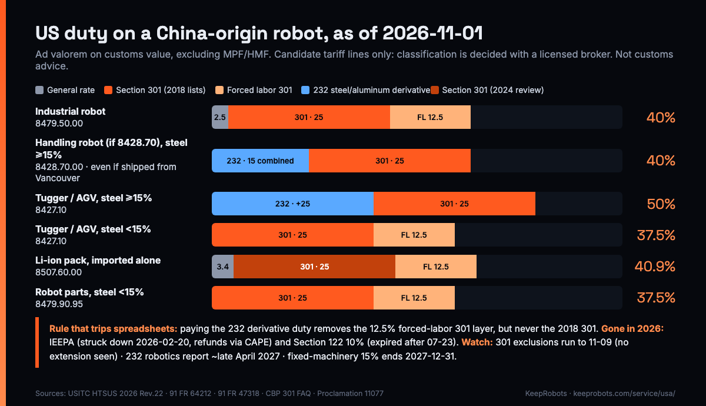

# US Import Duty Worksheet for China-Made Robots and Spare Parts (2026) — KeepRobots Template

A common pricing mistake (illustrative): a sales deck still says "US tariff on our robots: 25%", which counts only the 2018 Section 301 layer (still in force). 2026 changed the stack several times: the IEEPA tariffs were struck down in February, a temporary 10% Section 122 tariff came and went, a 12.5% Section 301 "forced labor" layer arrived in July, Section 232 steel and aluminum "derivative" duties now apply at full value to some robot tariff lines (Proclamations 11021 and 11032, April–June 2026), and the Section 232 robotics investigation concluded on October 28 with a proclamation that imposes no tariff for now but orders negotiations and a report within 180 days. For a China-origin industrial robot under HTSUS 8479.50, the stack today is **2.5% + 25% + 12.5% = 40%** of customs value.

This worksheet turns the current rules into one table per SKU, so the sales, finance and customs people are looking at the same numbers before a US quote goes out.

**How to use it:** one row per SKU you will import: robot, dock or charger, battery pack, and each common spare. Fill columns A–D from your BOM and your customs broker, then apply the rules in section 2. Re-check before every quote; US duties changed several times in 2026.

Rates below are from the USITC HTSUS 2026 Revision 22 and Federal Register / CBP / Supreme Court sources, checked 2026-11-01 (list at the end). **Not customs, tax or legal advice. Tariff classification is decided with a licensed customs broker; when unsure, ask CBP for a binding ruling.** KeepRobots is a robot field service company, not a broker or importer.

---

## 0. The layers, as of 2026-11-01

| Layer | China-origin rate | Status | Notes |
|---|---|---|---|
| General (column 1) rate | By tariff line; robots and parts mostly 0–4% | HTSUS 2026 Rev. 22 | 8479.50 2.5%; 8428.70, 8427.10, 8508.11 free |
| Section 301 (2018 lists) | Mostly 25% | In force (continued, 91 FR 64212, 2026-10-07); second four-year review opened 2026-05-06 (91 FR 24636), rates may change | 8479.50, 8428.70, 8427.10, 8479.90.95 on List 1; 8479.89.95, 8508.11, 8537.10.91 on List 3 |
| Section 301 four-year review increases (2024) | 25% on Li-ion 8507.60 (9903.91.06) | From 2026-01-01 | Separate 2024 action; stacks the same way as the 2018 lists |
| Section 301 forced labor | 12.5% (9903.05.31) | From 2026-07-24 | Not charged on goods paying Section 232 steel/aluminum derivative duty |
| Section 232 steel/aluminum derivatives | 8428.70, 8479.90.95: 15% combined; 8427.10: +25% | In force; only if the listed metal is at least 15% of the goods' weight (8428.70 and 8427.10: steel; 8479.90.95: steel. The aluminum list cites a retired suffix, 8479.90.9596, so confirm with your broker) | "Fixed industrial machinery" temporary 15% runs to 2027-12-31 |
| IEEPA (fentanyl, reciprocal) | — | Ended after *Learning Resources v. Trump* (2026-02-20) and EO 14389 | Refunds via CBP's CAPE in the ACE Portal (live since 2026-04-20); in practice the importer of record on the original entry files |
| Section 122 | — | 10% from 2026-02-24, expired after 2026-07-23 | No replacement |
| Section 232 robotics investigation | — | Proclamation 11077 (2026-10-28): no tariff now, negotiate, report within 180 days | Lists no tariff lines; future tariffs, quotas or fees possible |

Rates are ad valorem on customs value and exclude harbor and merchandise processing fees (MPF/HMF). Customs value is generally the transaction value; international freight and insurance to the US are not included (19 CFR 152.102(f)).

---

## 1. The worksheet

| A. SKU | B. Candidate HTSUS (broker-confirmed?) | C. Metal % by weight (232 metal) | D. Origin | E. General rate | F. 232 derivative applies? | G. 301 (list) | H. Forced labor 301 | I. Total | J. Duty on US$ value | K. Open questions |
|---|---|---|---|---|---|---|---|---|---|---|
| | | | | | | | | | | |

Key: C = weight share of the metal named on that line's 232 list (steel or aluminum); D = country of origin, where the goods were substantially made.

Filled example (fictional SKUs, US$30,000 unless noted; columns A–J, with K shown as a note below):

| SKU | HTSUS | Metal share | Origin | General | 232 | 301 | FL 301 | Total | Duty |
|---|---|---|---|---|---|---|---|---|---|
| Industrial arm | 8479.50.00 | — | CN | 2.5% | not on list | 25% (L1) | 12.5% | **40%** | US$12,000 |
| Handling robot (assumed 8428.70 "industrial robots"; confirm with broker), steel chassis, shipped from a Vancouver warehouse | 8428.70.00 | steel 35% | CN | (replaced) | 15% combined | 25% (L1) | not charged | **40%** | US$12,000 |
| Tugger, steel body | 8427.10 | steel 40% | CN | Free | +25% | 25% (L1) | not charged | **50%** | US$15,000 |
| Tugger, aluminum/composite body | 8427.10 | steel 8% | CN | Free | below 15% | 25% (L1) | 12.5% | **37.5%** | US$11,250 |
| Battery pack imported alone (US$2,000) | 8507.60.00 | — | CN | 3.4% | not on list | 25% | 12.5% | **40.9%** | US$818 |
| Service robot | 8479.89.95 | — | CN | 2.5% | unverified (see note) | 25% (L3) | 12.5% | **40%** | US$12,000 |

K (open question) on 8479.89.95: the aluminum derivative list refers to a retired statistical suffix, so we could not confirm whether it applies. Either way the China-origin total is 40%.

---

## 2. Stacking rules (apply in this order)

1. **Origin first.** If the goods are China-origin, the China rates apply no matter where they ship from. CBP: "Section 301 duties are based on country of origin, not country of export."
2. **Section 232 derivative test.** Is the tariff line on the steel or aluminum derivative list, *and* is that listed metal at least 15% of the goods' weight? If both: apply 232 on the full value.
   - 8428.70 and 8479.90.95: 15% **combined** (in place of the general rate).
   - 8427.10: **add** 25% on top of the general rate.
3. **Section 301 (2018 lists and the 2024 review increases) always stacks** on top, at the list rate.
4. **Forced labor 301 (12.5%) stacks only if step 2 did not apply.** Goods paying 232 derivative duty are exempt from it.
5. **Exclusions.** The 178 extended Section 301 exclusions are written in the HTSUS as valid "through November 9, 2026"; as of November 4, 2026 (searched that day) we had not seen a further extension, and we found no whole-robot tariff line among them. Price without them.
6. **Repairs (9802).** A part sent abroad for repair and re-imported, if it meets the 9802 conditions, pays duty on the value of the repair; China is not among the free-repair FTA partners, and Section 301 also applies to the repair value.

---

## 3. Routing through Canada: what changes and what doesn't

| Scenario | US origin treatment | Source |
|---|---|---|
| Stored, repacked or relabelled in Canada | Still China origin; China rates apply | 19 CFR 134.1(b); for CUSMA-country processing, Part 102 (102.11) |
| Assembled in Canada from parts | Possibly different; for CUSMA-country goods, tariff-shift rules in 19 CFR Part 102 apply. A complete robot shipped knocked-down usually classifies as the robot (GRI 2(a)), so no shift occurs | 19 CFR 102.11; USMCA Annex 4-B |
| Which origin rule Section 301 uses for CUSMA-origin goods | CBP has not said clearly | Get a binding ruling before relying on it |
| China-origin goods shipped from Canada | China rates (301 + 12.5%, or 301 + 232 where step 2 applies), not Canada's 10% forced-labor rate (9903.05.29, waived for CUSMA duty-free Canadian goods); this follows from the regulation text, CBP has not addressed this exact case | HTS chapter 99 note 52 |
| The 2025 IEEPA "40% transshipment" penalty (EO 14326) | No longer applies: it was part of the IEEPA reciprocal tariff system ended by EO 14389 (our reading of the texts) | 90 FR 37963; 91 FR 9437 |
| Wrong origin declared | Penalties up to 4× the lost duty for gross negligence, 2× for negligence (capped at domestic value); up to domestic value for fraud | 19 U.S.C. 1592(c) |

Canada itself charges MFN 0% on 8479.50 and 8428.70, plus 5% GST (recoverable for registrants). Canada's surtax on Chinese goods now covers only steel and aluminum chapters 72, 73 and 76.

---

## 4. Three dates to put in your contracts

| Date | What happens | Contract wording to consider |
|---|---|---|
| After 2026-11-09 | The 178 extended Section 301 exclusions lapse unless extended (valid "through November 9, 2026") | None needed if your quote already ignores exclusions |
| About late April 2027 | 180-day report under the Section 232 robotics proclamation; tariffs, quotas or fees possible afterward | "Any new or increased US duty imposed after [date] on the Equipment is borne by [party] / adjusts the price by [formula]." |
| 2027-12-31 | Temporary 15% for fixed industrial machinery ends; 25% from 2028 | Same clause; re-run section 2 for 8428.70 and 8479.90.95 |

Also: the US de minimis exemption no longer applies to commercial goods regardless of value, origin or mode (EO 14388); CBP suspended it for all non-postal channels indefinitely from 2026-06-24, and the statute repeals it on 2027-07-01. Splitting spare parts into small parcels no longer avoids duty.

---

## 5. Pre-quote checklist

- [ ] Every SKU (robot, dock, battery, common spares) has a broker-confirmed HTSUS line in writing; uncertain ones go to CBP for a binding ruling.
- [ ] Steel and aluminum weight share recorded for every SKU on a 232 derivative line.
- [ ] Origin analysis in writing for anything processed outside China.
- [ ] Importer of record named (your US entity, the customer, or a distributor) and who pays duty written into the contract.
- [ ] Duty-change clause covers the Section 232 robotics outcome.
- [ ] Drawback: who files and who keeps records for goods re-exported (for example to Canada). Per CBP's drawback FAQ, the 2018 Section 301 duties on goods re-exported unused can be drawn back, up to 99%; we found no official statement on forced labor 301. US import records are generally kept 5 years (19 CFR 163.4).
- [ ] FCC status checked for each foreign-produced mobile robot model: was it FCC-authorized before July 28, 2026? New models caught by the FCC Covered List entry for advanced robotic devices can't be sold in the US, however well the duty is calculated.
- [ ] Repair plan: which faults are fixed in North America so failed parts don't make a duty-paying round trip. (This is the part KeepRobots does: on-site repair in Canada and the US.)

---

## Sources (checked 2026-11-01; exclusion extension re-checked 2026-11-04)

- USITC HTSUS 2026 Revision 22, chapters 84, 85, 99: https://hts.usitc.gov/
- USTR, continuation of Section 301 actions (91 FR 64212): https://www.federalregister.gov/documents/2026/10/07/2026-20510/continuation-of-actions-chinas-acts-policies-and-practices-related-to-technology-transfer
- USTR, Section 301 second four-year review (91 FR 24636, 2026-05-06): https://www.federalregister.gov/citation/91-FR-24636
- USTR, Section 301 forced labor actions (91 FR 47318): https://www.federalregister.gov/documents/2026/07/28/2026-15181/notice-of-actions-in-section-301-investigations-of-acts-policies-and-practices-of-various-economies
- CBP, Section 301 FAQs: https://www.cbp.gov/trade/programs-administration/entry-summary/section-301-trade-remedies/faqs
- Supreme Court, *Learning Resources, Inc. v. Trump*, 607 U.S. 229 (2026): https://www.supremecourt.gov/opinions/25pdf/607us2r12_8nj9.pdf
- EO 14389, Ending Certain Tariff Actions (91 FR 9437): https://www.federalregister.gov/documents/2026/02/25/2026-03832/ending-certain-tariff-actions
- CBP, IEEPA duty refunds (CAPE): https://www.cbp.gov/trade/programs-administration/trade-remedies/ieepa-duty-refunds
- Section 232 robotics investigation notice (90 FR 46382): https://www.federalregister.gov/documents/2025/09/26/2025-18749/notice-of-request-for-public-comments-on-section-232-national-security-investigation-of-imports-of
- Proclamation 11077, robotics and industrial machinery (91 FR 69199): https://www.federalregister.gov/documents/2026/11/02/2026-22385/adjusting-imports-of-robotics-industrial-machinery-and-their-parts-and-components-into-the-united
- 19 CFR 134.1, 102.11, 152.102, 163.4: https://www.ecfr.gov/current/title-19
- Section 301 List 1 (83 FR 28710): https://www.govinfo.gov/content/pkg/FR-2018-06-20/pdf/2018-13248.pdf
- Section 301 four-year review modifications (89 FR 76581): https://www.federalregister.gov/d/2024-21217
- HTSUS chapter 99, subchapter III note 16 (232 steel/aluminum derivatives; Proclamations 11021 and 11032) and note 52 (forced labor 301): https://hts.usitc.gov/
- De minimis suspension for non-postal channels (91 FR 37789): https://www.govinfo.gov/content/pkg/FR-2026-06-24/pdf/2026-12670.pdf
- CBP, drawback and trade remedies FAQ: https://www.cbp.gov/trade/automated/news/drawback/drawback-trade-remedies-frequently-asked-questions
- USMCA chapter 4, rules of origin (Annex 4-B): https://ustr.gov/sites/default/files/files/agreements/FTA/USMCA/Text/04%20Rules%20of%20Origin.pdf
- 19 CFR Part 177, binding rulings: https://www.ecfr.gov/current/title-19/chapter-I/part-177
- 19 U.S.C. 1592: https://www.govinfo.gov/content/pkg/USCODE-2024-title19/html/USCODE-2024-title19-chap4-subtitleIII-partV-sec1592.htm

This worksheet summarises public sources for orientation only, as of 2026-11-01. It is not customs, tax or legal advice. SKUs and values in the examples are fictional; the contract wording is a template suggestion.

### Related pages on keeprobots.com

- [机器人出口美国 2026 关税（Chinese, full rate table and sources）](https://keeprobots.com/zh/notes/robot-export-usa-tariffs-2026/)
- [Shipping a robot back to China for repair: duty on the repair value](https://keeprobots.com/notes/robot-return-to-manufacturer-china/)
- [Robot repair, after-sales and field service in the USA](https://keeprobots.com/service/usa/)
- [Robot field service companies in North America (comparison)](https://keeprobots.com/guides/robot-field-service-companies-north-america/)

---

*Maintained by KeepRobots (Vancouver robot field service).*
