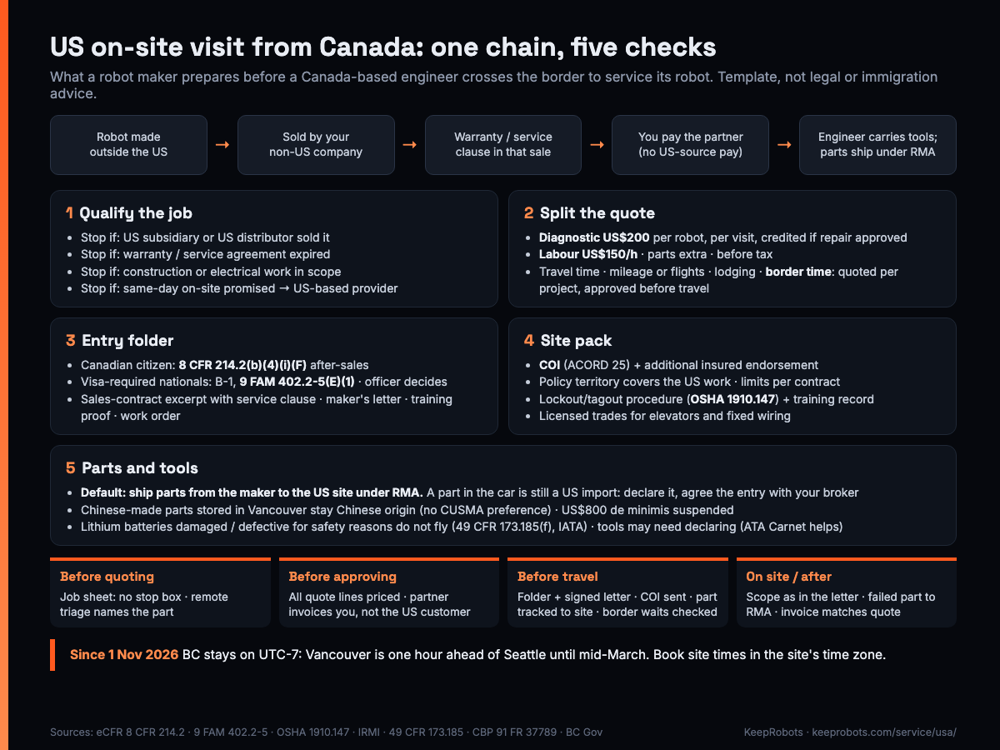

# US On-Site Visit Readiness Pack: Robot Makers Using a Canada-Based Field Service Partner — KeepRobots Template



A Canadian field engineer can fix your robot in Seattle and still have a bad trip. The repair is rarely the problem. The trip goes wrong at one of three questions: **who sold the robot, who pays the engineer, and what is in the car.** If the robot came through your US subsidiary, if the US customer pays the engineer directly, or if a box of undeclared spare boards is on the back seat, the visit can stop at the border or end in a duty bill.

This pack puts those three questions on paper before anyone books a hotel. It is written by **KeepRobots**, a robot field service company in Vancouver, Canada. We have **no US office and no engineers living in the US**: US work is project-based, and engineers travel from Vancouver. That is exactly the setup this template is for. Rules below are summarised from the official texts listed at the end (immigration rules checked 2026-10-28, customs 2026-10-30, insurance 2026-10-20). **Not legal, immigration, customs or insurance advice; at the border, the officer decides.**

Full explanation: [Robot field service in Seattle and the Pacific Northwest from Vancouver](https://keeprobots.com/notes/robot-field-service-seattle-pacific-northwest/)

**The rule behind the whole file:** every document in the pack must tell the same story. *Robot made outside the US → sold by your non-US company → warranty or service contract in that sale → you engage the partner and pay from outside the US → the engineer carries tools, the parts travel under your RMA.* Where one link breaks, fix it before the trip or send a US-based provider.

---

## 1. Job qualification sheet (fill before quoting)

One sheet per site per visit. If a "stop" box is ticked, do not book the cross-border trip.

| Field | Value | Stop if… |
|---|---|---|
| Robot model / serials | | |
| Country of manufacture | | ☐ made in the US |
| Seller to the US customer (legal entity, country) | | ☐ your US subsidiary or a US distributor |
| Purchase date / warranty or service agreement end | | ☐ warranty or service agreement has expired |
| Clause in the sales contract that obliges the seller to provide service (section no.) | | ☐ no such clause |
| Who pays the partner | | ☐ the US customer pays the engineer directly |
| Work type | repair / maintenance / installation / training | ☐ building, electrical or construction work (anchoring, wiring, fencing a cell) |
| Site address, state | | |
| Customer response promise in the contract | | ☐ same-day or next-morning on site |
| Engineer's citizenship | Canadian (3A) / needs a US visa (3B) / other: check ESTA vs visa | |

Why each "stop" exists:

| Situation | How it lines up with the rules | What to do |
|---|---|---|
| Made outside the US, sold by your non-US company, warranty or service contract in the sale, you pay the partner from outside the US | Closest fit to the after-sales wording | Closest fit: build the entry folder (section 3). The officer still decides |
| Bought from your US subsidiary or a US distributor | Not "purchased from an enterprise located outside the United States" | US-based provider |
| Warranty / service agreement expired, customer wants ad hoc repair | Outside "the life of the warranty or service agreement" | US-based provider, unless a new service contract tied to the sale applies |
| Building or electrical construction in scope | Excluded by 9 FAM 402.2-5(E)(1); treat it as out of scope for USMCA trips too | Local licensed trades; partner supervises or trains only where the rules allow |
| US customer pays the engineer | Conflicts with the source-of-pay requirement | Bill through your contract: partner invoices you |
| Contract promises same-day response | A team that crosses a border and drives hours cannot promise that reliably | US-based provider for urgent calls; Canada-based partner for planned trips |

## 2. Quote structure: what each US visit quote should split out

The point of splitting lines is that you can approve travel **before** anyone leaves. (For comparing several providers, the full 12-line RFQ is [robot-field-service-rfq-template.md](robot-field-service-rfq-template.md).) Rates below are KeepRobots' current published US rates (before tax, may change). Travel amounts are blanks on purpose: they are quoted per project.

| # | Line | Unit | How it is priced | Amount |
|---|---|---|---|---|
| 1 | Diagnostic | per robot, per visit | US$200; credited in full against that robot's repair if you approve it | |
| 2 | On-site labour | per hour | US$150/h | est. h × 150 |
| 3 | Travel time (driving or flight days) | per trip | quoted per project | |
| 4 | Mileage **or** flights | per trip | quoted per project | |
| 5 | Lodging | per night | quoted per project | |
| 6 | Border time | per crossing | quoted per project; a separate line, not a surprise on the invoice | |
| 7 | Parts | per part | extra; normally shipped by you under your RMA, not bought by the partner | |
| 8 | Taxes | | all prices above are before tax | |

Notes that change the total:

- **Greater Vancouver call-out (C$100) does not apply to US jobs.** US travel is lines 3–6.
- **Group sites.** One trip covering several robots or sites shares lines 3–6. Planned maintenance rounds cost far less per robot than separate emergency runs.
- **Remote triage first.** It is free at KeepRobots and it is what prevents a second trip: the engineer arrives with the right part already shipped.
- **Who is invoiced.** Put the contracting and invoicing entities on the quote. For section 1 to hold, the partner invoices *you* (the seller), not your US customer.

Worked arithmetic (published rates; hours are assumptions, not job records):

| Example (before tax, parts extra) | Calculation | Total |
|---|---|---|
| Seattle area, 1 robot, repair approved, 3 h on site | 3 × $150 (US$200 diagnostic credited) | US$450 + travel quoted |
| Same, you decide not to repair after diagnosis | $200 diagnostic, not credited | US$200 + travel quoted |
| Two Puget Sound sites on one trip, 2 robots approved, 5 h total | 5 × $150 (both diagnostics credited) | US$750 + one shared travel quote |

## 3. Entry folder: what the engineer carries across the border

### 3A. Canadian-citizen engineer: USMCA after-sales service, 8 CFR 214.2(b)(4)(i)(F)

The category admits, as business visitors, "installers, repair and maintenance personnel, and supervisors, possessing specialized knowledge essential to the seller's contractual obligation, performing services or training workers to perform services, pursuant to a warranty or other service contract incidental to the sale of commercial or industrial equipment or machinery, including computer software, purchased from an enterprise located outside the United States, during the life of the warranty or service agreement." The equipment must also have been made outside the US, and the visitor must meet the normal B-1 requirements, including where their pay comes from.

Folder (printed, or saved offline so nothing depends on a login at the booth):

- [ ] Passport (proof of Canadian citizenship)
- [ ] **Excerpt of the original sales contract**: parties (your non-US entity as seller), equipment, date, and the warranty or service clause; warranty end date visible
- [ ] **Letter from you, the robot maker** (template below)
- [ ] **Proof of training on the model** (your certificate or training record for this engineer; supports "specialized knowledge", not itself a legal requirement)
- [ ] Work order: site, robot serials, the fault, scope limited to service under the warranty or service contract
- [ ] Partner agreement or purchase order showing you pay the partner from outside the US
- [ ] Tool list (section 5) and, if any part travels with the engineer, the customs entry agreed with your broker

### 3B. Engineer who needs a US visa (e.g. a Chinese national living in Canada): B-1, 9 FAM 402.2-5(E)(1)

Consular officers may issue a B-1 visa to someone coming "to install, service, or repair commercial or industrial equipment or machinery purchased from a company outside the United States". Conditions: the **contract of sale must specifically require the seller to provide those services**; the person has **unique knowledge essential** to that obligation; and they receive **no pay from a US source**. Building or construction work is not covered. Same folder as 3A, plus the visa; plan the visa lead time before you promise a date. 9 FAM is guidance for consular officers issuing visas: an engineer from a Visa Waiver Program country normally travels on ESTA instead, so check that route separately.

### What we are not sure of

Both texts are written around knowledge "essential to the seller's contractual obligation". Neither says explicitly how an officer treats an engineer employed by a **third-party partner** rather than by the seller. That is the point most likely to be probed, which is why the training record and your letter matter. Before the first trip under a new partner arrangement, confirm it with a US immigration lawyer.

### 3C. Maker's letter (template, edit to fit)

```
[Maker letterhead]                                   Date:
To: U.S. Customs and Border Protection

[Maker legal name], [country], manufactured the [model] robot(s), serial
nos. [...], in [country of manufacture] and sold them to [US customer legal
name], [city, state], under contract [no.] dated [date].

Section [x] of that contract obliges [Maker] to provide [warranty repair /
maintenance] during the warranty period, which ends on [date].

We have engaged [partner legal name], Vancouver, Canada, to perform this
service on our behalf. [Engineer name], passport no. [...], has been trained
on this model by us. The visit is from [date] to [date] at [site address].
Work: [diagnosis and module replacement under warranty]. No building,
electrical or construction work is included.

[Engineer name] is employed and paid by [partner] in Canada. [Partner]
invoices [Maker], [country], for this visit.
[Only if true: [Maker] has not charged [US customer] separately for it.]

Attached: contract excerpt, training record, work order.

Contact: [name, title, email, phone reachable during the visit]
```

Keep the letter factual: state who employs, pays and invoices whom, and let the officer draw the conclusion. It points to documents the officer can ask to see; it does not replace them.

## 4. Customer site pack: insurance and safety documents

US facilities and procurement teams often ask for these before giving site access. Send them a week ahead, not at the gate. (Building-side checks before the robot first ships are in [site-readiness-checklist.md](site-readiness-checklist.md); who owns each warranty step is in [warranty-repair-raci.md](warranty-repair-raci.md).)

**Insurance**

- [ ] **Certificate of insurance (COI)**, commonly ACORD 25, naming the customer's exact legal entity as certificate holder. A COI is information only: it does not change the policy and does not make anyone an additional insured.
- [ ] **Additional insured endorsement** copy, if the contract requires the customer (and you, the maker) to be additional insureds. Only the insurer's endorsement does that.
- [ ] Waiver of subrogation and primary/non-contributory endorsements, if the contract asks. Add them when the contract is signed; waiving rights after a loss can void cover.
- [ ] **Check the policy territory covers the US work.** A Canada-based partner's policy has to be confirmed for each US project, not assumed.
- [ ] Limits: set by the customer's contract, not by law ("$1M / $2M plus a $5M umbrella" is common practice; public example: Tufts University).
- [ ] Workers' compensation: US rules are state by state (Texas, for example, lets private employers opt out). Follow the state's rules and the customer's contract.
- [ ] Commercial auto: customer contracts often require owned, hired and non-owned vehicles to be covered; the engineer is driving from Vancouver.

**Safety and site**

- [ ] **Written safe-work procedure for your robot**: how stored energy is controlled before servicing. Lockout/tagout applies to servicing work in the US under OSHA 29 CFR 1910.147; 1910.147(c)(7) requires training of authorized employees in recognizing hazardous energy sources, the type and magnitude of the energy and the methods of isolation and control, with a certification listing each employee's name and dates of training. Include batteries, springs and raised loads, and how a legged robot or arm is made safe.
- [ ] Engineer's lockout training certification (name, dates) ready to show.
- [ ] **Exchange lockout procedures with the site.** Under 29 CFR 1910.147(f)(2), when outside servicing personnel do this work, the on-site employer and the outside employer must inform each other of their lockout/tagout procedures. Send yours with the COI; ask for theirs.
- [ ] Site requirements: badges, safety orientation, background checks where the facility requires them.
- [ ] **Licensed work stays with licensed trades.** Elevator and electrical licensing is set by each state (in Washington, conveyance work must be done by a licensed elevator mechanic, RCW 70.87.230). The partner does the robot side of an elevator link and coordinates with the building's contractor.
- [ ] **FCC check if the repair touches radios.** Foreign-produced advanced robotic devices are on the FCC Covered List since 28 July 2026 (DA 26-786). Models authorized before that date can still be imported, sold and used. If a repair would change the radio hardware, ask your certification team before the visit.

## 5. Parts and tools: carry or ship?

| Item | Default | If it must travel with the engineer |
|---|---|---|
| Replacement parts | **Ship from you straight to the US site under your RMA process**; engineer brings only tools | It is a US import even in a car. Declare it and agree beforehand with your customs broker how it will be entered |
| Chinese-made parts stored in Vancouver | Ship from the factory to the US site | Storage in Canada does not change origin: still Chinese origin, no CUSMA preference, Chinese-origin duties apply (CUSMA Art. 4.2; 19 CFR 134.1) |
| Tools and test equipment | Engineer carries them | May need declaring; an ATA Carnet helps for temporary equipment entering the US (in Canada it cannot be used for goods imported for repair, CBSA D8-1-1) |
| Lithium battery packs | Ship separately under the dangerous-goods rules | Batteries **damaged or defective for safety reasons do not fly**, including when installed in equipment (equipment returned for an unrelated fault is not barred from air on that ground); highway, rail or vessel only, in specific packaging marked "Damaged/defective lithium ion battery" (49 CFR 173.185(f); IATA). From 2026-01-01, IATA requires ≤30% state of charge for batteries packed with equipment |
| Failed parts after the repair | Tag with serial number and hand into your RMA | Never swap a "new one" for a part declared as repaired; that is a new import |

Two traps people bring from older playbooks: the US$800 de minimis exemption has been **suspended for all countries since 2025-08-29** (indefinitely from 2026-06-24; repealed in law from 2027-07-01), so splitting parts into small parcels no longer avoids duty; and US tariffs changed several times in 2026, so a duty estimate from last spring is probably wrong. Ask your broker on the day of entry.

From the Canadian side, non-controlled goods exported to the US do not need a Canadian export declaration (CBSA D20-1-1).

## 6. Trip checklist (go / no-go)

**Before quoting**
- [ ] Section 1 sheet complete, no "stop" box ticked
- [ ] Remote triage done (fault codes, logs, photos, video): which part, which serial

**Before approving the quote**
- [ ] Every line in section 2 answered, travel lines 3–6 priced
- [ ] Invoicing chain written: partner → you, not the US customer

**Before travel**
- [ ] Entry folder (section 3) printed or saved offline; maker's letter signed
- [ ] Customer has received COI, endorsements and safe-work procedure (section 4); site access confirmed
- [ ] Part shipped under RMA and tracked to the site, or broker has agreed the entry for a carried part
- [ ] Border: live waits checked (DriveBC for southbound into the US, WSDOT for northbound on the way back). Four Lower Mainland crossings: Peace Arch (I-5, no commercial vehicles), Pacific Highway (SR 543), Lynden (SR 539), Sumas (SR 9)
- [ ] **Time zone:** BC stays on UTC-7 all year from 1 November 2026, so from November to mid-March Vancouver is one hour ahead of Seattle. Book the site time in the site's time zone

**On site / after**
- [ ] Work stays inside the scope in the letter
- [ ] Failed part tagged and returned under RMA; report with serials, firmware, photos and hours
- [ ] Invoice to you matches the quote lines; diagnostic credited if repair approved

## What KeepRobots can do here

KeepRobots is a robot field service company based in Vancouver. We send engineers to US sites per project; the West Coast (Washington, Oregon, California) is closest, other states on planned trips. We work in English and Mandarin and read Chinese technical documentation. Before booking we check with the maker whether each job fits the after-sales conditions above; if it doesn't, we say so and suggest a US-based provider. Current US rates: diagnostic US$200 per robot, per visit (credited if the repair is approved), on-site labour US$150/hour, travel quoted per project, all before tax.

## Sources

Immigration and border (checked 2026-10-28)
- 8 CFR 214.2(b)(4)(i)(F), USMCA after-sales service: https://www.ecfr.gov/current/title-8/chapter-I/subchapter-B/part-214/section-214.2
- 9 FAM 402.2-5(E)(1), commercial or industrial workers: https://fam.state.gov/fam/09FAM/09FAM040202.html
- WSDOT, border crossings: https://wsdot.wa.gov/travel/roads-bridges/border-crossings
- BC Government, permanent daylight time: https://news.gov.bc.ca/releases/2026AG0013-000209

Insurance (checked 2026-10-20)
- IRMI, certificate of insurance: https://www.irmi.com/term/insurance-definitions/certificate-of-insurance
- IRMI, additional insured: https://www.irmi.com/term/insurance-definitions/additional-insured
- IRMI, waiver of subrogation: https://www.irmi.com/term/insurance-definitions/waiver-of-subrogation
- IRMI, primary and noncontributory: https://www.irmi.com/term/insurance-definitions/primary-and-noncontributory
- NY DFS, OGC opinion 02-12-04 (certificates cannot alter policies): https://www.dfs.ny.gov/insurance/ogco2002/rg021204.htm
- Tufts University, vendor insurance requirements (public example): https://access.tufts.edu/insurance-requirements-vendors-contractors-and-service-providers
- Texas Department of Insurance, workers' compensation nonsubscribers: https://www.tdi.texas.gov/WC/nonsubscriber.html

Safety and site
- OSHA 29 CFR 1910.147, control of hazardous energy: https://www.osha.gov/laws-regs/regulations/standardnumber/1910/1910.147
- RCW 70.87.230 (Washington conveyance work): https://app.leg.wa.gov/rcw/default.aspx?cite=70.87.230
- FCC DA 26-786 (Covered List, advanced robotic devices): https://docs.fcc.gov/public/attachments/DA-26-786A1.pdf

Parts and customs (checked 2026-10-30)
- 49 CFR 173.185 (lithium batteries): https://www.ecfr.gov/current/title-49/section-173.185
- IATA lithium battery guidance: https://www.iata.org/en/programs/cargo/dangerous-goods/lithium-batteries/
- CUSMA Chapter 4 (rules of origin): https://www.international.gc.ca/trade-commerce/trade-agreements-accords-commerciaux/agr-acc/cusma-aceum/text-texte/04.aspx?lang=eng
- 19 CFR 134.1 (country of origin): https://www.ecfr.gov/current/title-19/section-134.1
- CBP de minimis suspension, interim final rule (91 FR 37789): https://www.govinfo.gov/content/pkg/FR-2026-06-24/pdf/2026-12670.pdf
- CBSA Memorandum D20-1-1 (export reporting): https://www.cbsa-asfc.gc.ca/publications/dm-md/d20/d20-1-1-eng.html
- CBSA Memorandum D8-1-1 (temporary importation, 9993.00.00): https://www.cbsa-asfc.gc.ca/publications/dm-md/pdf/d8-1-1-eng.pdf

KeepRobots rates are current published rates as of 2026-11-02, before tax, and may change. Example hours are assumptions.

### Related pages on keeprobots.com

- [Robot repair, after-sales and field service in the USA](https://keeprobots.com/service/usa/)
- [Robot field service companies in North America (comparison)](https://keeprobots.com/guides/robot-field-service-companies-north-america/)
- [Robot field service in Seattle and the Pacific Northwest from Vancouver](https://keeprobots.com/notes/robot-field-service-seattle-pacific-northwest/)
- [Shipping a robot back to China for repair: customs, cost, downtime](https://keeprobots.com/notes/robot-return-to-manufacturer-china/)
