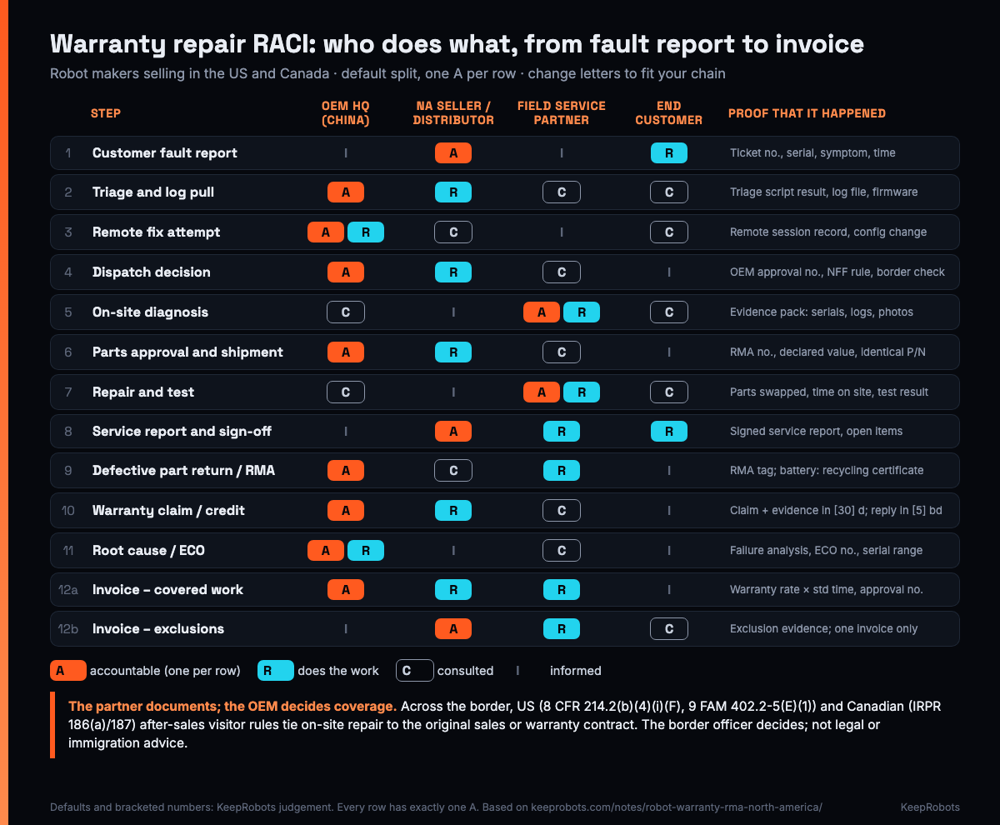

# Warranty Repair RACI for Robot Makers Selling in the US and Canada — KeepRobots Template

> Written by KeepRobots, a robot field-service company in Vancouver, Canada — [keeprobots.com](https://keeprobots.com)

A robot sold into the US or Canada breaks down under warranty. Four parties are now involved: the maker's headquarters in China, the North American seller (a subsidiary, dealer or distributor, if there is one), the local field service partner who drives to site, and the customer whose floor is waiting. Everybody agrees on the main rule: the maker pays for covered defects. The fights come from the steps nobody assigned. Who decided to send a technician to a fault that turned out to be Wi‑Fi? Who was supposed to get the failed drive module back to the factory? And who is allowed to tell the customer "that's covered"?

This template makes those answers explicit, one line per step of a warranty repair, before the first ticket. It is for after-sales managers and overseas business leads at robot companies, especially from China, selling mobile, cleaning, delivery, humanoid or quadruped robots and arms in North America. Copy it into an issue, a spreadsheet or the annex of your dealer and service agreements.

It is based on our field note [Robot warranty and RMA in North America: who pays for what](https://keeprobots.com/notes/robot-warranty-rma-north-america/), which has the clause-by-clause reasoning and official sources. In the setup below KeepRobots would be the "field service partner" column, so read our defaults with that in mind. **This is not legal, customs, tax or immigration advice.**



---

## How to read and fill the matrix

**R** = Responsible (does the work). **A** = Accountable (owns the outcome, signs off; exactly **one A per row**). **C** = Consulted (asked before, two-way). **I** = Informed (told after, one-way).

1. **Pick your chain.** The defaults assume OEM HQ (China) → North American seller → end customer, with a field service partner doing on-site work. If you sell direct with no North American entity, HQ takes the seller column too. If the dealer has its own technicians, it may take the partner column. The columns stay; what breaks warranty programmes is a column nobody holds.
2. **Change letters, not rows.** Go row by row with each party. Where you disagree with a default, change it, but keep one A per row. Two A's means nobody.
3. **Fill the "proof" column with document names your systems actually produce** (ticket number format, report template, RMA tag). If a step has no proof, it didn't happen when the claim is reviewed.
4. **Write the blanks in brackets** (`[30] days`, `[15] business days`) as numbers in your contracts. The bracketed numbers below are examples, not recommendations.
5. **Run the cross-border check** (section 4) for every US or Canadian site that a technician might reach from the other country.
6. **Attach the finished matrix** to the dealer agreement and the service partner agreement as a schedule, and give each party's duty desk a copy.

---

## 1. The RACI matrix (copy-paste)

```markdown
# Warranty repair RACI: [product / models], [company], [date]
OEM HQ: [legal entity, country]          After-hours approver (name, time zone): [ ]
North American seller: [ ] subsidiary  [ ] dealer / distributor: [ ]  [ ] none (HQ sells direct)
Field service partner(s) and coverage area: [ ]
Response clock time zone: [e.g. customer's local time]     Matrix owner: [ ]     Review date: [ ]
```

| # | Step | OEM HQ (China) | NA seller / distributor | Field service partner | End customer | Proof / document | Common gap |
|---|---|---|---|---|---|---|---|
| 1 | Customer fault report | I | **A** | I | R | Ticket number; robot serial; symptom; time of fault; site contact | Customer calls whoever's number they have; two tickets, two stories |
| 2 | Triage and log pull | **A** | R | C | C | Triage script steps done and result; exported log file; firmware version; fault codes; run hours | Triage skipped "to save time", then the visit finds nothing and nobody agrees who pays |
| 3 | Remote fix attempt | **A** / R | C | I | C | Remote session record; any config or firmware change, with version | Fault lands in the middle of the night in China and waits a day; no after-hours approver |
| 4 | Dispatch decision | **A** | R | C | I | OEM approval or work order number; NFF rule applied; cross-border check (section 4) for out-of-country technicians | Partner sent "just go and look" with no approval number; US/Canada eligibility checked after booking |
| 5 | On-site diagnosis | C | I | **A** / R | C | Evidence pack: robot and part serials, firmware, run hours, fault codes, log file, photos before removal (label and damage), video if intermittent | Partner tells the customer "this is covered" or "not covered": that is the OEM's call |
| 6 | Parts approval and shipment | **A** | R | C | I | RMA number; approval for any labour over standard time; commercial invoice with a declared value even at no charge; identical part number | Each "no charge" part shipped by courier and declared differently; a non-identical part swapped in |
| 7 | Repair and test | C | I | **A** / R | C | Parts replaced (old and new serials); time on site; post-repair test result; firmware after repair | Sealed assembly opened without written OEM approval; no workmanship period agreed |
| 8 | Service report and customer sign-off | I | **A** | R | R | Signed service report: work done, parts, time on site, test result, open items | Report written in a format the warranty desk can't use; no signature, so the invoice is disputed later |
| 9 | Defective part return / RMA | **A** | C | R | I | RMA tag on part and box; export and return paperwork; for damaged lithium batteries, photos, logs and a local recycling certificate | Failed parts sit in a van for months; a damaged battery planned for air freight |
| 10 | Warranty claim / credit | **A** | R | C | I | Claim with evidence pack within [30] days of repair; OEM accept/reject within [5] business days; credit note | Claim arrives months late with one blurry photo; no deemed-acceptance rule, so claims sit unanswered |
| 11 | Root cause / ECO | **A** / R | I | C | I | Failure analysis report; ECO number; affected serial range; field action notice if needed | Without returned parts, root cause never happens and the same fault keeps coming back |
| 12a | Invoice – covered work | **A** | R | R | I | Partner invoice at the agreed warranty rate and standard time, referencing the OEM approval number | US customer pays a visiting foreign technician directly, which conflicts with the US source-of-pay condition (section 4) |
| 12b | Invoice – exclusions | I | **A** | R | C | Exclusion evidence (impact marks, liquid, broken seals, consumables list); one invoice to the customer from the party the invoicing route names | Customer gets two invoices for one visit, from the dealer and from the partner |

**Why the A's fall where they do:**

- **HQ is accountable for every coverage and money decision** (rows 2–4, 6, 9–11, 12a): it owns the warranty, the fault tree, the RMA number and root cause.
- **The North American seller is accountable for the customer** (rows 1, 8, 12b): it owns the customer contract and the first call, files the claim (row 10, R) and bills exclusions.
- **The field service partner is accountable for workmanship** (rows 5, 7): diagnosis quality, the evidence pack and the repair. It documents; it doesn't decide coverage.
- **The customer is never accountable, but it is responsible for two things**: reporting the fault (row 1) and signing the service report (row 8). It also gives site access and uses the robot as documented.
- **Rows 12a/12b:** covered work is billed to the OEM; exclusions are billed once to the customer by whoever holds the customer contract.

### Who usually pays at each outcome (default, if the contract is written as in section 3)

| Visit outcome | Parts | Labour and call-out | Note |
|---|---|---|---|
| Covered defect | OEM (shipped free or from consignment stock) | OEM, at the warranty labour rate and standard repair time | Labour over standard time needs an OEM approval number first |
| No fault found, triage was done | — | OEM | Review trigger, e.g. [3] NFF visits per site per quarter = training or site problem |
| No fault found, triage skipped at customer's or dealer's request | — | Dealer or customer | Per the NFF clause |
| Dead on arrival (within the DOA window) | OEM | OEM, including re-commissioning and freight | Handled as quality cost, not argued as a claim |
| Exclusion (abuse, consumables, unapproved modification, out of warranty) | Customer | Customer | Invoiced once, by one party |
| Same fault returns within the workmanship period (suggested default) | OEM, if the part failed | Partner covers its own return visit | Suggested default; workmanship period e.g. [30] days |

---

## 2. Example: one ticket through the matrix

*Illustrative estimate, not a real job.* A delivery robot at a Greater Vancouver site stops with a drive fault. The customer reports it to the dealer (row 1). The dealer runs the OEM triage script and exports logs (row 2); HQ reviews them the next morning, China time, and its remote reset doesn't help (row 3). HQ issues an approval number for a drive module swap from local consignment stock (rows 4, 6). The partner swaps the module in an estimated 2 hours, tests, and gets the report signed (rows 5, 7, 8), tags the failed module with the RMA number and returns it within the agreed [15] business days (row 9). The dealer files the claim (row 10).

At KeepRobots' published Greater Vancouver core-area rates (diagnostic C$200 per robot, per visit, credited against an approved repair; call-out C$100; on-site labour C$150/hour; before tax), that visit would be invoiced to the OEM at C$100 + 2 × C$150 = **C$400 before tax** (row 12a). If your agreed warranty rate or standard time differs, that governs. If the same visit had found no fault after skipped triage, it would be C$200 + C$100 = C$300, billed to the dealer or customer under the NFF clause (row 12b). The hours are an assumption for illustration; your partner's rates and standard times go here. For US sites: US$200 diagnostic per robot, per visit (credited against an approved repair), US$150/hour, no Greater Vancouver call-out; travel quoted per project; before tax.

---

## 3. Six contract clauses the matrix implies

The matrix only works if the contracts behind it say the same thing. Wording in quotes is a starting point for your lawyer, not finished contract language.

1. **Warranty start date (start date comes from the commissioning report; checked at row 10).** "12 months from the date of commissioning recorded in the commissioning report, but no later than [X] months after shipment from the OEM's factory." One date everyone can see; the cap protects the OEM from stock sitting at a dealer.
2. **Labour rate and standard repair times (rows 6, 7, 12a).** A schedule with one line per field-replaceable unit (drive module, lidar, battery pack, main board, charging contacts): standard minutes, whether diagnosis is included, the rate. "Labour in excess of the standard time requires an approval number from the OEM before the work continues." Say whether call-out and travel are covered, and up to what distance.
3. **Triage before dispatch, and no fault found (rows 2–4).** "A remote check following the OEM's triage script is required before dispatch. If the partner finds no defect and the triage was done, the OEM pays the visit. If triage was skipped at the customer's or dealer's request, the visit is billable to [dealer / customer]."
4. **Advance replacement and part return (rows 6, 9).** "Advance replacement from local stock for parts on the critical list; failed part returned within [15] business days under the RMA number, or invoiced at [price]." List repair-and-return-only assemblies. For damaged lithium batteries, accept photos, logs and a local recycling certificate instead of the pack: damaged or defective lithium batteries that could overheat, catch fire or short circuit are forbidden on aircraft (IATA; Canadian TDG special provision 137), and US rules allow them only by road, rail or vessel (49 CFR 173.185(f)).
5. **Claim deadline, evidence pack and response clock (rows 3, 10).** "Claims must be submitted within [30] days of the repair with the evidence pack in Schedule C. The OEM will accept or reject within [5] business days; claims not answered in that time are accepted." Put the clock in a stated time zone and name an after-hours approver, or give the partner a pre-approved list of swaps. From 1 November 2026, BC stays on UTC-7, so Vancouver is 15 hours behind Shenzhen year-round and working days overlap very little.
6. **Who provides service, who decides coverage, who pays whom (rows 4, 5, 12a, 12b).** Name the service provider in the sales contract, and state that the seller is obliged to provide installation, repair and maintenance. State that the partner documents and the OEM decides coverage, and that billing runs through the maker's contract, paid from outside the US for US visits, not from the end customer to a visiting technician. This is also the clause the border rules in section 4 look at.

For robots in scope of the FCC Covered List decision on foreign-produced robotic equipment, add one line to clause 2 or 4: warranty swaps use **identical part numbers**. The FCC's FAQ says repairs and replacement with identical parts are not prohibited, while under the rules effective 13 October 2026 (91 FR 57798), changes made by Covered List entities, or changes that would make a device covered equipment, need a new certification. Check any non-identical swap with your test lab or US counsel.

---

## 4. Cross-border constraint: one partner, two countries

A field service partner near the border (Vancouver–Seattle, Toronto–Buffalo or Detroit) can look like one partner for two countries. For hands-on repair, both countries tie the after-sales business-visitor route to the **original sales or warranty contract**. What that changes in the matrix:

| Situation | Effect on the matrix |
|---|---|
| Robot made outside the US, sold by the maker's non-US company, warranty in the sale, maker engages and pays the partner from outside the US, and the partner's engineer is a Canadian citizen | Closest fit to the US after-sales wording. Row 4 proof: contract excerpt, letter from the maker, proof of training on the model |
| Robot bought from the maker's US subsidiary or a US distributor | Not "purchased from an enterprise located outside the United States". Usually a US-based provider takes R/A on rows 5 and 7 |
| Warranty or service agreement expired | Outside "the life of the warranty or service agreement". Use a local provider in the customer's country |
| Service provider hired after the sale (Canada side) | Explicitly not covered by the after-sales provision. Plan for a provider in the customer's country, or name the provider in the original sale (then assessed under s.187, not guaranteed) |
| Customer pays the visiting engineer directly | Conflicts with the US source-of-pay requirement. Row 12a: billing runs through the maker's contract |
| Work includes anchoring, wiring or other construction | Excluded. Hire local licensed trades |

The rules behind the table:

- **Canadian citizens to the US, 8 CFR 214.2(b)(4)(i)(F) (USMCA after-sales services):** repair under the warranty or service contract from the sale, equipment made and bought outside the US, during the contract's life; B-1 pay rules apply.
- **Engineers needing a US visa (including staff from China), 9 FAM 402.2-5(E)(1):** B-1 if the sales contract requires the seller to provide the service, the person has essential knowledge, no US-source pay; no construction work.
- **Going to Canada, IRPR s.186(a) and s.187:** repair, servicing, setup, testing and supervision of equipment bought or leased outside Canada, under the original sale or its extension. Third-party contracts signed after the sale don't qualify.

**Practical default: put a field service partner column in each country**, and treat cross-border visits as possible only where every condition above is shown. Rules summarized from the source texts as checked 2026-10-28 and 2026-10-29 (sources below). **The border officer decides each entry. Not legal or immigration advice.**

---

## 5. Common mistakes

- **Two A's on the dispatch row.** The dealer and HQ both think they approved it, or both think the other did. One approver per row, with a named after-hours backup.
- **Parts-only warranty in a labour-heavy market.** Many factory warranties written for home markets cover parts and say nothing about labour. In North America the visit is often more than the part, and the customer blames the brand.
- **The dealer promises more than the OEM warranty.** If the dealer sells 24 months on a 12-month OEM warranty, year two is the dealer's cost unless it's a written, paid OEM programme.
- **No proof column.** If rows 2, 5 and 9 don't produce documents, row 10 becomes an argument.
- **Customs treated per ticket.** Decide the importer of record, declared value and duty refund or drawback process once, with a licensed customs broker. Free warranty replacements are not automatically duty-free in either country.
- **One partner for both sides of the border.** See section 4.

---

## When to use KeepRobots for the partner column

KeepRobots can be the field service partner column in Canada (fastest in Greater Vancouver and the Fraser Valley; elsewhere in Canada on scheduled trips or per project) and can travel to US sites per project, with travel quoted up front. In this matrix we take the R on rows 5, 7, 8, 9, 12a and 12b (and the A on 5 and 7), working to your fault tree and approval rules: the evidence pack in English or Chinese, consignment spares for advance replacement, and RMA tagging and returns. For US jobs we check the section 4 conditions with the maker before booking; where a job doesn't fit, we say so before quoting. Rates are on the Canada and USA service pages below.

Related templates in this repo: [Robot Fault Report & Dispatch Template](robot-fault-report-template.md) (rows 1–4), [Robot Commissioning & Site Acceptance Test Template](robot-commissioning-sat-template.md) (warranty start date), [Shipping a Robot Back to the Factory for Repair](robot-factory-return-paperwork.md) (row 9), [North American Robot After-Sales Base Location Worksheet](robot-after-sales-base-worksheet.md) (section 4 in depth).

---

## Sources

- KeepRobots, Robot warranty and RMA in North America: who pays for what (four-party split, clause wording, NFF/DOA/advance replacement, customs, battery, FCC identical-parts points, with official sources: CBSA D8-2-26, HTSUS 9802.00.40, IATA, 49 CFR 173.185, TDG SP 137, FCC FAQ and 91 FR 57798) — https://keeprobots.com/notes/robot-warranty-rma-north-america/
- US eCFR, 8 CFR 214.2(b)(4)(i)(F), USMCA business visitors, after-sales services — https://www.ecfr.gov/current/title-8/chapter-I/subchapter-B/part-214/section-214.2
- US Department of State, 9 FAM 402.2-5(E)(1), Commercial or Industrial Workers — https://fam.state.gov/fam/09FAM/09FAM040202.html
- Immigration and Refugee Protection Regulations, sections 186 and 187 — https://laws-lois.justice.gc.ca/eng/regulations/SOR-2002-227/section-186.html , https://laws-lois.justice.gc.ca/eng/regulations/SOR-2002-227/section-187.html
- IRCC program delivery instructions, business visitors (after-sales service, third-party service contracts) — https://www.canada.ca/en/immigration-refugees-citizenship/corporate/publications-manuals/operational-bulletins-manuals/temporary-residents/foreign-workers/work-without-permit/business.html
- Cross-border summaries as published in KeepRobots, [Robot field service in Seattle and the Pacific Northwest](https://keeprobots.com/notes/robot-field-service-seattle-pacific-northwest/) and [北美第一个机器人售后据点放哪？](https://keeprobots.com/zh/notes/robot-after-sales-base-vancouver-toronto/) (checked 2026-10-29)
- BC Government, permanent daylight time — https://news.gov.bc.ca/releases/2026AG0013-000209

The RACI defaults, the bracketed numbers and the example hours are our judgement and illustration, not regulation or measured data. KeepRobots rates are current published rates and may change; taxes, parts and travel outside the core area are extra. Found an error? Open an issue. We check and correct.

## Related pages on keeprobots.com

- [robot repair and field service in the USA](https://keeprobots.com/service/usa/)
- [Robot field service companies in North America: who services robots in the US and Canada (2026)](https://keeprobots.com/guides/robot-field-service-companies-north-america/)
- [Robot warranty and RMA in North America: who pays for what](https://keeprobots.com/notes/robot-warranty-rma-north-america/)
- [robot repair and after-sales service in Canada](https://keeprobots.com/service/canada/)

*KeepRobots is a robot field-service company in Vancouver, BC (deployment, commissioning, repair, maintenance). We don't make or sell robots. Licensed CC BY 4.0, like the rest of this repository.*
